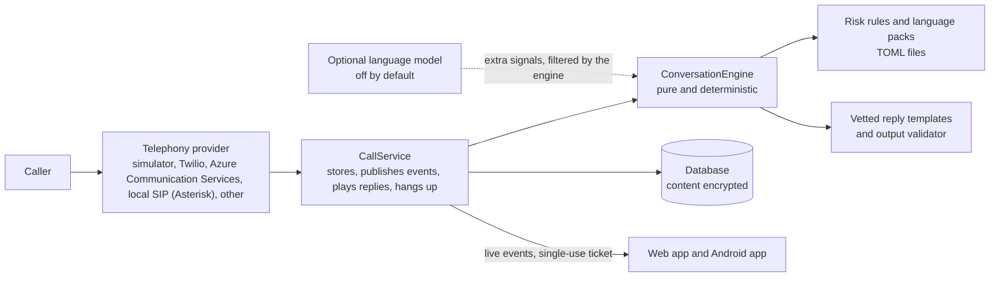

# Sparta

**Your calls. Your voice. Your shield.**

Sparta is a multilingual AI call-screening assistant for people who get unknown and unwanted phone calls in India. A call
that reaches Sparta is answered by an assistant whose first line says that it is an AI, asks who is calling and why, and
decides what to do from a fixed rule set. The assistant never asks a caller for protected information (one-time
passcodes, PINs, passwords, card and account details, identity documents, the owner's address or whereabouts, payments,
remote access). A caller's request for any of it makes the assistant refuse and, at high risk, end the call. Spam is
ended, and a legitimate call that looks urgent is flagged so that the owner can step in. Every call produces a summary, a
risk level with the evidence behind it, and a transcript the owner can delete. The assistant converses in English, Hindi and
Kannada and follows callers who mix them (Hinglish and Kanglish, written in Latin script).

> **Status: a prototype.** By default everything runs on a built-in simulator and fakes. Phase 3 adds a free, open-source
> **local voice path**: a SIP phone on your own network calls an Asterisk PBX in Docker, which streams real two-way audio to
> Sparta. A real SIP client (baresip, in Docker) has completed calls against it with real speech recognition and synthesis
> (completion level B, with a machine-voice caller; [docs/PHASE3_ASTERISK_PLAN.md](docs/PHASE3_ASTERISK_PLAN.md)). **No
> physical phone has called it, and nothing here is connected to the phone network (PSTN):** a friend dialling your mobile
> number cannot reach Sparta this way, and that needs a paid carrier, a number and a SIP trunk that this repository does not
> provide. The Twilio and Azure paths from Phase 2 have only run against fakes (**level A**). No native Hindi or Kannada
> speaker has reviewed the language packs or the evaluation data, and the free local recogniser does **not** reliably
> understand Hindi or Kannada: in the Docker test a Hindi, a Hinglish and a Kannada OTP request were all missed. Read
> [Limitations](#limitations) before relying on any statement about real calls.

## Contents

* [Product status](#product-status)
* [How a call is handled](#how-a-call-is-handled)
* [What is real and what is simulated](#what-is-real-and-what-is-simulated)
* [Evaluation results](#evaluation-results)
* [Quick start](#quick-start)
* [Run Sparta voice locally without Twilio](#run-sparta-voice-locally-without-twilio)
* [Try the simulator](#try-the-simulator)
* [Configuration](#configuration)
* [Testing](#testing)
* [Deployment](#deployment)
* [Limitations](#limitations)
* [Repository structure](#repository-structure)
* [Documentation](#documentation)
* [Contributing and security](#contributing-and-security)
* [Licence](#licence)

## Product status

Three levels, and only the evidence listed counts:
**A** code-complete (everything that does not need an external account is built and tested with fakes);
**B** a real external call reached Sparta and was answered, with real speech recognition and synthesis;
**C** B plus a physical Android phone, a monitored deployment, several real calls and a legal review.
**The Twilio and Azure paths are at level A. The local SIP path is at level B with a machine-voice caller** (a real SIP client,
real SIP, RTP and G.711, real recognition and synthesis, in Docker) **and not at level C**: no physical phone has called it. Level
B here is *not* a phone-network (PSTN) call and not a human on a phone.

| Area | Status | Evidence |
| --- | --- | --- |
| Simulator-based product (engine, rules, replies, apps, API) | **Verified** | Backend tests, web tests, Playwright, Android unit tests, CI; evaluation on synthetic scenarios |
| Real-call path through the Twilio and ACS adapters, streaming speech recognition, owner takeover, cost caps, failure handling | **Verified against fakes only** | Adapter and API tests, plus a controlled matrix of whole calls over a real WebSocket with scripted speech services ([docs/PHASE2_CONTROLLED_RESULTS.md](docs/PHASE2_CONTROLLED_RESULTS.md)) |
| **Local SIP (Asterisk): a separate SIP client registers, calls Sparta, hears the AI disclosure, is refused an OTP, interrupts the assistant, hangs up** | **Verified in Docker, with a machine voice** | `python scripts/sip_e2e.py` (28 tests, real Asterisk 22, real SIP, RTP and G.711, headless baresip) and `python scripts/sip_e2e.py --speech local` (8 tests with real faster-whisper and Piper: [docs/PHASE3_ASTERISK_PLAN.md](docs/PHASE3_ASTERISK_PLAN.md)); the documented `docker compose --profile asterisk` flow was also run once, and the call, transcript and summary were read in the real web app |
| Local SIP on a physical Android phone (Linphone) | **Not run** | No phone was attached. [docs/ANDROID_SIP_TESTING.md](docs/ANDROID_SIP_TESTING.md) is the checklist |
| Free local speech: English | **Verified**, with limits | A Piper voice's English line was recognised word for word by Whisper `small`; about 3 to 5 s per utterance on CPU (two runs). Telephone-band audio and accents were not measured |
| Free local speech: Hindi, Hinglish, Kanglish, Kannada | **Unreliable (Hindi, Hinglish, Kanglish), not usable (Kannada)** | Measured: the OTP or UPI PIN requests in all five lines were misheard and **not refused**, although the rules refuse them when given the right words ([docs/MULTILINGUAL_SPEECH.md](docs/MULTILINGUAL_SPEECH.md) section 11) |
| A real call from the **phone network** (ordinary mobile or landline numbers) | **Not delivered** | Needs a paid carrier, a phone number and a SIP trunk; Twilio and ACS remain unverified live ([docs/PHASE2_REAL_WORLD_PLAN.md](docs/PHASE2_REAL_WORLD_PLAN.md), section 6) |
| Azure deployment | **Unverified** | The Bicep compiles and lints; it has never been deployed |
| Android: build, unit tests, lint | **Verified** | 641 JVM unit tests, lint, debug APK |
| Android on an emulator or a physical phone, call-screening role, notifications | **Not run** | No phone or emulator image was available; [docs/ANDROID_SETUP.md](docs/ANDROID_SETUP.md) has the checklist, every row "NOT RUN" |
| Personal Voice | **Off, not usable** | Consent recording only, by design |
| Legal and privacy review | **Not done** | [docs/PRIVACY.md](docs/PRIVACY.md), section 13 |

## How a call is handled



1. A telephony provider delivers the call: the built-in simulator, Twilio Media Streams, Azure Communication Services, a SIP
   phone through a local Asterisk, or another provider through a plugin.
2. `CallService` hands every caller utterance to `ConversationEngine`, which detects the language, matches the signals
   defined in `services/api/src/sparta/risk/policies/default-v1.toml` (36 signals, 14 of them requests for protected
   information), scores the risk, advances a state machine and chooses a reply. The engine is deterministic: the same
   input gives the same output.
3. The reply is rendered from a closed set of templates in the language packs (English, Hindi, Kannada) and checked by an
   output validator before it is spoken. The assistant's words never come from a language model.
4. The service stores the turn with encrypted content, publishes live events to the web and Android apps over a WebSocket
   (opened with a single-use ticket), and acts on the provider (play the reply, hang up).
5. A language model is optional and off by default (`SPARTA_LLM_PROVIDER=rules`). When one is configured it can only add
   low-weight context signals, and the deterministic rules always win.

Details: [docs/ARCHITECTURE.md](docs/ARCHITECTURE.md), [docs/SAFETY_MODEL.md](docs/SAFETY_MODEL.md).

## What is real and what is simulated

| Part | State in this repository |
| --- | --- |
| Screening engine, risk rules, reply templates, output validator | Implemented in `services/api/src/sparta/{orchestrator,risk,language}` and covered by automated tests and by the evaluation below. |
| Languages | English (`en-IN`), Hindi (`hi-IN`) and Kannada (`kn-IN`), plus Hinglish and Kanglish. Marathi, Tamil, Telugu, Malayalam and Bengali are listed as planned: a caller who speaks one of them is detected as unsupported and asked to continue in a supported language. Detection is a script-and-lexicon heuristic, not a trained model ([docs/MULTILINGUAL_SPEECH.md](docs/MULTILINGUAL_SPEECH.md)). |
| Telephony: simulator | Works. Every simulated call is marked `simulated: true` and both apps show a simulated badge. Owner takeover on the simulator is a labelled simulation: no audio is bridged. |
| Telephony: Azure Communication Services | Adapter and signed-webhook verification are implemented and unit-tested against fakes. They have never run against a live ACS resource, and a new ACS customer cannot currently obtain a number (none in India at all): [docs/research/phase2-provider-verification.md](docs/research/phase2-provider-verification.md). |
| Telephony: Twilio Media Streams | Added in Phase 2: signed voice and status webhooks, a media WebSocket (mu-law 8 kHz) with per-call tokens, barge-in, `<Dial>` takeover, `<Reject>` for blocked callers and calls over a cap, doctor checks. Tested against fakes and a scripted caller over a real WebSocket; never run against a Twilio account. A Twilio **trial** account cannot be used ([docs/TELEPHONY.md](docs/TELEPHONY.md), section 4.3). |
| Telephony: another provider | A plugin interface and HMAC-signed generic webhook exist. No provider integration ships. |
| Telephony: local SIP (Asterisk) | Added in Phase 3: `SPARTA_TELEPHONY_PROVIDER=asterisk`, a free provider that takes the audio of a SIP call over Asterisk's AudioSocket and speaks back over the same connection, with barge-in, a refusal-and-hang-up path and take-over that rings an owner **SIP extension** (never a phone number). A separate SIP client (baresip, in Docker) has called it for real; **no physical phone has, and it does not carry calls from the phone network**. Reported honestly by the API and the apps as `Connection: Local SIP`, `PSTN: Not configured` ([infrastructure/asterisk/README.md](infrastructure/asterisk/README.md), [docs/TELEPHONY.md](docs/TELEPHONY.md) section 4.5). |
| Speech recognition and synthesis | The simulator produces no audio. Azure Speech adapters (streaming recognition through the Speech SDK with partials, confidence and language identification, or REST per utterance; text-to-speech including mu-law for Twilio), and the real-time audio pipeline for provider media streams (voice-activity detection, barge-in), are implemented and tested with fakes. A real call that cannot speak or hear is ended with a summary that says so. The Azure adapters have never run with real credentials. **Phase 3 added free local engines, faster-whisper and Piper, that have run on real audio** (English recognised accurately, Hindi unreliable, Kannada not usable with the small model: [docs/MULTILINGUAL_SPEECH.md](docs/MULTILINGUAL_SPEECH.md) section 11), and a test-only tone-coded voice (`fake`) that production refuses. |
| Language model | Optional and off by default. The Azure OpenAI adapter has never run with real credentials. Caller-speech translation is not implemented. |
| Backend API | HTTP and WebSocket API with a generated contract ([docs/API_CONTRACT.md](docs/API_CONTRACT.md), `packages/contracts/openapi.json`). Sign-in is a development identity or OpenID Connect bearer tokens; the OIDC path has never run against a real identity provider. |
| Web app | Eight screens including the Simulator Lab ([apps/web/README.md](apps/web/README.md), [docs/WEB_APP.md](docs/WEB_APP.md)). The default is the development identity. OpenID Connect sign-in (Authorization Code with PKCE, `NEXT_PUBLIC_AUTH_MODE=oidc`) is implemented and unit-tested with a fake client, but has never run against a real identity provider. |
| Android app | Call-screening role (allow, silence or reject on the phone), history, assistant studio and live view. It cannot answer, speak to, hear or record a call. Its unit tests run on the JVM; it has never run on a device or emulator ([docs/ANDROID_SETUP.md](docs/ANDROID_SETUP.md)). |
| Personal voice | Consent recording only. Enrolment stops at `pending_provider_approval`; nothing in the code makes a personal voice usable. |
| Raw audio | Never stored. The API rejects a request to turn storage on, and production start-up refuses the setting. |

## Evaluation results

Copied from [docs/eval/latest-dev.md](docs/eval/latest-dev.md) and [docs/eval/latest-test.md](docs/eval/latest-test.md),
generated 2026-11-17 by `python -m sparta evaluate` against policy `2026.11.2`. The development split was used to tune the
rules, so its numbers are optimistic. The test split is held out; [docs/EVALUATION.md](docs/EVALUATION.md) records that it
was run once to produce the published numbers, with the engine as of commit `b09c936`, and that it was not re-run after
later commits that changed code the run exercises (the input hardening in `117752e` among them).

| Measure | Development split (70 scenarios) | Test split (70 scenarios) |
| --- | --- | --- |
| Scam calls ended by the assistant | 97.4% (38/39) | 82.0% (32/39) |
| Legitimate calls wrongly ended (lower is better) | 0.0% (0/21) | 4.8% (1/21) |
| Legitimate calls rated high risk (lower is better) | 4.8% (1/21) | 14.3% (3/21) |
| Protected-information requests refused | 100.0% (33/33) | 100.0% (35/35) |
| Prompt-injection attempts resisted (refused and call ended) | 87.5% (7/8) | 75.0% (6/8) |
| Unwanted calls ended politely | 100.0% (5/5) | 60.0% (3/5) |
| Per-turn language detected correctly | 94.0% (141/150) | 97.1% (165/170) |
| Prohibited assistant behaviours found | 0 | 0 |

The scenarios are synthetic: an AI assistant wrote them and no native speaker has reviewed them
(`packages/evaluation/dataset/v1/MANIFEST.md`). The reports give 95% intervals, which are wide at these sizes (for
example 67.3% to 91.0% around 32/39). These figures say how the rules behave on this dataset, not how Sparta would
perform on real calls.

## Quick start

Prerequisites: Git; Python 3.12 or newer; Node.js 22.12 or newer with npm. Optional: Docker with Compose v2.24 or newer
(PostgreSQL, Redis and the container stack), `make` (Linux, macOS, WSL, Git Bash), JDK 17 and the Android SDK (Android
app).

### Option 1: the project scripts

Windows PowerShell, from the repository root:

```powershell
powershell -ExecutionPolicy Bypass -File scripts\bootstrap.ps1   # once: Python environment from the lock file, npm ci, .env from .env.example
powershell -ExecutionPolicy Bypass -File scripts\dev.ps1         # migrate, seed, API on :8000, web app on :3000
```

Linux, macOS, WSL, Git Bash:

```bash
make bootstrap    # same as: bash scripts/bootstrap.sh
make dev          # same as: bash scripts/dev.sh
```

Both start the API with SQLite and the simulator providers, then the web app; Ctrl+C stops both. Open
<http://localhost:3000/simulator>. `scripts\dev.ps1 -Docker` (or `make dev-docker`) takes PostgreSQL and Redis from
Docker Compose instead of SQLite and in-process state; `-ApiPort` and `-WebPort` change the ports. `scripts\tasks.ps1
<task>` is the PowerShell equivalent of `make <task>`; `scripts\tasks.ps1 help` lists the tasks. The scripts also
cover `test`, `check`, `smoke`, `migrate`, `seed`, `keygen` and `eval`.

### Option 2: by hand

Backend (Python 3.12 or newer), from `services/api`. Windows PowerShell:

```powershell
cd services\api
python -m venv .venv
.\.venv\Scripts\Activate.ps1
pip install --require-hashes -r requirements-dev.lock
pip install --no-deps -e .
python -X utf8 -m sparta migrate
python -X utf8 -m sparta seed
python -X utf8 -m sparta serve --port 8000
```

Linux or macOS:

```bash
cd services/api
python3 -m venv .venv
source .venv/bin/activate
pip install --require-hashes -r requirements-dev.lock
pip install --no-deps -e .
python -m sparta migrate
python -m sparta seed
python -m sparta serve --port 8000
```

`requirements-dev.lock` pins the runtime and development dependencies with sha256 hashes. Outside production the server
also applies pending migrations when it starts. `serve`, `migrate` and `seed` first check that the database answers
(`serve` and `seed` also check Redis when `SPARTA_REDIS_URL` is set) and exit with status 2 and one readable line per
problem when it does not. With no configuration the database is a SQLite file under `services/api/var`, and development
encryption keys are created in that folder (it is git-ignored). Health: <http://127.0.0.1:8000/healthz> and `/readyz`;
interactive API documentation: <http://127.0.0.1:8000/docs> (switched off in production).

Web app, in a second terminal. Windows PowerShell:

```powershell
cd apps\web
npm ci
npm run dev
```

Linux or macOS:

```bash
cd apps/web
npm ci
npm run dev
```

The web app is served at <http://localhost:3000>. Its defaults point at the API on `http://localhost:8000` with the
development identity, and the API allows the `http://localhost:3000` origin by default. See
[apps/web/README.md](apps/web/README.md) for its scripts and settings.

### Option 3: Docker Compose

```bash
docker compose up --build
```

The same command works in PowerShell. It builds and starts PostgreSQL 16, Redis 7, the API and the web app, with every
published port bound to `127.0.0.1`: web on 3000, API on 8000. The stack uses the development identity, the simulator
providers and development-only passwords, and its header says it is not a production template. The API container listens
on `0.0.0.0` inside the container, which `serve` allows with the development identity only because the compose file sets
`SPARTA_ALLOW_NETWORK_DEV_AUTH=true` for it. To start only the
backend: `docker compose up -d --build postgres redis api`. `docker compose down` stops it and keeps the data volumes;
`docker compose down -v` also deletes them.

## Run Sparta voice locally without Twilio

Three different things can reach Sparta. Do not confuse them:

| | What it is | Cost | State in this repository |
| --- | --- | --- | --- |
| **SIMULATOR** | You type, speak or upload the caller's side in the Simulator Lab. Nothing is dialled and no phone is involved | free | A working local simulation |
| **LOCAL SIP** | A SIP phone (Linphone on Android, a desk phone, `baresip`) on **your own network** calls an open-source [Asterisk](https://www.asterisk.org/) PBX in Docker, which streams real two-way audio to Sparta. No Twilio, no phone number, no account | free, open source | A real SIP client has completed calls in Docker (see [Product status](#product-status)); **never tried on a physical phone** |
| **PSTN** | Ordinary mobile and landline numbers reaching Sparta | **paid**: a carrier, a phone number (DID) and a SIP trunk | **Not delivered.** Local SIP is not "phone-call support": a friend dialling your number cannot reach it this way |

Prerequisites: Docker with Compose v2.24 or newer, and Python 3.12 for the helper scripts. Behind a proxy that blocks pypi.org or
registry.npmjs.org (a web image build that stops at `npm ci` with "Exit handler never called!" is that), set `PIP_INDEX_URL` and
`NPM_REGISTRY` to your mirrors first ([docs/DEPLOYMENT.md](docs/DEPLOYMENT.md), troubleshooting). From the repository root:

```bash
python scripts/sip_local.py init                 # random secrets -> .env and .env.sip (git-ignored); prints nothing secret
cd services/api && python -m sparta models fetch # free local speech models, about 650 MB, each file checked against a pinned SHA-256
cd ../.. && docker compose --profile asterisk up --build   # first build compiles Asterisk (5-15 min) and adds the speech engines
python scripts/sip_local.py show --reveal        # server address, extension numbers and the SIP passwords for the phone
```

(`python -m sparta models fetch` needs the backend environment from [Quick start](#quick-start) option 1 or 2.) Then register a
SIP client as extension **6001** with the password from `show --reveal`, and dial **6000**. Step-by-step phone setup,
troubleshooting and the full test script are in [docs/ANDROID_SIP_TESTING.md](docs/ANDROID_SIP_TESTING.md) (a checklist: **not run
on a phone**). Open the web app at <http://localhost:3000> to watch the live call and read the summary. By default SIP and RTP are
published on `127.0.0.1` only (a client on the same computer); to reach it from a phone on your Wi-Fi set
`SPARTA_ASTERISK_BIND` and `SPARTA_ASTERISK_EXTERNAL_IP` to the computer's LAN address, as that document explains.

* **No speech models?** `python scripts/sip_local.py init --speech fake` uses a test-only tone-coded voice. It exercises the whole
  path but cannot understand a person.
* **Check the set-up:** `python -m sparta doctor --provider asterisk --env-file ../../.env` (from `services/api`; `init` wrote the
  `.env` in the repository root, and the doctor reads only the working directory's `.env` unless told otherwise) prints PASS,
  WARNING, BLOCKED or UNVERIFIED per check and never prints a secret. It checks the configuration of **its own process**, not of
  the running containers: with Compose it reports the database as SQLite and Redis as unset, because Compose sets those inside the
  API container; the media listener shows UNVERIFIED because Compose does not publish port 8090.
* **Test it without a phone** (Docker only): `python scripts/sip_e2e.py` runs a real Asterisk and a headless SIP client through
  28 scenarios with tone speech; `python scripts/sip_e2e.py --speech local --models services/api/var/models --python <python with the
  local-speech extra>` does the same call with real Whisper and Piper.
* **What local speech can do:** English works; Hindi, Hinglish and Kanglish are unreliable; Kannada is not usable with the small
  model, so a Hindi, Hinglish, Kanglish or Kannada caller is **not reliably screened** ([docs/MULTILINGUAL_SPEECH.md](docs/MULTILINGUAL_SPEECH.md)
  section 11). Recognition takes about 3 to 5 seconds per utterance on a CPU, so the assistant answered 4 to 6 seconds after the
  caller stopped (two runs).
* **Licences:** Piper is GPL-3.0 (an opt-in extra, never in the default image), and its Hindi and Kannada voices are
  non-commercial. Asterisk is GPL-2.0 and is only talked to over the network. Details in
  [infrastructure/asterisk/README.md](infrastructure/asterisk/README.md) and the speech document.
* **Security:** SIP and RTP are not encrypted, the container does not limit failed logins, and the network filter cannot see real
  source addresses on Docker Desktop. Use a network you trust. [docs/SECURITY_REVIEW_PHASE3.md](docs/SECURITY_REVIEW_PHASE3.md) lists
  what was reviewed (automatically, not by a human) and what was fixed.

## Try the simulator

The Simulator Lab plays the caller against the real engine. Nothing is dialled and the backend produces no audio (the web
app can read the assistant's lines aloud with the browser's own voice, and labels it as such).

In the web app:

1. Open <http://localhost:3000/simulator>.
2. Under "1 · Choose a call" keep "Free play" and click **Start simulated call**.
3. In the live console, type a caller line in "Type what the caller says" and press **Send**, for example:
   `This is your bank. Please read out the one time password sent to your phone right now.`
4. The assistant refuses and ends the call, the risk panel shows the risk level and the signals behind it, and a summary
   line appears when the call has ended. The finished call is also in the call history (`/calls`).

To replay a scripted call instead, choose one of the 13 curated scenarios under "1 · Choose a call", open the
"Deterministic replay" section and press **Replay once** or **Run twice and compare**. The replay runs instantly on a
virtual clock, and running it twice gives the same checksum. Replays write nothing to the call history.

From the command line (the API from Option 1, 2 or 3 must be running). Windows PowerShell:

```powershell
$api = 'http://127.0.0.1:8000/api/v1'

# Deterministic replay of a curated scenario
$r = Invoke-RestMethod -Method Post -Uri "$api/simulator/replay" -ContentType 'application/json' -Body (@{ scenario_id = 'bank-otp-en' } | ConvertTo-Json)
$r.checksum; $r.call.risk_level; $r.call.risk.recommended_action

# A simulated call that you play yourself
$call = Invoke-RestMethod -Method Post -Uri "$api/simulator/calls" -ContentType 'application/json' -Body (@{ caller_number = '+15550100'; caller_label = 'quick start'; language_mode = 'auto' } | ConvertTo-Json)
$turn = Invoke-RestMethod -Method Post -Uri "$api/calls/$($call.id)/turns" -ContentType 'application/json' -Body (@{ text = 'This is your bank. Please read out the one time password sent to your phone right now.'; source = 'typed' } | ConvertTo-Json)
$turn.assistant_turn.text
$detail = Invoke-RestMethod -Uri "$api/calls/$($call.id)"
$detail.risk_level; $detail.action_taken
```

Linux, macOS, WSL, Git Bash (the one-line Python filters only pick fields out of the JSON; use `python` where `python3`
is not installed):

```bash
API=http://127.0.0.1:8000/api/v1

# Deterministic replay of a curated scenario
curl -s -X POST "$API/simulator/replay" -H 'Content-Type: application/json' -d '{"scenario_id": "bank-otp-en"}' \
  | python3 -c 'import sys, json; d = json.load(sys.stdin); print(d["checksum"], d["call"]["risk_level"], d["call"]["risk"]["recommended_action"])'

# A simulated call that you play yourself
CALL=$(curl -s -X POST "$API/simulator/calls" -H 'Content-Type: application/json' \
  -d '{"caller_number": "+15550100", "caller_label": "quick start", "language_mode": "auto"}' \
  | python3 -c 'import sys, json; print(json.load(sys.stdin)["id"])')
curl -s -X POST "$API/calls/$CALL/turns" -H 'Content-Type: application/json' \
  -d '{"text": "This is your bank. Please read out the one time password sent to your phone right now.", "source": "typed"}' \
  | python3 -c 'import sys, json; print(json.load(sys.stdin)["assistant_turn"]["text"])'
curl -s "$API/calls/$CALL" | python3 -c 'import sys, json; d = json.load(sys.stdin); print(d["risk_level"], d["action_taken"])'
```

For the `bank-otp-en` scenario the replay reports risk level `high` and the action `refuse_and_end`. The typed OTP line
above is also rated `high` and the call is ended (`action_taken` is `refused_and_ended`). The curated scenario ids come
from `GET /api/v1/simulator/scenarios`; they include English, Hinglish, Kanglish and Hindi cases, legitimate calls, a
prompt-injection attempt, an owner probe, a silent caller and a caller who speaks an unsupported language. `scripts\smoke.ps1`
(`make smoke`) runs the same kind of check and reports pass or fail. `python scripts/journey.py` (standard library only;
`--base-url` selects the API) goes further: it replays five curated scenarios, types an OTP scam in English, Hinglish and
Kanglish through the REST API, then blocks the number, downloads a report and an export, deletes the call's content and
checks that the number is ended automatically next time; it exits 0 when every check passes.

## Configuration

Settings are `SPARTA_*` environment variables, or a `.env` file in the working directory of the API process. The project
scripts load the `.env` in the repository root into the processes they start; a manual `python -m sparta ...` reads the
`.env` in its own working directory (for example `services/api/.env`). Copy [.env.example](.env.example) to `.env` (the
bootstrap script does this); it lists the settings with their defaults, section by section. With no configuration, everything runs on the
simulator with deterministic rules: no cloud account, no cost, no audio. The variables you are most likely to change:

| Variable | Default | Meaning |
| --- | --- | --- |
| `SPARTA_ENV` | `development` | `production` turns on the start-up guards described under [Deployment](#deployment). |
| `SPARTA_AUTH_MODE` | `dev` | `dev` is a development identity with no sign-in (forbidden in production); `oidc` validates OpenID Connect bearer tokens. |
| `SPARTA_ALLOW_NETWORK_DEV_AUTH` | `false` | `python -m sparta serve` refuses (exit status 2) to listen on a non-loopback address while the development identity is active, because anyone who can reach the server would act as the owner. Setting this to `true` allows it; use it only on a trusted network or inside a container whose port is published on `127.0.0.1` (the compose file sets it for that reason). |
| `SPARTA_DATABASE_URL` | SQLite file under `services/api/var` | PostgreSQL with `postgresql+asyncpg://...`. |
| `SPARTA_REDIS_URL` | unset | Shared rate limits, WebSocket tickets and call locks across instances. Unset means in-process memory, which is only correct for one instance. |
| `SPARTA_DATA_KEYS`, `SPARTA_PEPPER`, `SPARTA_WEBHOOK_SECRET` | unset | Content encryption keys, caller-number hashing, webhook signing. All three are required in production. Outside production the first two are generated into `services/api/var` when unset; the webhook secret is not. `python -m sparta keygen` prints fresh values and stores nothing. |
| `SPARTA_TELEPHONY_PROVIDER`, `SPARTA_STT_PROVIDER`, `SPARTA_TTS_PROVIDER`, `SPARTA_LLM_PROVIDER` | `simulator`, `simulator`, `simulator`, `rules` | Provider selection (`SPARTA_TELEPHONY_PROVIDER` is `simulator`, `azure`, `twilio`, `asterisk` or `other`; speech is `simulator`, `azure`, `local` or the test-only `fake`). Choosing a real provider makes the API refuse to start until the credentials listed in `.env.example` are present, and production also refuses real telephony with a simulated recogniser or voice, and refuses `fake`. `python scripts/sip_local.py init` writes the local-SIP set. |
| `SPARTA_DAILY_CALL_MINUTES_CAP`, `SPARTA_PER_NUMBER_DAILY_CALL_CAP`, `SPARTA_PROVIDER_FAILURE_LIMIT` | `240`, `10`, `2` | Cost brakes for real calls: minutes per owner per day, calls from one number per day (further calls are rejected without being answered), and how many speaking or listening failures in a row end a call. |
| `SPARTA_CORS_ORIGINS` | `http://localhost:3000,http://127.0.0.1:3000` | Browser origins allowed to call the API. |

Before any real call, run the provider preflight. It prints no secret, exits 1 when anything is BLOCKED, and always lists
what only a real call can prove:

```powershell
python -m sparta doctor --provider twilio --online     # or --provider azure; add --allow-billable for a speech round trip
```

## Testing

Run the commands from the directory shown. Each tool reports its own result; the tables below are the last verified runs,
pinned to a commit, and go stale as the code changes.

**Last verified, Phase 3** (free local SIP), on branch `feat/asterisk-open-voice` at commit `a600b87`, the last commit that
changes code, tests or infrastructure (the commits after it change documentation, one gitleaks allowlist and
`scripts/verify_locks.py`; the rows marked "re-run" were repeated after those commits, on code identical to `a600b87`), on one
Windows 11 machine, with this repository's own tools. The branch was cut from pull request 11's last verified commit
(`4409ff9`), so every row also covers Phase 2. Phase 2's record and Phase 1's follow.

| Check | Result |
| --- | --- |
| `scripts\check.ps1 -Security` (what CI runs) | all 13 steps passed (603 s) |
| Backend `pytest`, with PostgreSQL 16 and Redis 7 (re-run on the final tree) | 2902 passed, 56 skipped in 5 min 29 s (Phase 2: 2321 passed; the 13-step run above had 2900 passed and 54 skipped, before two real-speech cases and two doctor tests were added). The skips are 36 Docker end-to-end tests (28 with tone speech and 8 with real speech, next rows), 12 that need `numpy` and 8 that need the downloaded speech models; both of the last two are optional extras |
| `pytest tests/unit/providers_local`, in the optional speech environment (`numpy`, faster-whisper, Piper, models in `SPARTA_LOCAL_MODEL_DIR`) | 279 passed, 0 skipped (49 s), including the 20 tests the row above skips |
| `ruff check`, `ruff format --check`, `mypy src` | clean; no issues in 133 source files |
| `python -m sparta openapi --check` | the contract is current |
| `python -m sparta evaluate --split dev` | unchanged from Phase 2: scam recall 87.8%, precision 94.7%, protected requests refused 33/33, 0 violations, 0 fallbacks, deterministic. No rule was changed in Phase 3 and nothing was tuned on the test split |
| `bandit`; `pip-audit` on the dev lock and on `requirements-local-speech.lock`; `python scripts/verify_locks.py` | no findings; no known vulnerabilities; all 5 lock files verified (111 pins, every hash published on PyPI) |
| Web: `eslint`, `tsc`, `vitest`, `next build` | 0 problems, 0 errors, 318 tests passed, build OK (Phase 2: 310) |
| Web: `npm run e2e` (re-run) | 112 of 112 passed against the real API and the production build (Chromium only), 7.4 min |
| Android: `testDebugUnitTest --rerun --no-build-cache` (re-run) | 641 JVM tests passed, 0 failures, 0 skipped (Phase 2: 634) |
| Android: `lintDebug assembleDebug` (re-run) | lint 0 errors and 21 warnings; debug APK 23,254,294 bytes. No device or emulator was available |
| Docker Compose (PostgreSQL, Redis, API; the web service was not started) (re-run) | all three healthy; `/readyz` ready; `scripts\smoke.ps1` passed; `scripts\journey.py` passed (`PROBLEMS: none`) |
| Trivy 0.76.2 (`--severity HIGH,CRITICAL --ignore-unfixed`) on the API image and on the Asterisk image (re-run) | no findings in either (Debian 13.7, 87 packages; Debian 12.15, 120 packages). It reads package databases, so it does not see Asterisk and PJPROJECT, which are compiled from pinned sources. CI scans only the API image |
| `python scripts/sip_e2e.py` (re-run): Docker, real Asterisk 22.12.0, real SIP, RTP and G.711, a separate headless baresip client, tone-coded fake speech | 28 passed, 8 skipped (the eight real-speech tests, which belong to the next row), 3 min 49 s. [Evidence](docs/evidence/phase3-sip-e2e-fake.json) |
| `python scripts/sip_e2e.py --speech local --models DIR --python PY` (re-run): the same stack with real faster-whisper `small` and Piper | 8 passed, 6 min 1 s. English scam refusal, interruption and legitimate call asserted; Hindi, Hinglish, Kanglish, a Kanglish UPI PIN line and Kannada measured and reported, **not asserted: none of those five was screened** ([docs/PHASE3_ASTERISK_PLAN.md](docs/PHASE3_ASTERISK_PLAN.md) section 8). [Evidence](docs/evidence/phase3-sip-e2e-local.json) |
| `gitleaks` 8.30.1 (`gitleaks git`) on the branch since pull request 11's head | no leaks; Phase 3's dummy test secrets and public model hashes are allowlisted by exact value in `.gitleaks.toml` |
| **The documented local-SIP flow, verbatim, with the web app** (re-run): `python scripts/sip_local.py init`; `docker compose --profile asterisk up --build`; `python -m sparta doctor --provider asterisk --env-file ../../.env --online`; a baresip call from a container on the Compose `sip` network; then the real web app opened with Playwright | all five services healthy; the doctor reports no blockers and "SIP service answers" passes; a 27 s call from extension 6001 to 6000 was answered, the OTP request refused and the call ended by Sparta; the web app shows the call (`LOCAL SIP`, High risk, the exact opening line, the caller's words, the refusal, an accurate summary) and the first-run step that says Local SIP, PSTN not configured. No warning or error in the container logs and none of the three generated secrets in them. The caller was a Piper voice in a container, not a phone ([docs/PHASE3_ASTERISK_PLAN.md](docs/PHASE3_ASTERISK_PLAN.md) section 8). It found, and this branch fixes, a doctor that read the wrong `.env` |
| **Not run** | a physical phone (level C), the phone network (level D), a human voice, native-speaker review of any language, Azure or Twilio with real credentials |

**Phase 2, last verified** on branch `feat/real-world-telephony` at commit `c8a56c4`, on one Windows 11 machine, with this
repository's own tools. The commits after it change documentation, test names and the hash list of one lock file (below);
GitHub re-ran the backend on them. The Android rows were measured at `ccec1c8`, the last commit that changed Android code.
Phase 1's record on `main` follows the table.

| Check | Result |
| --- | --- |
| `scripts\check.ps1 -Security` (what CI runs) | all 13 steps passed |
| Backend `pytest`, with PostgreSQL 16 and Redis 7 | 2321 passed |
| `ruff check`, `ruff format --check`, `mypy src` | clean; no issues in 116 source files |
| `python -m sparta openapi --check` | the contract is current |
| `python -m sparta evaluate --split dev` | scam recall 87.8%, precision 94.7%, protected requests refused 33/33, 0 violations, 0 fallbacks, deterministic (the split the rules were tuned on: [docs/EVALUATION.md](docs/EVALUATION.md)) |
| `bandit`, `pip-audit` on the lock | no findings; no known vulnerabilities |
| Web: `eslint`, `tsc`, `vitest`, `next build` | 0 problems, 0 errors, 310 tests passed, build OK |
| Web: `npm run e2e` | 112 of 112 passed against the real API and the production build (Chromium only); axe-core finds no violations on any screen in either theme. An earlier run of the same code failed one test with `ECONNRESET` in the test harness's own API client (the server stayed up and every other test passed; the likely cause, not confirmed, is a pooled connection meeting the server's 5 s idle keep-alive); the rerun passed 112 of 112 |
| Android: `testDebugUnitTest` | 634 JVM tests passed, 0 failures (one run, at `ccec1c8`) |
| Android: `lintDebug assembleDebug` | lint 0 errors and 21 warnings; debug APK 22,481,118 bytes (at `ccec1c8`). `assembleDebugAndroidTest` fails in D8 (see Limitations) and no emulator or device was available. The release APK and bundle were not rebuilt in Phase 2 |
| Docker Compose (PostgreSQL, Redis, API) | all three healthy (the web service was not started); `/readyz` ready; `scripts\smoke.ps1` and `scripts\journey.py` passed |
| API image and Bicep | the API image (with the Speech SDK) builds; the SDK imports and builds a streaming recogniser in the `python:3.12-slim` runtime image (loading only: nothing was recognised); Trivy 0.76.2 with CI's flags (`--severity HIGH,CRITICAL --ignore-unfixed`) reports nothing; the Bicep builds, builds its parameters and lints (Bicep 0.48.1); nothing was deployed |
| Controlled call matrix (Phase 2) | 12 whole-call tests over a real WebSocket with scripted speech services; local processing time from the end of the caller's turn to the first audio, p50 about 92 ms and p95 about 205 ms, with zero-latency fakes: [docs/PHASE2_CONTROLLED_RESULTS.md](docs/PHASE2_CONTROLLED_RESULTS.md) |
| `gitleaks` 8.30.1 (`gitleaks git`) on the history of the branch | no leaks; two fake test values it flagged are allowlisted by exact value ([docs/SECURITY_REVIEW_PHASE2.md](docs/SECURITY_REVIEW_PHASE2.md)) |

**Phase 3 on GitHub** (pull request 12, 2026-11-19, `ubuntu-24.04` runners): the first run, at `deef687`, passed **all 16 checks**: the
changed-area filter, Backend (with PostgreSQL and Redis service containers, 4 min 6 s), Backend security (`pip-audit`, `bandit`, lock
hashes, now including the local-speech lock), Web, Android (unit tests, lint, debug APK), Infrastructure and tooling (Compose,
Bicep, workflows, scripts), both container images built and scanned by Trivy, `gitleaks`, CodeQL for Java and Kotlin,
JavaScript and TypeScript, and Python (no open alert), dependency review, the `ci-ok` gate, and the informational Playwright job
(12 min 41 s). **A second run, on a README-only commit (`1e0633e`), failed one backend test**,
`test_a_caller_who_talks_over_the_assistant_stops_it_within_a_few_frames`: "the greeting should have been cut, not played to its
end". It was a race in the **test harness**, not in the product. The kit's driver fast-forwards the virtual clock that paces
speech, while the test froze that clock by polling in real time, so how far into the greeting the freeze landed depended on
scheduling: on Linux it was between 27 and 78 frames (0.5 to 1.5 s, in 40 measured runs, against a limit of 75), and two of those 40
runs crossed the limit, idle or loaded. The root fix (no retry, no wider bound) is `Kit.freeze_media_when`, which stops virtual time
inside the driver on an exact frame count (the other test that used the same idiom was changed too, and the wait for the stop now
looks at the greeting's own playback id, which the answer's playback cannot hide). Afterwards, on Linux in a `python:3.12`
container with 8 CPUs: 80 of 80 repeats of both tests, half idle and half with every CPU busy, and 6 of 6 runs of every Python test file this
phase added or touched except the Docker end-to-end ones (724 passed, 20 skipped each; three idle, three under full load). **The Docker
SIP end-to-end tests do not run in CI** (they skip unless `SPARTA_SIP_E2E=1`): their results above are from the local runs.

**Phase 2 on GitHub** (pull request 11, 2026-11-18, `ubuntu-24.04` runners): the first run failed three things that did not
show locally, all fixed in `e468311`. `requirements-dev.lock` carried five md5 hashes for the Speech SDK (the package mirror
it was generated through publishes them), which pip's hash-checking mode refuses, so the backend and backend-security jobs
could not install. CodeQL reported three high alerts in test code: a fake Twilio account SID named `ACCOUNT`, which its name
heuristic classes as sensitive account data as it flows through the test fixtures into Twilio's HMAC-SHA1 signature, and two
`endswith` host checks. The constant was renamed and the checks made exact; nothing was suppressed or excluded. On the second
run all checks passed: the backend with PostgreSQL and Redis service containers, backend security (`pip-audit`, `bandit`, lock
hashes), Android, infrastructure and tooling, both container images built and scanned by Trivy, `gitleaks`, CodeQL for three
languages with no open alert, dependency review and the `ci-ok` gate. The web job and the Playwright job were skipped by the
changed-area filter, because no web file changed.

**Phase 1 on GitHub** (pull request 1, 2026-11-18, `ubuntu-24.04` runners; the workflows had never run before): all 16 checks passed
on `99023e2`: the changed-area filter, the backend job with PostgreSQL and Redis service containers, backend security
(`pip-audit`, `bandit`, lock hashes), the web job, the Android job (unit tests, lint, debug APK), infrastructure and
tooling (Compose, Bicep, workflows, scripts), both container images built and scanned by Trivy (no fixable HIGH or CRITICAL
finding), `gitleaks`, CodeQL for Java and Kotlin, JavaScript and TypeScript, and Python, and the Playwright job (which is
informational and not part of the `ci-ok` gate). The first runs also found things that were fixed
([docs/SECURITY_REVIEW.md](docs/SECURITY_REVIEW.md), [docs/WEB_APP.md](docs/WEB_APP.md)): two product bugs the Playwright
job caught (the voice stage could show "Call ended" about 10 ms before the closing sentence, and **an owner whose display
name had four digits, a link-like word or was an e-mail address got a call that never said it was an AI**), four CodeQL
alerts, three flaky Android unit tests (assertions that raced asynchronous state), and a dependency-review job that fails
when the repository's dependency graph is off (it now skips with a warning, so nothing is reviewed until the graph is
enabled). **After the merge, on `main` (`603bc19`)**: CI, CodeQL and the secret scan passed again, with no open code-scanning
alert; the container workflow built and scanned both images and **published** them to GHCR (`ghcr.io/snowjug/sparta-api` and
`ghcr.io/snowjug/sparta-web`, tags `main`, `latest` and `sha-<commit>`, with provenance and an SBOM; both can be pulled
without credentials); the API image, pulled by its digest, answered `/readyz` and passed `scripts\journey.py` (English,
Hinglish and Kanglish OTP scams, block, report, export, delete); and the deploy workflow started on the successful push and
skipped itself, as designed, because the three `AZURE_*` repository variables are not set. The deploying job (Azure login,
`what-if`, `create`, migrations) has never run.

**Never verified:** anything that needs a real account, device or number: any real call (Twilio or Azure Communication
Services: media, signatures and tokens as the live service sends them, transfer), Azure Speech (streaming recognition and
synthesis on telephone audio) and Azure OpenAI with credentials, Personal Voice, OIDC against a real identity provider,
PSTN transfer and carrier call forwarding, the Android app on a physical phone or an emulator (the instrumented tests do
not build, see [Limitations](#limitations)), the deploying job of the deploy workflow (the publish job has run), any Azure
deployment, and a native-speaker review of the Hindi and Kannada packs and of the dataset. See [Limitations](#limitations).

Backend, from `services/api` with the virtual environment active. Windows PowerShell:

```powershell
python -X utf8 -m pytest
ruff check .
ruff format --check .
mypy src
python -X utf8 -m sparta openapi --check
python -X utf8 -m sparta evaluate --split dev
```

Linux or macOS:

```bash
python -m pytest
ruff check .
ruff format --check .
mypy src
python -m sparta openapi --check
python -m sparta evaluate --split dev
```

The tests that need PostgreSQL or Redis are skipped unless `SPARTA_TEST_POSTGRES_URL` or `SPARTA_TEST_REDIS_URL` is set. The
PostgreSQL tests drop every table in the database they are pointed at, so give them a throwaway database
([.env.example](.env.example) explains how). Do not run `evaluate --split test` to tune anything: the test split is the
held-out one ([docs/EVALUATION.md](docs/EVALUATION.md)).

Web app, from `apps/web` (the same commands in PowerShell and bash):

```
npm run lint
npm run typecheck
npm run test
npm run build
npm run e2e:install   # once: downloads Chromium for Playwright
npm run e2e           # starts the real API and the production build, then drives Chromium
```

Android, from `apps/android` (JDK 17 and the Android SDK; [docs/ANDROID_SETUP.md](docs/ANDROID_SETUP.md) has the details).
Windows PowerShell:

```powershell
.\gradlew.bat testDebugUnitTest lintDebug assembleDebug
```

Linux or macOS:

```bash
./gradlew testDebugUnitTest lintDebug assembleDebug
```

`connectedDebugAndroidTest` needs a device or emulator, and `assembleDebugAndroidTest` currently fails (D8 refuses the
backtick test names with spaces at `minSdk` 26; [docs/ANDROID_SETUP.md](docs/ANDROID_SETUP.md)), so the instrumented tests
have never been run.

Everything the backend and web CI would check, in one go: `scripts\check.ps1` (`-Fast` skips the slow steps) or `make check`;
`scripts\test.ps1` or `make test` runs only the tests.

## Deployment

* **Development stack:** `docker compose up --build` ([Option 3](#option-3-docker-compose)). It is not a production
  template.
* **Production start-up guards:** with `SPARTA_ENV=production` the API refuses to start unless it has OIDC authentication,
  `SPARTA_DATA_KEYS`, `SPARTA_PEPPER`, `SPARTA_WEBHOOK_SECRET`, a PostgreSQL database, `SPARTA_REDIS_URL`, explicit https
  CORS origins without localhost, explicit trusted hosts, and raw-audio storage switched off. The list is
  `Settings.problems()` in `services/api/src/sparta/config.py`.
* **Migrations** are a release step in production: run `python -m sparta migrate` (the server does not migrate by itself
  there). Until it has run, `/readyz` answers 503 with `checks.database` set to `migrations_pending` for a database that
  is behind the code's newest migration (`Database.schema_state` in `services/api/src/sparta/db/session.py`).
* **Azure:** `infrastructure/azure` holds Bicep for an Azure deployment (monitoring, network, Key Vault, PostgreSQL, Azure
  Managed Redis, Container Apps, optional ACS and Speech resources). Its header states that it compiles and lints with the
  Bicep CLI and has **not** been deployed. The deployment commands, the secrets flow, the legal and approvals checklist and
  the list of unverified items are in [docs/DEPLOYMENT.md](docs/DEPLOYMENT.md); the steps before a release are in
  [docs/RELEASE_CHECKLIST.md](docs/RELEASE_CHECKLIST.md).
* **Telephony:** calling a real phone number needs a provider, a number, and the owner forwarding calls to it; see
  [docs/TELEPHONY.md](docs/TELEPHONY.md) for what each path can and cannot do and for the live-test checklist.

## Limitations

Not verified against any live service:

* Azure Communication Services and Twilio (call answering, webhooks and callbacks, media streaming, transfer), Event Grid
  delivery tokens, Azure Speech (streaming recognition, language identification on telephone audio, Hinglish and Kanglish),
  Azure OpenAI and Personal Voice have never been exercised with real credentials, and **no call from the phone network has
  ever reached Sparta**. The code and its fakes are tested; the real behaviour is **UNVERIFIED**. The controlled matrix in
  [docs/PHASE2_CONTROLLED_RESULTS.md](docs/PHASE2_CONTROLLED_RESULTS.md) is not an external test, and its latencies are
  local processing time with zero-latency fakes.
* **Local SIP** (Phase 3) was exercised only with a headless SIP client in Docker and a machine-voice caller. Not verified: a
  physical Android phone and a real SIP app (Linphone), a human voice, an Indian accent, telephone-line noise, Wi-Fi and
  firewall behaviour, a second registered phone for take-over, and a longer or busier session. Its measured numbers
  ([docs/PHASE3_ASTERISK_PLAN.md](docs/PHASE3_ASTERISK_PLAN.md)) are local-Docker figures, not device figures.
* **Local speech** recognises English but not reliably Hindi, Hinglish or Kanglish, and not Kannada, with the small model: the OTP
  requests in Hindi, Hinglish, Kanglish and Kannada, and a Kanglish UPI PIN request, were **missed** in the Docker test (the rules
  refuse all five when given the words that were said: the recogniser is what failed). Answers came 4 to 6 seconds after the caller
  stopped in two runs, because recognition takes 3 to 5 seconds on a CPU. Telephone-band audio and accents were not measured, and no
  native speaker has heard any of it.
* SIP and RTP are not encrypted; the Asterisk container does not limit failed logins; the network filter cannot see real source
  addresses on Docker Desktop ([docs/SECURITY_REVIEW_PHASE3.md](docs/SECURITY_REVIEW_PHASE3.md)). The Phase 3 security review was
  automated, not a penetration test.
* OpenID Connect sign-in (the backend's token verification and the web app's sign-in flow) has never been tried against a
  real identity provider.
* Conditional call forwarding to a provider number is carrier-specific, and no carrier has been tested.
* Android call screening has never run on a device or emulator, and the Android instrumented tests do not build
  (`assembleDebugAndroidTest` fails in D8 on test names with spaces at `minSdk` 26; see
  [docs/ANDROID_SETUP.md](docs/ANDROID_SETUP.md)).
* A takeover is requested, not confirmed: Sparta does not learn whether the owner's phone rang or answered.

Not implemented:

* The AI conversation does not happen on the phone itself. Android's call-screening role cannot answer, speak to, hear or
  record a call. The conversation exists only for calls that reach a telephony provider (Twilio, ACS, or a SIP phone through
  Asterisk).
* A call from the **phone network** needs a paid provider account and a number that Sparta does not buy. Azure Communication Services
  cannot provision Indian (+91) numbers, a new customer may not be able to get one at all, and its standalone telephony is
  scheduled to retire; a Twilio trial account removes the TwiML Sparta needs; both points and the alternatives are in
  [docs/research/phase2-provider-verification.md](docs/research/phase2-provider-verification.md),
  [docs/research/acs-android-verification.md](docs/research/acs-android-verification.md) and
  [docs/TELEPHONY.md](docs/TELEPHONY.md). Local SIP is free but reaches only SIP phones on your network.
* Translation of caller speech; the assistant's own lines carry an English rendering from the templates.
* A usable personal voice; push notifications to the Android app (FCM is not set up); account deletion; purging of audit
  events.
* The language model never speaks to callers, and no setting enables it.
* Metrics and log export through OpenTelemetry. Metrics are Prometheus text at `/metrics` when
  `SPARTA_EXPOSE_METRICS=true`. Traces are exported (one span per HTTP request, provider call and engine step, carrying
  identifiers and timings only) only when `SPARTA_OTLP_ENDPOINT` is set and the `otlp` extra is installed. FastAPI's own
  OpenTelemetry instrumentation is switched off, so Sparta's spans are the only ones
  ([docs/PRIVACY.md](docs/PRIVACY.md) section 9).

Known weaknesses of the safety rules ([docs/SAFETY_MODEL.md](docs/SAFETY_MODEL.md) lists them with the probes that show them):

* Rule-based detection misses some conditional and indirect phrasings, for example "No OTP, no refund." or "Do not share
  your OTP with anyone. Just read it to me.", and one-time-code requests in languages other than English, Hindi and
  Kannada. Speech-to-text output without punctuation weakens denial handling.
* The Hindi and Kannada packs, the code-switching lexicons and the evaluation dataset have not been reviewed by native
  speakers. Short code-switched utterances with few Indic words can be detected as English.
* A scam that raises only medium-risk signals does not end the call: the assistant keeps screening and asks clarifying
  questions.

Other limits:

* Calls delivered by a real provider are routed to a single owner (`SPARTA_TELEPHONY_OWNER_USER_ID`, or the development
  user).
* A call that fails inside the engine is not marked as failed: the `FAILED` call state is defined but nothing sets it.
* Some stored preferences have no effect on the backend (`escalate_uncertain_urgent`, `notify_on_high_risk` and the quiet
  hours). The Android app applies `notify_on_high_risk` and the quiet hours to its own notifications; the web app only
  saves them.
* No part of this repository is legal advice. Rules on call recording, AI disclosure, call forwarding and personal-data
  protection differ by jurisdiction and change; get legal review before any use with real callers
  ([docs/PRIVACY.md](docs/PRIVACY.md), [docs/THREAT_MODEL.md](docs/THREAT_MODEL.md)).

## Repository structure

```text
services/api/            FastAPI backend (Python 3.12), package `sparta`
  src/sparta/              domain, language, risk, orchestrator, providers, telephony, db, services, api, simulator,
                           evaluation, observability, cli
  migrations/              Alembic migrations
  tests/                   unit, integration and API tests
  requirements-dev.lock    hash-pinned runtime and development dependencies (the test environment)
  requirements.lock        hash-pinned runtime dependencies only (Docker image built without extras)
  requirements-extras.lock runtime plus the azure and otlp extras (the default Docker image)
  requirements-build.lock  the image's build tools (uv, hatchling)
                           (regenerate the last three with scripts\lock.ps1, scripts/lock.sh or `make lock`)
apps/web/                Next.js web app (eight screens, Simulator Lab)
apps/android/            Kotlin and Jetpack Compose Android app
packages/contracts/      openapi.json, generated from the backend (python -m sparta openapi)
packages/evaluation/     evaluation dataset v1 (development and test splits) and its schema
docs/                    architecture, safety, privacy, threat model, telephony, languages, evaluation, decisions, research
scripts/, Makefile       developer tasks for Windows PowerShell and for bash
docker-compose.yml       development stack (PostgreSQL, Redis, API, web app; the `asterisk` profile adds local SIP)
.env.example             settings template with development defaults
infrastructure/azure/    Bicep for an Azure deployment (not deployed)
infrastructure/asterisk/ the local-SIP Asterisk image (Dockerfile, dialplan, PJSIP config), its end-to-end stack and fail2ban filter
scripts/sip_local.py     generates the local-SIP secrets and shows how to register a phone; sip_e2e.py runs the Docker SIP test
.github/                 CI, CodeQL, container, dependency-review, secret-scan and deploy workflows; templates
experiments/unsloth/     optional research notes (no code)
```

## Documentation

| Document | What it covers |
| --- | --- |
| [docs/ARCHITECTURE.md](docs/ARCHITECTURE.md) | Components, data flow, the conversation state machine, provider interfaces, storage, sequence diagrams, failure modes |
| [docs/SAFETY_MODEL.md](docs/SAFETY_MODEL.md) | Protected information, the signal table, scoring, denial handling, escalation, what the model may and may not do |
| [docs/MULTILINGUAL_SPEECH.md](docs/MULTILINGUAL_SPEECH.md) | Language detection, code-switching, locales and voices, fallbacks, test corpus, and what the free local speech can and cannot do |
| [docs/TELEPHONY.md](docs/TELEPHONY.md) | What Android can and cannot do, the programmable-number path (Twilio, ACS), local SIP over Asterisk, provider setup, live-test checklist |
| [docs/PHASE2_REAL_WORLD_PLAN.md](docs/PHASE2_REAL_WORLD_PLAN.md), [docs/PHASE2_CONTROLLED_RESULTS.md](docs/PHASE2_CONTROLLED_RESULTS.md), [docs/SECURITY_REVIEW_PHASE2.md](docs/SECURITY_REVIEW_PHASE2.md) | Phase 2 (the real-call path): blockers, decisions, completion level, the smallest ask to reach a real call; the controlled call matrix and its evidence; the security review of the new path |
| [docs/PHASE3_ASTERISK_PLAN.md](docs/PHASE3_ASTERISK_PLAN.md), [docs/DECISIONS/ADR-ASTERISK-MEDIA-BRIDGE.md](docs/DECISIONS/ADR-ASTERISK-MEDIA-BRIDGE.md), [docs/SECURITY_REVIEW_PHASE3.md](docs/SECURITY_REVIEW_PHASE3.md) | Phase 3 (free local SIP): the plan, results and completion level; why AudioSocket; the security review of the new path |
| [docs/ANDROID_SIP_TESTING.md](docs/ANDROID_SIP_TESTING.md), [infrastructure/asterisk/README.md](infrastructure/asterisk/README.md) | Registering Linphone and making the test call (a checklist, not run on a phone); the Asterisk image, its settings and what it does not do |
| [docs/PRIVACY.md](docs/PRIVACY.md) | What is stored, what is encrypted, retention, deletion paths, subprocessors |
| [docs/THREAT_MODEL.md](docs/THREAT_MODEL.md) | Assets, actors, abuse cases, mitigations with file references, residual risks |
| [docs/EVALUATION.md](docs/EVALUATION.md) | Dataset, scoring, discipline, published numbers, reproduction |
| [docs/API_CONTRACT.md](docs/API_CONTRACT.md) | The HTTP and WebSocket contract |
| [docs/ANDROID_SETUP.md](docs/ANDROID_SETUP.md), [docs/WEB_APP.md](docs/WEB_APP.md) | Android and web client setup, design and limits |
| [docs/IMPLEMENTATION_PLAN.md](docs/IMPLEMENTATION_PLAN.md) | Milestones, status and the remaining external dependencies |
| [docs/SECURITY_REVIEW.md](docs/SECURITY_REVIEW.md) | Findings of the automated security review, what was fixed, what is still open |
| [docs/DEPLOYMENT.md](docs/DEPLOYMENT.md), [docs/RELEASE_CHECKLIST.md](docs/RELEASE_CHECKLIST.md) | Azure deployment, secrets, legal and approvals checklist, release steps |
| [docs/DECISIONS/](docs/DECISIONS/) | Architecture decision records 0001 to 0006, and the Asterisk media-bridge decision |
| [docs/research/](docs/research/) | Verified notes on Azure Communication Services, Android, Azure Speech, Azure OpenAI and (Phase 2) the telephony providers |
| [services/api/README.md](services/api/README.md), [apps/web/README.md](apps/web/README.md), [apps/android/README.md](apps/android/README.md), [packages/evaluation/README.md](packages/evaluation/README.md), [experiments/unsloth/README.md](experiments/unsloth/README.md) | Per-component notes |

## Contributing and security

* [CONTRIBUTING.md](CONTRIBUTING.md): setup, conventions and the checks to run before a change.
* [SECURITY.md](SECURITY.md): how to report a vulnerability privately, and what is in scope.

## Licence

The project owner has not chosen a licence. The repository has no `LICENSE` file, and `services/api/pyproject.toml`
declares `UNLICENSED`. Do not assume any right to reuse the code; ask the owner. The licences of the web app's
dependencies are listed in [apps/web/README.md](apps/web/README.md).
