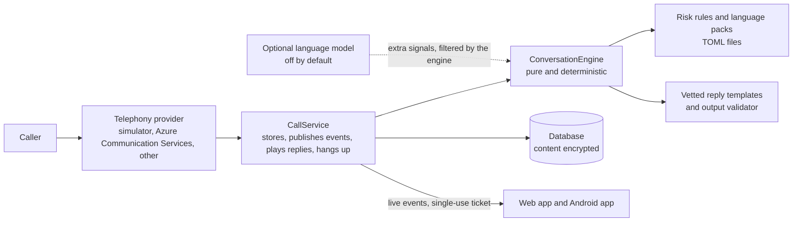

# Sparta

**Your calls. Your voice. Your shield.**

Sparta is a multilingual AI call-screening assistant for people who get unknown and unwanted phone calls in India. A call
that reaches Sparta is answered by an assistant whose first line says that it is an AI, asks who is calling and why, and
decides what to do from a fixed rule set. The assistant never asks a caller for protected information (one-time
passcodes, PINs, passwords, card and account details, identity documents, the owner's address or whereabouts, payments,
remote access). A caller's request for any of it makes the assistant refuse and, at high risk, end the call. Spam is
ended, and a legitimate call that looks urgent is flagged so that the owner can step in. Every call produces a summary, a
risk level with the evidence behind it, and a transcript the owner can delete. The assistant converses in English, Hindi and
Kannada and follows callers who mix them (Hinglish and Kanglish, written in Latin script).

> **Status: a prototype that has only run against a built-in simulator.** Nothing in this repository has been connected to
> a live phone network, a live speech service or a live language model, and no native Hindi or Kannada speaker has
> reviewed the language packs or the evaluation data. Read [Limitations](#limitations) before relying on any statement
> about real calls.

## Contents

* [How a call is handled](#how-a-call-is-handled)
* [What is real and what is simulated](#what-is-real-and-what-is-simulated)
* [Evaluation results](#evaluation-results)
* [Quick start](#quick-start)
* [Try the simulator](#try-the-simulator)
* [Configuration](#configuration)
* [Testing](#testing)
* [Deployment](#deployment)
* [Limitations](#limitations)
* [Repository structure](#repository-structure)
* [Documentation](#documentation)
* [Contributing and security](#contributing-and-security)
* [Licence](#licence)

## How a call is handled



1. A telephony provider delivers the call: the built-in simulator, Azure Communication Services, or another provider
   through a plugin.
2. `CallService` hands every caller utterance to `ConversationEngine`, which detects the language, matches the signals
   defined in `services/api/src/sparta/risk/policies/default-v1.toml` (36 signals, 14 of them requests for protected
   information), scores the risk, advances a state machine and chooses a reply. The engine is deterministic: the same
   input gives the same output.
3. The reply is rendered from a closed set of templates in the language packs (English, Hindi, Kannada) and checked by an
   output validator before it is spoken. The assistant's words never come from a language model.
4. The service stores the turn with encrypted content, publishes live events to the web and Android apps over a WebSocket
   (opened with a single-use ticket), and acts on the provider (play the reply, hang up).
5. A language model is optional and off by default (`SPARTA_LLM_PROVIDER=rules`). When one is configured it can only add
   low-weight context signals, and the deterministic rules always win.

Details: [docs/ARCHITECTURE.md](docs/ARCHITECTURE.md), [docs/SAFETY_MODEL.md](docs/SAFETY_MODEL.md).

## What is real and what is simulated

| Part | State in this repository |
| --- | --- |
| Screening engine, risk rules, reply templates, output validator | Implemented in `services/api/src/sparta/{orchestrator,risk,language}` and covered by automated tests and by the evaluation below. |
| Languages | English (`en-IN`), Hindi (`hi-IN`) and Kannada (`kn-IN`), plus Hinglish and Kanglish. Marathi, Tamil, Telugu, Malayalam and Bengali are listed as planned: a caller who speaks one of them is detected as unsupported and asked to continue in a supported language. Detection is a script-and-lexicon heuristic, not a trained model ([docs/MULTILINGUAL_SPEECH.md](docs/MULTILINGUAL_SPEECH.md)). |
| Telephony: simulator | Works. Every simulated call is marked `simulated: true` and both apps show a simulated badge. Owner takeover on the simulator is a labelled simulation: no audio is bridged. |
| Telephony: Azure Communication Services | Adapter and signed-webhook verification are implemented and unit-tested against fakes. They have never run against a live ACS resource. |
| Telephony: another provider | A plugin interface and HMAC-signed generic webhook exist. No provider integration ships. |
| Speech recognition and synthesis | The simulator produces no audio. Azure Speech adapters, and the real-time audio pipeline for provider media streams (voice-activity detection, per-utterance recognition, barge-in), are implemented and tested with fakes. They have never run with real credentials. |
| Language model | Optional and off by default. The Azure OpenAI adapter has never run with real credentials. Caller-speech translation is not implemented. |
| Backend API | HTTP and WebSocket API with a generated contract ([docs/API_CONTRACT.md](docs/API_CONTRACT.md), `packages/contracts/openapi.json`). Sign-in is a development identity or OpenID Connect bearer tokens; the OIDC path has never run against a real identity provider. |
| Web app | Eight screens including the Simulator Lab ([apps/web/README.md](apps/web/README.md), [docs/WEB_APP.md](docs/WEB_APP.md)). The default is the development identity. OpenID Connect sign-in (Authorization Code with PKCE, `NEXT_PUBLIC_AUTH_MODE=oidc`) is implemented and unit-tested with a fake client, but has never run against a real identity provider. |
| Android app | Call-screening role (allow, silence or reject on the phone), history, assistant studio and live view. It cannot answer, speak to, hear or record a call. Its unit tests run on the JVM; it has never run on a device or emulator ([docs/ANDROID_SETUP.md](docs/ANDROID_SETUP.md)). |
| Personal voice | Consent recording only. Enrolment stops at `pending_provider_approval`; nothing in the code makes a personal voice usable. |
| Raw audio | Never stored. The API rejects a request to turn storage on, and production start-up refuses the setting. |

## Evaluation results

Copied from [docs/eval/latest-dev.md](docs/eval/latest-dev.md) and [docs/eval/latest-test.md](docs/eval/latest-test.md),
generated 2026-11-17 by `python -m sparta evaluate` against policy `2026.11.2`. The development split was used to tune the
rules, so its numbers are optimistic. The test split is held out; [docs/EVALUATION.md](docs/EVALUATION.md) records that it
was run once to produce the published numbers, with the engine as of commit `b09c936`, and that it was not re-run after
later commits that changed code the run exercises (the input hardening in `117752e` among them).

| Measure | Development split (70 scenarios) | Test split (70 scenarios) |
| --- | --- | --- |
| Scam calls ended by the assistant | 97.4% (38/39) | 82.0% (32/39) |
| Legitimate calls wrongly ended (lower is better) | 0.0% (0/21) | 4.8% (1/21) |
| Legitimate calls rated high risk (lower is better) | 4.8% (1/21) | 14.3% (3/21) |
| Protected-information requests refused | 100.0% (33/33) | 100.0% (35/35) |
| Prompt-injection attempts resisted (refused and call ended) | 87.5% (7/8) | 75.0% (6/8) |
| Unwanted calls ended politely | 100.0% (5/5) | 60.0% (3/5) |
| Per-turn language detected correctly | 94.0% (141/150) | 97.1% (165/170) |
| Prohibited assistant behaviours found | 0 | 0 |

The scenarios are synthetic: an AI assistant wrote them and no native speaker has reviewed them
(`packages/evaluation/dataset/v1/MANIFEST.md`). The reports give 95% intervals, which are wide at these sizes (for
example 67.3% to 91.0% around 32/39). These figures say how the rules behave on this dataset, not how Sparta would
perform on real calls.

## Quick start

Prerequisites: Git; Python 3.12 or newer; Node.js 22.12 or newer with npm. Optional: Docker with Compose v2.24 or newer
(PostgreSQL, Redis and the container stack), `make` (Linux, macOS, WSL, Git Bash), JDK 17 and the Android SDK (Android
app).

### Option 1: the project scripts

Windows PowerShell, from the repository root:

```powershell
powershell -ExecutionPolicy Bypass -File scripts\bootstrap.ps1   # once: Python environment from the lock file, npm ci, .env from .env.example
powershell -ExecutionPolicy Bypass -File scripts\dev.ps1         # migrate, seed, API on :8000, web app on :3000
```

Linux, macOS, WSL, Git Bash:

```bash
make bootstrap    # same as: bash scripts/bootstrap.sh
make dev          # same as: bash scripts/dev.sh
```

Both start the API with SQLite and the simulator providers, then the web app; Ctrl+C stops both. Open
<http://localhost:3000/simulator>. `scripts\dev.ps1 -Docker` (or `make dev-docker`) takes PostgreSQL and Redis from
Docker Compose instead of SQLite and in-process state; `-ApiPort` and `-WebPort` change the ports. `scripts\tasks.ps1
<task>` is the PowerShell equivalent of `make <task>`; `scripts\tasks.ps1 help` lists the tasks. The scripts also
cover `test`, `check`, `smoke`, `migrate`, `seed`, `keygen` and `eval`.

### Option 2: by hand

Backend (Python 3.12 or newer), from `services/api`. Windows PowerShell:

```powershell
cd services\api
python -m venv .venv
.\.venv\Scripts\Activate.ps1
pip install --require-hashes -r requirements-dev.lock
pip install --no-deps -e .
python -X utf8 -m sparta migrate
python -X utf8 -m sparta seed
python -X utf8 -m sparta serve --port 8000
```

Linux or macOS:

```bash
cd services/api
python3 -m venv .venv
source .venv/bin/activate
pip install --require-hashes -r requirements-dev.lock
pip install --no-deps -e .
python -m sparta migrate
python -m sparta seed
python -m sparta serve --port 8000
```

`requirements-dev.lock` pins the runtime and development dependencies with sha256 hashes. Outside production the server
also applies pending migrations when it starts. `serve`, `migrate` and `seed` first check that the database answers
(`serve` and `seed` also check Redis when `SPARTA_REDIS_URL` is set) and exit with status 2 and one readable line per
problem when it does not. With no configuration the database is a SQLite file under `services/api/var`, and development
encryption keys are created in that folder (it is git-ignored). Health: <http://127.0.0.1:8000/healthz> and `/readyz`;
interactive API documentation: <http://127.0.0.1:8000/docs> (switched off in production).

Web app, in a second terminal. Windows PowerShell:

```powershell
cd apps\web
npm ci
npm run dev
```

Linux or macOS:

```bash
cd apps/web
npm ci
npm run dev
```

The web app is served at <http://localhost:3000>. Its defaults point at the API on `http://localhost:8000` with the
development identity, and the API allows the `http://localhost:3000` origin by default. See
[apps/web/README.md](apps/web/README.md) for its scripts and settings.

### Option 3: Docker Compose

```bash
docker compose up --build
```

The same command works in PowerShell. It builds and starts PostgreSQL 16, Redis 7, the API and the web app, with every
published port bound to `127.0.0.1`: web on 3000, API on 8000. The stack uses the development identity, the simulator
providers and development-only passwords, and its header says it is not a production template. The API container listens
on `0.0.0.0` inside the container, which `serve` allows with the development identity only because the compose file sets
`SPARTA_ALLOW_NETWORK_DEV_AUTH=true` for it. To start only the
backend: `docker compose up -d --build postgres redis api`. `docker compose down` stops it and keeps the data volumes;
`docker compose down -v` also deletes them.

## Try the simulator

The Simulator Lab plays the caller against the real engine. Nothing is dialled and the backend produces no audio (the web
app can read the assistant's lines aloud with the browser's own voice, and labels it as such).

In the web app:

1. Open <http://localhost:3000/simulator>.
2. Under "1 · Choose a call" keep "Free play" and click **Start simulated call**.
3. In the live console, type a caller line in "Type what the caller says" and press **Send**, for example:
   `This is your bank. Please read out the one time password sent to your phone right now.`
4. The assistant refuses and ends the call, the risk panel shows the risk level and the signals behind it, and a summary
   line appears when the call has ended. The finished call is also in the call history (`/calls`).

To replay a scripted call instead, choose one of the 13 curated scenarios under "1 · Choose a call", open the
"Deterministic replay" section and press **Replay once** or **Run twice and compare**. The replay runs instantly on a
virtual clock, and running it twice gives the same checksum. Replays write nothing to the call history.

From the command line (the API from Option 1, 2 or 3 must be running). Windows PowerShell:

```powershell
$api = 'http://127.0.0.1:8000/api/v1'

# Deterministic replay of a curated scenario
$r = Invoke-RestMethod -Method Post -Uri "$api/simulator/replay" -ContentType 'application/json' -Body (@{ scenario_id = 'bank-otp-en' } | ConvertTo-Json)
$r.checksum; $r.call.risk_level; $r.call.risk.recommended_action

# A simulated call that you play yourself
$call = Invoke-RestMethod -Method Post -Uri "$api/simulator/calls" -ContentType 'application/json' -Body (@{ caller_number = '+15550100'; caller_label = 'quick start'; language_mode = 'auto' } | ConvertTo-Json)
$turn = Invoke-RestMethod -Method Post -Uri "$api/calls/$($call.id)/turns" -ContentType 'application/json' -Body (@{ text = 'This is your bank. Please read out the one time password sent to your phone right now.'; source = 'typed' } | ConvertTo-Json)
$turn.assistant_turn.text
$detail = Invoke-RestMethod -Uri "$api/calls/$($call.id)"
$detail.risk_level; $detail.action_taken
```

Linux, macOS, WSL, Git Bash (the one-line Python filters only pick fields out of the JSON; use `python` where `python3`
is not installed):

```bash
API=http://127.0.0.1:8000/api/v1

# Deterministic replay of a curated scenario
curl -s -X POST "$API/simulator/replay" -H 'Content-Type: application/json' -d '{"scenario_id": "bank-otp-en"}' \
  | python3 -c 'import sys, json; d = json.load(sys.stdin); print(d["checksum"], d["call"]["risk_level"], d["call"]["risk"]["recommended_action"])'

# A simulated call that you play yourself
CALL=$(curl -s -X POST "$API/simulator/calls" -H 'Content-Type: application/json' \
  -d '{"caller_number": "+15550100", "caller_label": "quick start", "language_mode": "auto"}' \
  | python3 -c 'import sys, json; print(json.load(sys.stdin)["id"])')
curl -s -X POST "$API/calls/$CALL/turns" -H 'Content-Type: application/json' \
  -d '{"text": "This is your bank. Please read out the one time password sent to your phone right now.", "source": "typed"}' \
  | python3 -c 'import sys, json; print(json.load(sys.stdin)["assistant_turn"]["text"])'
curl -s "$API/calls/$CALL" | python3 -c 'import sys, json; d = json.load(sys.stdin); print(d["risk_level"], d["action_taken"])'
```

For the `bank-otp-en` scenario the replay reports risk level `high` and the action `refuse_and_end`. The typed OTP line
above is also rated `high` and the call is ended (`action_taken` is `refused_and_ended`). The curated scenario ids come
from `GET /api/v1/simulator/scenarios`; they include English, Hinglish, Kanglish and Hindi cases, legitimate calls, a
prompt-injection attempt, an owner probe, a silent caller and a caller who speaks an unsupported language. `scripts\smoke.ps1`
(`make smoke`) runs the same kind of check and reports pass or fail. `python scripts/journey.py` (standard library only;
`--base-url` selects the API) goes further: it replays five curated scenarios, types an OTP scam in English, Hinglish and
Kanglish through the REST API, then blocks the number, downloads a report and an export, deletes the call's content and
checks that the number is ended automatically next time; it exits 0 when every check passes.

## Configuration

Settings are `SPARTA_*` environment variables, or a `.env` file in the working directory of the API process. The project
scripts load the `.env` in the repository root into the processes they start; a manual `python -m sparta ...` reads the
`.env` in its own working directory (for example `services/api/.env`). Copy [.env.example](.env.example) to `.env` (the
bootstrap script does this); it lists the settings with their defaults, section by section. With no configuration, everything runs on the
simulator with deterministic rules: no cloud account, no cost, no audio. The variables you are most likely to change:

| Variable | Default | Meaning |
| --- | --- | --- |
| `SPARTA_ENV` | `development` | `production` turns on the start-up guards described under [Deployment](#deployment). |
| `SPARTA_AUTH_MODE` | `dev` | `dev` is a development identity with no sign-in (forbidden in production); `oidc` validates OpenID Connect bearer tokens. |
| `SPARTA_ALLOW_NETWORK_DEV_AUTH` | `false` | `python -m sparta serve` refuses (exit status 2) to listen on a non-loopback address while the development identity is active, because anyone who can reach the server would act as the owner. Setting this to `true` allows it; use it only on a trusted network or inside a container whose port is published on `127.0.0.1` (the compose file sets it for that reason). |
| `SPARTA_DATABASE_URL` | SQLite file under `services/api/var` | PostgreSQL with `postgresql+asyncpg://...`. |
| `SPARTA_REDIS_URL` | unset | Shared rate limits, WebSocket tickets and call locks across instances. Unset means in-process memory, which is only correct for one instance. |
| `SPARTA_DATA_KEYS`, `SPARTA_PEPPER`, `SPARTA_WEBHOOK_SECRET` | unset | Content encryption keys, caller-number hashing, webhook signing. All three are required in production. Outside production the first two are generated into `services/api/var` when unset; the webhook secret is not. `python -m sparta keygen` prints fresh values and stores nothing. |
| `SPARTA_TELEPHONY_PROVIDER`, `SPARTA_STT_PROVIDER`, `SPARTA_TTS_PROVIDER`, `SPARTA_LLM_PROVIDER` | `simulator`, `simulator`, `simulator`, `rules` | Provider selection. Choosing `azure` or `azure_openai` makes the API refuse to start until the credentials listed in `.env.example` are present. |
| `SPARTA_CORS_ORIGINS` | `http://localhost:3000,http://127.0.0.1:3000` | Browser origins allowed to call the API. |

## Testing

Run the commands from the directory shown. Each tool reports its own result; the table below is the last verified run,
pinned to a commit, and goes stale as the code changes.

**Last verified 2026-11-18** on commit `0fd2a84` (later commits change documentation only), on one Windows 11 machine, with
this repository's own tools:

| Check | Result |
| --- | --- |
| `scripts\check.ps1 -Security` (what CI runs) | all 13 steps passed |
| Backend `pytest`, with PostgreSQL 16 and Redis 7 | 1898 passed |
| `ruff check`, `ruff format --check`, `mypy src` | clean; no issues in 107 source files |
| `python -m sparta openapi --check` | the contract is current |
| `python -m sparta evaluate --split dev` | scam recall 87.8%, precision 94.7%, protected requests refused 33/33, 0 violations, 0 fallbacks, deterministic (the split the rules were tuned on: [docs/EVALUATION.md](docs/EVALUATION.md)) |
| `bandit`, `pip-audit` on the lock | no findings; no known vulnerabilities |
| Web: `eslint`, `tsc`, `vitest`, `next build` | 0 problems, 0 errors, 294 tests passed, build OK |
| Web: `npm run e2e` | 110 of 110 passed against the real API and the production build (Chromium only); axe-core finds no violations on any screen in either theme |
| Android: `testDebugUnitTest lintDebug assembleDebug assembleRelease bundleRelease` | 632 JVM tests passed; lint 0 errors and 21 warnings; debug APK 22.7 MB; unsigned R8 release APK 2.4 MiB and AAB 5.3 MiB |
| Docker Compose (PostgreSQL, Redis, API, web) | all four healthy; `/readyz` ok at migration `0002`; `scripts\smoke.ps1` and `scripts\journey.py` passed |
| `gitleaks` on the tree and the history | no leaks (a planted key is detected) |

**Never verified:** anything that needs a real account, device or number: Azure Communication Services calls and media,
Azure Speech and Azure OpenAI with credentials, Personal Voice, OIDC against a real identity provider, PSTN transfer and
carrier call forwarding, the Android app on a physical phone (the instrumented tests compile but have never been run),
any GitHub Actions run, any Azure deployment, and a native-speaker review of the Hindi and Kannada packs and of the
dataset. See [Limitations](#limitations).

Backend, from `services/api` with the virtual environment active. Windows PowerShell:

```powershell
python -X utf8 -m pytest
ruff check .
ruff format --check .
mypy src
python -X utf8 -m sparta openapi --check
python -X utf8 -m sparta evaluate --split dev
```

Linux or macOS:

```bash
python -m pytest
ruff check .
ruff format --check .
mypy src
python -m sparta openapi --check
python -m sparta evaluate --split dev
```

The tests that need PostgreSQL or Redis are skipped unless `SPARTA_TEST_POSTGRES_URL` or `SPARTA_TEST_REDIS_URL` is set. The
PostgreSQL tests drop every table in the database they are pointed at, so give them a throwaway database
([.env.example](.env.example) explains how). Do not run `evaluate --split test` to tune anything: the test split is the
held-out one ([docs/EVALUATION.md](docs/EVALUATION.md)).

Web app, from `apps/web` (the same commands in PowerShell and bash):

```
npm run lint
npm run typecheck
npm run test
npm run build
npm run e2e:install   # once: downloads Chromium for Playwright
npm run e2e           # starts the real API and the production build, then drives Chromium
```

Android, from `apps/android` (JDK 17 and the Android SDK; [docs/ANDROID_SETUP.md](docs/ANDROID_SETUP.md) has the details).
Windows PowerShell:

```powershell
.\gradlew.bat testDebugUnitTest lintDebug assembleDebug
```

Linux or macOS:

```bash
./gradlew testDebugUnitTest lintDebug assembleDebug
```

`connectedDebugAndroidTest` needs a device or emulator. The instrumented tests compile but have never been run.

Everything the backend and web CI would check, in one go: `scripts\check.ps1` (`-Fast` skips the slow steps) or `make check`;
`scripts\test.ps1` or `make test` runs only the tests.

## Deployment

* **Development stack:** `docker compose up --build` ([Option 3](#option-3-docker-compose)). It is not a production
  template.
* **Production start-up guards:** with `SPARTA_ENV=production` the API refuses to start unless it has OIDC authentication,
  `SPARTA_DATA_KEYS`, `SPARTA_PEPPER`, `SPARTA_WEBHOOK_SECRET`, a PostgreSQL database, `SPARTA_REDIS_URL`, explicit https
  CORS origins without localhost, explicit trusted hosts, and raw-audio storage switched off. The list is
  `Settings.problems()` in `services/api/src/sparta/config.py`.
* **Migrations** are a release step in production: run `python -m sparta migrate` (the server does not migrate by itself
  there). Until it has run, `/readyz` answers 503 with `checks.database` set to `migrations_pending` for a database that
  is behind the code's newest migration (`Database.schema_state` in `services/api/src/sparta/db/session.py`).
* **Azure:** `infrastructure/azure` holds Bicep for an Azure deployment (monitoring, network, Key Vault, PostgreSQL, Azure
  Managed Redis, Container Apps, optional ACS and Speech resources). Its header states that it compiles and lints with the
  Bicep CLI and has **not** been deployed. The deployment commands, the secrets flow, the legal and approvals checklist and
  the list of unverified items are in [docs/DEPLOYMENT.md](docs/DEPLOYMENT.md); the steps before a release are in
  [docs/RELEASE_CHECKLIST.md](docs/RELEASE_CHECKLIST.md).
* **Telephony:** calling a real phone number needs a provider, a number, and the owner forwarding calls to it; see
  [docs/TELEPHONY.md](docs/TELEPHONY.md) for what each path can and cannot do and for the live-test checklist.

## Limitations

Not verified against any live service:

* Azure Communication Services (call answering, callbacks, media streaming, transfer), Event Grid delivery tokens, Azure
  Speech, Azure OpenAI and Personal Voice have never been exercised with real credentials. The code and its fakes are
  tested; the real behaviour is **UNVERIFIED**.
* OpenID Connect sign-in (the backend's token verification and the web app's sign-in flow) has never been tried against a
  real identity provider.
* Conditional call forwarding to a provider number is carrier-specific, and no carrier has been tested.
* Android call screening has never run on a device or emulator.

Not implemented:

* The AI conversation does not happen on the phone itself. Android's call-screening role cannot answer, speak to, hear or
  record a call. The conversation exists only for calls that reach a telephony provider.
* Azure Communication Services cannot provision Indian (+91) numbers directly, and its standalone telephony is
  scheduled to retire; both points and the realistic alternatives are in
  [docs/research/acs-android-verification.md](docs/research/acs-android-verification.md) and
  [docs/TELEPHONY.md](docs/TELEPHONY.md).
* Translation of caller speech; the assistant's own lines carry an English rendering from the templates.
* A usable personal voice; push notifications to the Android app (FCM is not set up); account deletion; purging of audit
  events.
* The language model never speaks to callers, and no setting enables it.
* Metrics and log export through OpenTelemetry. Metrics are Prometheus text at `/metrics` when
  `SPARTA_EXPOSE_METRICS=true`. Traces are exported (one span per HTTP request, provider call and engine step, carrying
  identifiers and timings only) only when `SPARTA_OTLP_ENDPOINT` is set and the `otlp` extra is installed. FastAPI's own
  OpenTelemetry instrumentation is switched off, so Sparta's spans are the only ones
  ([docs/PRIVACY.md](docs/PRIVACY.md) section 9).

Known weaknesses of the safety rules ([docs/SAFETY_MODEL.md](docs/SAFETY_MODEL.md) lists them with the probes that show them):

* Rule-based detection misses some conditional and indirect phrasings, for example "No OTP, no refund." or "Do not share
  your OTP with anyone. Just read it to me.", and one-time-code requests in languages other than English, Hindi and
  Kannada. Speech-to-text output without punctuation weakens denial handling.
* The Hindi and Kannada packs, the code-switching lexicons and the evaluation dataset have not been reviewed by native
  speakers. Short code-switched utterances with few Indic words can be detected as English.
* A scam that raises only medium-risk signals does not end the call: the assistant keeps screening and asks clarifying
  questions.

Other limits:

* Calls delivered by a real provider are routed to a single owner (`SPARTA_TELEPHONY_OWNER_USER_ID`, or the development
  user).
* A call that fails inside the engine is not marked as failed: the `FAILED` call state is defined but nothing sets it.
* Some stored preferences have no effect on the backend (`escalate_uncertain_urgent`, `notify_on_high_risk` and the quiet
  hours). The Android app applies `notify_on_high_risk` and the quiet hours to its own notifications; the web app only
  saves them.
* No part of this repository is legal advice. Rules on call recording, AI disclosure, call forwarding and personal-data
  protection differ by jurisdiction and change; get legal review before any use with real callers
  ([docs/PRIVACY.md](docs/PRIVACY.md), [docs/THREAT_MODEL.md](docs/THREAT_MODEL.md)).

## Repository structure

```text
services/api/            FastAPI backend (Python 3.12), package `sparta`
  src/sparta/              domain, language, risk, orchestrator, providers, telephony, db, services, api, simulator,
                           evaluation, observability, cli
  migrations/              Alembic migrations
  tests/                   unit, integration and API tests
  requirements-dev.lock    hash-pinned runtime and development dependencies (the test environment)
  requirements.lock        hash-pinned runtime dependencies only (Docker image built without extras)
  requirements-extras.lock runtime plus the azure and otlp extras (the default Docker image)
  requirements-build.lock  the image's build tools (uv, hatchling)
                           (regenerate the last three with scripts\lock.ps1, scripts/lock.sh or `make lock`)
apps/web/                Next.js web app (eight screens, Simulator Lab)
apps/android/            Kotlin and Jetpack Compose Android app
packages/contracts/      openapi.json, generated from the backend (python -m sparta openapi)
packages/evaluation/     evaluation dataset v1 (development and test splits) and its schema
docs/                    architecture, safety, privacy, threat model, telephony, languages, evaluation, decisions, research
scripts/, Makefile       developer tasks for Windows PowerShell and for bash
docker-compose.yml       development stack (PostgreSQL, Redis, API, web app)
.env.example             settings template with development defaults
infrastructure/azure/    Bicep for an Azure deployment (not deployed)
.github/                 CI, CodeQL, container, dependency-review, secret-scan and deploy workflows; templates
experiments/unsloth/     optional research notes (no code)
```

## Documentation

| Document | What it covers |
| --- | --- |
| [docs/ARCHITECTURE.md](docs/ARCHITECTURE.md) | Components, data flow, the conversation state machine, provider interfaces, storage, sequence diagrams, failure modes |
| [docs/SAFETY_MODEL.md](docs/SAFETY_MODEL.md) | Protected information, the signal table, scoring, denial handling, escalation, what the model may and may not do |
| [docs/MULTILINGUAL_SPEECH.md](docs/MULTILINGUAL_SPEECH.md) | Language detection, code-switching, locales and voices, fallbacks, test corpus |
| [docs/TELEPHONY.md](docs/TELEPHONY.md) | What Android can and cannot do, the programmable-number path, provider setup, live-test checklist |
| [docs/PRIVACY.md](docs/PRIVACY.md) | What is stored, what is encrypted, retention, deletion paths, subprocessors |
| [docs/THREAT_MODEL.md](docs/THREAT_MODEL.md) | Assets, actors, abuse cases, mitigations with file references, residual risks |
| [docs/EVALUATION.md](docs/EVALUATION.md) | Dataset, scoring, discipline, published numbers, reproduction |
| [docs/API_CONTRACT.md](docs/API_CONTRACT.md) | The HTTP and WebSocket contract |
| [docs/ANDROID_SETUP.md](docs/ANDROID_SETUP.md), [docs/WEB_APP.md](docs/WEB_APP.md) | Android and web client setup, design and limits |
| [docs/IMPLEMENTATION_PLAN.md](docs/IMPLEMENTATION_PLAN.md) | Milestones, status and the remaining external dependencies |
| [docs/SECURITY_REVIEW.md](docs/SECURITY_REVIEW.md) | Findings of the automated security review, what was fixed, what is still open |
| [docs/DEPLOYMENT.md](docs/DEPLOYMENT.md), [docs/RELEASE_CHECKLIST.md](docs/RELEASE_CHECKLIST.md) | Azure deployment, secrets, legal and approvals checklist, release steps |
| [docs/DECISIONS/](docs/DECISIONS/) | Architecture decision records 0001 to 0006 |
| [docs/research/](docs/research/) | Verified notes on Azure Communication Services, Android, Azure Speech and Azure OpenAI |
| [services/api/README.md](services/api/README.md), [apps/web/README.md](apps/web/README.md), [apps/android/README.md](apps/android/README.md), [packages/evaluation/README.md](packages/evaluation/README.md), [experiments/unsloth/README.md](experiments/unsloth/README.md) | Per-component notes |

## Contributing and security

* [CONTRIBUTING.md](CONTRIBUTING.md): setup, conventions and the checks to run before a change.
* [SECURITY.md](SECURITY.md): how to report a vulnerability privately, and what is in scope.

## Licence

The project owner has not chosen a licence. The repository has no `LICENSE` file, and `services/api/pyproject.toml`
declares `UNLICENSED`. Do not assume any right to reuse the code; ask the owner. The licences of the web app's
dependencies are listed in [apps/web/README.md](apps/web/README.md).
