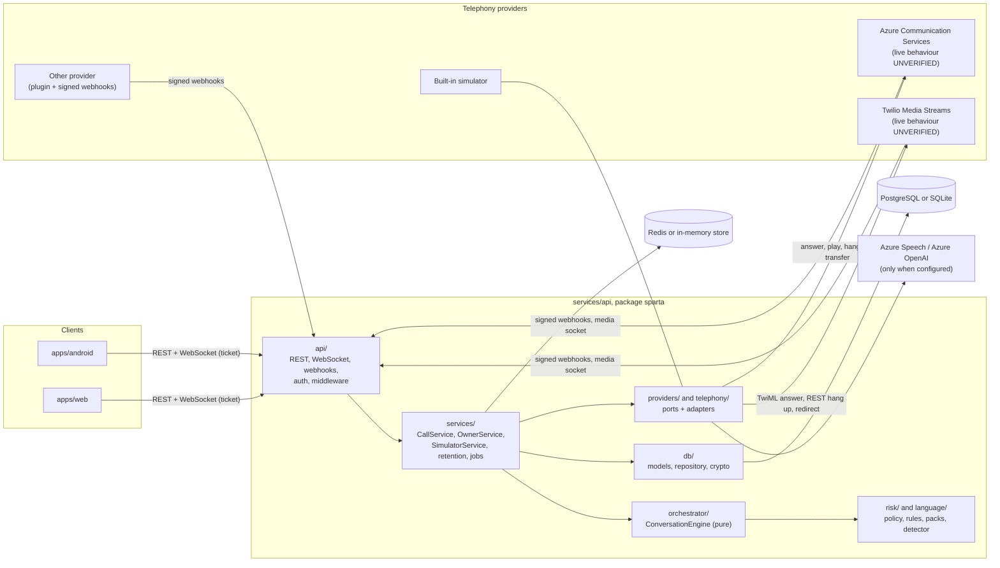
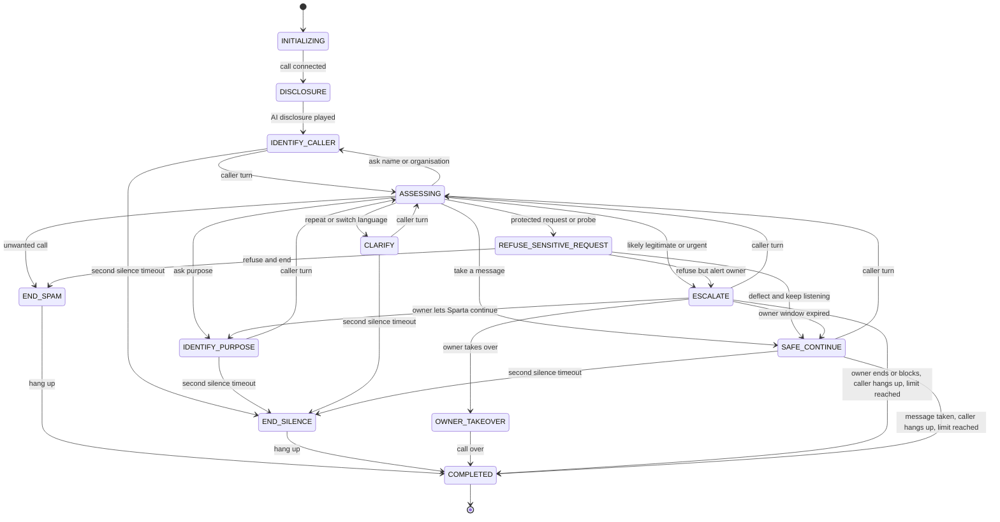
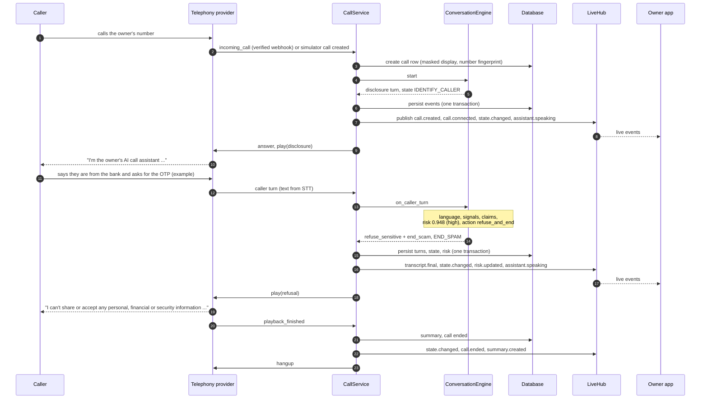
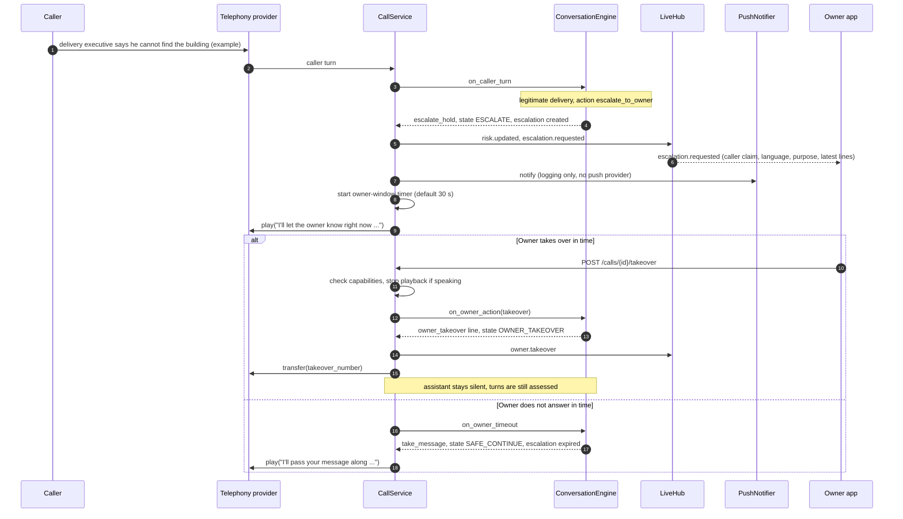
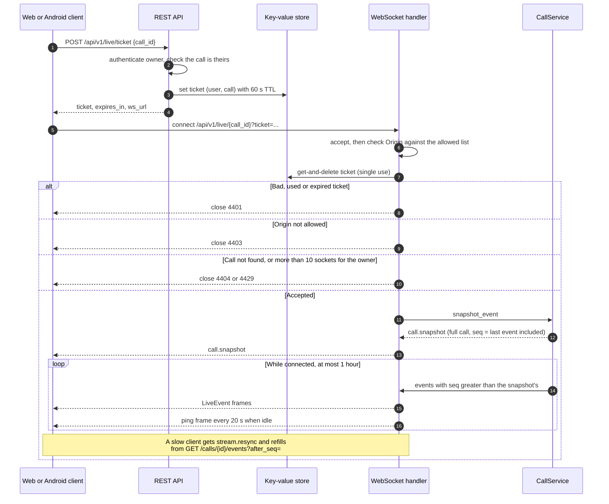

# Architecture

How Sparta is put together: components, data flow, the conversation state machine, the provider interfaces, storage,
sequence diagrams, failure modes and telemetry. Everything here describes `services/api` as of commit `5f980d1`
([IMPLEMENTATION_PLAN.md](IMPLEMENTATION_PLAN.md) section 6); where behaviour was
never exercised against a live external service it is marked **UNVERIFIED**.

Related documents: [ADR 0001](DECISIONS/0001-modular-monolith.md) (why one deployable service),
[SAFETY_MODEL.md](SAFETY_MODEL.md), [MULTILINGUAL_SPEECH.md](MULTILINGUAL_SPEECH.md), [TELEPHONY.md](TELEPHONY.md),
[PRIVACY.md](PRIVACY.md), [THREAT_MODEL.md](THREAT_MODEL.md), [API_CONTRACT.md](API_CONTRACT.md).

## 1. Shape of the system

Sparta is a modular monolith: one Python service (`services/api`, importable package `sparta`) with internal packages
that talk through typed interfaces (ports) and have adapters for the simulator and for Azure. Two clients consume the HTTP
and WebSocket contract: a web app (`apps/web`) and a native Android app (`apps/android`). The contract is generated from
the FastAPI app into `packages/contracts/openapi.json` (`python -m sparta openapi`, with `--check` as the drift check).

The native Android screening role (`CallScreeningService`) is a separate capability: it can allow, silence or reject a
call on the phone and report the decision to the backend, but it cannot answer, bridge, record or hear a call
([TELEPHONY.md](TELEPHONY.md), [ANDROID_SETUP.md](ANDROID_SETUP.md)). The AI conversation happens only for calls that
reach a telephony provider (the simulator, or a provider that delivers real calls).

## 2. Packages

All paths are under `services/api/src/sparta/`.

| Package | Responsibility | Imports from other `sparta` packages (checked by scanning the imports) |
| --- | --- | --- |
| `domain/` | Enums and Pydantic models shared everywhere (`CallState`, `SignalCode`, `RiskAssessment`, `CallTurn`, `UserPreferences` ...). Field names are the public API contract | none |
| `language/` | Language packs (`packs/*.toml`), registry, script and lexicon detector, text normalisation | `domain` |
| `risk/` | Safety policy (`policies/default-v1.toml`), signal matchers, risk scoring, claim extraction | `domain`, `language` |
| `orchestrator/` | `ConversationEngine` (pure, deterministic), state machine, reply planner, output validator, summary | `clock`, `domain`, `language`, `providers` (the SSML duration estimate only), `risk` |
| `providers/` | Ports and adapters for speech-to-text, text-to-speech, conversation model and voice-activity detection; simulators; Azure adapters; resilience wrapper | `clock`, `config`, `domain`, `observability` |
| `telephony/` | Telephony port, simulator, Azure Communication Services adapter, Twilio adapter (and its mu-law codec), webhook verification | `clock`, `config`, `domain`, `observability`, `providers` |
| `db/` | SQLAlchemy models, repository, field encryption, async sessions, Alembic runner | `config`, `domain` |
| `services/` | Application services that apply side effects: `CallService`, `OwnerService`, `SimulatorService`, `AudioService`, `AudioPipeline`, retention, background jobs, live hub, key-value store, rate limiter, composition root (`container.py`) | `clock`, `config`, `db`, `domain`, `language`, `logging_setup`, `observability`, `orchestrator`, `providers`, `risk` (the owner-name replacement before a model call), `telephony` |
| `api/` | FastAPI app factory, middleware, authentication, routers | `config`, `db`, `domain`, `logging_setup`, `observability`, `providers`, `services`, `telephony` |
| `evaluation/` | Dataset loader, runner, metrics and report for `python -m sparta evaluate` | `domain`, `observability`, `orchestrator` |
| `observability/` | `tracing.py` (OpenTelemetry setup, the `span()` helper, trace ids, cost estimates) and `metrics.py` (in-process counters, a bounded sample store for percentiles, Prometheus text) | `config` |
| `simulator/scenarios/` | The 13 curated scenarios (`curated.json`) | none (data) |
| `preflight.py` | Start-up checks for `serve`, `migrate` and `seed`: the database (and Redis, when `SPARTA_REDIS_URL` is set) must answer, otherwise one readable line per problem is printed and the command exits with status 2 | `config`, `db` |
| `cli.py` | `python -m sparta {serve,migrate,seed,openapi,evaluate,keygen}`. `serve` also refuses (exit status 2) to listen on a non-loopback `--host` while the development identity is active, unless `SPARTA_ALLOW_NETWORK_DEV_AUTH=true` | `api`, `config`, `db`, `evaluation`, `logging_setup`, `preflight`, `services` |

ADR 0001 states that `risk` and `language` import nothing from `orchestrator`, `telephony`, `db` or `api`, and that
`orchestrator` never imports `api`. `services/api/tests/unit/test_architecture.py` enforces the direction by parsing
every module's imports (including imports inside functions): `domain` may import none of `api`, `db`, `language`,
`observability`, `orchestrator`, `providers`, `risk`, `services` or `telephony`; `language` none of `api`, `db`,
`orchestrator`, `providers`, `risk`, `services` or `telephony`; `risk` none of `api`, `db`, `orchestrator`, `providers`,
`services` or `telephony`; `orchestrator` none of `api`, `db`, `services` or `telephony`; `providers` and `telephony` neither
`api` nor `services`; `db` none of `api`, `orchestrator`, `services` or `telephony`. The test does not constrain
`services`, `api`, `evaluation`, `observability` or the top-level modules. A separate scan of the imports (the table
above) matches these rules.

## 3. Data flow of one call

1. **A call exists.** Either the owner starts a simulated call (`POST /api/v1/simulator/calls`, optionally with a
   curated scenario and `autoplay`), or a real telephony provider delivers one (for Azure: an Event Grid
   `IncomingCall` event on `POST /api/v1/webhooks/acs/events`, which is verified and then handled by
   `AzureAcsTelephonyProvider.handle_incoming`). `CallService._create` builds the call row, computes a keyed
   fingerprint of the caller number and its masked display, enforces the daily cap and the active-call limit, and
   ends blocked callers without answering.
2. **The assistant opens.** `ConversationEngine.start` moves `INITIALIZING` to `DISCLOSURE` to `IDENTIFY_CALLER` and
   returns the disclosure line ("Hi, I'm Atharv's AI call assistant. May I know who's calling and what this is
   regarding?" in the default style). With a full name such as `Atharv Shukla` the line names the full name: the output
   validator judges a name as a whole, and never judges the name as something the assistant said, so a name with digits,
   a link-like word or an e-mail address cannot cost the call its AI disclosure (an e-mail address is spoken as "the
   owner"; [SAFETY_MODEL.md](SAFETY_MODEL.md) section 2).
3. **The caller speaks.** The text reaches `CallService._submit_turn` in one of these ways: typed or scripted turns
   from the simulator, a browser speech result (`POST /calls/{id}/turns`), an uploaded clip
   (`POST /calls/{id}/audio`, transcribed in memory), or provider audio. Provider audio (Azure Communication Services
   or Twilio media streaming) goes through `services/audio_pipeline.py`: energy-based voice-activity detection, a 300 ms
   pre-roll, one recognition stream per utterance (streaming through the Speech SDK when installed, so partials arrive as
   live captions), strictly ordered delivery, and barge-in when speech starts while the
   assistant is talking.
4. **The engine decides.** `ConversationEngine.on_caller_turn` runs, in order: language detection, deterministic
   signals (including phrases split across the previous turn), optional model signals, claim extraction, risk
   assessment, the decision table, the templated reply and output validation. It is pure: no I/O, no randomness, an
   injectable clock. The full table is in [SAFETY_MODEL.md](SAFETY_MODEL.md).
5. **Side effects, in a fixed order** (`services/calls.py`, module docstring): read state under the per-call lock, run the
   engine, apply simulated network latency (if the call has a simulated network profile), persist everything in one
   database transaction (`CallService._persist_result`), publish live events only after the commit, speak or hang up
   through the telephony provider, re-arm timers.
6. **The assistant speaks.** `provider.play(plan)` starts playback; completion arrives through
   `TelephonyEventSink.playback_finished`. A caller turn that arrives while speech is still playing is a barge-in: the
   provider is told to stop, the turn is marked `interrupted` with the fraction spoken, and `assistant.interrupted` is
   emitted.
7. **The call ends.** On a hang-up decision, silence, owner action, maximum duration, a provider hang-up or the reaper,
   `_finalize_locked` builds the summary, stores it, resolves open escalations, records metrics, emits `call.ended` and
   `summary.created`, and asks the provider to hang up. If the owner does not store transcripts the transcript is deleted
   at this point.

Timers run in the call service, not in the engine: silence (default 8 s then 8 s), maximum duration (default 180 s,
bounded by `SPARTA_MAX_CALL_DURATION_S`), owner response window (default 30 s) and the abandoned-call reaper
(idle for more than `SPARTA_ABANDONED_CALL_TIMEOUT_S`, default 180 s, checked every 15 s).

## 4. Conversation state machine

The states are `CallState` in `domain/enums.py`; legal transitions are the `ALLOWED` table in
`orchestrator/state_machine.py`, and an illegal move raises `InvalidTransition`. The diagram shows the transitions the
engine actually performs; `ALLOWED` additionally permits some moves the engine does not currently use
(for example `OWNER_TAKEOVER` back to `SAFE_CONTINUE`). `COMPLETED` and `FAILED` are terminal.

Notes that the diagram cannot show:

* From any non-terminal state, `ConversationEngine.complete` moves to `COMPLETED`; `IDENTIFY_CALLER`,
  `IDENTIFY_PURPOSE` and `CLARIFY` do the same on a caller hang-up or the maximum-duration limit. Owner "end" and
  "block", the limit and a caller hang-up set `ended_reason` and finalise the call; the state moves to `COMPLETED` when
  it is finalised. `ASSESSING` is transitional: it only exists inside one engine step.
* `FAILED` is a terminal state in `ALLOWED` and `ConversationEngine.fail` is implemented, but nothing in `CallService`
  calls it in this release, so no call currently ends in `FAILED`. For the same reason `CallStatus.FAILED` and the
  metric `sparta_call_failures_total` are defined but never set.
* While in `OWNER_TAKEOVER` the assistant stops replying but keeps transcribing and assessing; the risk assessment is
  updated for the owner.
* After the owner decides (continue) or the owner window expires, `escalation_closed` is set and the owner is not
  alerted again for that call.

## 5. Provider interfaces (ports)

All external capabilities are Protocol classes; the call pipeline never knows which adapter it is using. Every provider
reports `meta.simulated`, and every failure is a `ProviderError` with a sanitised message (no response bodies, no secrets).

| Port | Defined in | Operations | Simulator | Azure adapter |
| --- | --- | --- | --- | --- |
| `SpeechToTextProvider` and `SttStream` | `providers/base.py` | `start_stream` (`push_audio`, `flush`, `events`, `stop_stream`), `transcribe` (one clip) | `providers/stt/simulator.py`: cannot transcribe audio; echoes a `transcript_hint` for uploads and refuses otherwise (422 `stt_unavailable`) | `providers/stt/azure.py`: Fast Transcription REST. `start_stream` is utterance based: it buffers PCM until `flush()` and emits exactly one `final` event, never `partial` events |
| `TextToSpeechProvider` | `providers/base.py` | `synthesize_stream`, `stop_playback`, `list_voices` | `providers/tts/simulator.py`: timing only, no audio | `providers/tts/azure.py`: SSML over REST. Chunked-transfer streaming is UNVERIFIED |
| `ConversationModelProvider` | `providers/base.py` | `evaluate_turn`, `generate_safe_reply`, `summarize_call`, `classify_call`, `translate` | `providers/llm/rules.py`: no model (default) | `providers/llm/azure_openai.py`: chat completions with a strict JSON schema; advisory only ([SAFETY_MODEL.md](SAFETY_MODEL.md)). `evaluate_turn` and `summarize_call` are used by the call path; `generate_safe_reply` and `translate` are implemented but nothing calls them; `classify_call` returns `None` |
| `VoiceActivityProvider` | `providers/base.py` | `process`, `reset` | `providers/vad/energy.py` is the only implementation: energy based, 20 ms frames, 500 ms hangover, deterministic | none |
| `TelephonyProvider` and `TelephonyEventSink` | `telephony/base.py` | `answer`, `play`, `stop_playback`, `hangup`, `transfer`, `status`, `bind`; the sink receives `incoming_call`, `caller_audio`, `caller_dtmf`, `playback_finished`, `remote_hangup`, `provider_error` | `telephony/simulator.py`: `simulated: true`, no caller audio, `live_calls_supported: false`, takeover is a labelled simulation | `telephony/azure_acs.py`: Call Automation with bidirectional PCM media streaming; webhook verification in `telephony/webhooks.py`. `telephony/twilio.py`: voice webhook answering with `<Connect><Stream>`, mu-law 8 kHz media socket, `mark`/`clear`, REST hang-up and `<Dial>` redirect; stored as provider kind `other`. Live behaviour of both UNVERIFIED |
| `PushNotifier` | `services/notifier.py` | `notify` | `NullPushNotifier`, `LoggingPushNotifier`, `RecordingPushNotifier` (test double) | none: push delivery (FCM) is not implemented |
| `KeyValueStore` | `services/kv.py` | counters, TTL values, atomic get-and-delete, locks, publish and subscribe | `MemoryKV` (single instance) | `RedisKV` (shared across instances) |

Adapters are chosen only by configuration in `services/providers.py` (`build_providers`): `TELEPHONY_PROVIDER`
(`simulator`, `azure` or `other`, also read as `SPARTA_TELEPHONY_PROVIDER`), `SPARTA_STT_PROVIDER`,
`SPARTA_TTS_PROVIDER` (`simulator` or `azure`) and `SPARTA_LLM_PROVIDER` (`rules` or `azure_openai`). Azure adapters are
imported lazily, so a simulator-only install does not load them. With `TELEPHONY_PROVIDER=other`,
`SPARTA_TELEPHONY_PLUGIN='package.module:factory'` names a factory that returns a `TelephonyProvider`. A misconfiguration
fails at startup with a message that lists every problem (`Settings.problems`).

Capabilities are honest and per provider. `TelephonyCapabilities.call_capabilities` produces `CallDetail.capabilities`,
which tells every client which owner controls are real and why a control is disabled (`takeover_note`, `audio_note`).
For ACS, `two_way_audio` is true only while the call has a live media socket.

Every external call goes through `ResilientCaller` (`providers/resilience.py`): a per-attempt timeout
(`SPARTA_PROVIDER_TIMEOUT_S`, default 6 s), at most `SPARTA_PROVIDER_MAX_RETRIES` retries (default 2) for retryable
errors with capped exponential backoff (0.2 s doubling, at most 2 s, `Retry-After` honoured but bounded), and a circuit
breaker that opens after five consecutive failures and allows a probe after 30 s. The ACS transfer stage is never
retried because a transfer is not idempotent.

## 6. Storage

* **Relational database.** SQLAlchemy 2 (async) models in `db/models.py`; 18 tables: `users`, `user_preferences`,
  `assistant_profiles`, `voice_profiles`, `trusted_callers`, `blocked_callers`, `call_sessions`, `call_turns`,
  `risk_assessments`, `escalations`, `owner_actions`, `call_summaries`, `feedback`, `provider_events`, `live_events`,
  `audit_events`, `idempotency_keys`, `simulator_scenarios`. The default is SQLite
  (`sqlite+aiosqlite:///./var/sparta.db`) for development; production configuration requires PostgreSQL
  (`Settings.problems`). Schema changes are Alembic migrations in `services/api/migrations/versions/` (two exist:
  `0001_initial_schema.py` and `0002_idempotency_call_link.py`, which adds `idempotency_keys.call_id`); a wheel install
  carries them as `sparta/_migrations` (`db/session.py` picks the packaged copy when it exists, otherwise the source
  tree). In development `SPARTA_AUTO_MIGRATE` (default true) applies migrations at startup; in production run
  `python -m sparta migrate` yourself. `/readyz` answers 503 with `checks.database` set to `migrations_pending` while the
  applied revision is behind the newest migration this code ships (`Database.schema_state`); a database created without
  Alembic (tests, deterministic replay) or ahead of the code stays ready.
* **What is encrypted.** Content-bearing and personal columns use Fernet field encryption (`EncryptedText` and
  `EncryptedJSON` in `db/types.py`, keys in `SPARTA_DATA_KEYS`). Columns needed to list and filter calls (risk level,
  category, timestamps, flags, the masked caller display and the caller-number fingerprint) stay in clear. The complete
  per-column list is in [PRIVACY.md](PRIVACY.md).
* **Shared ephemeral state.** `KeyValueStore` holds rate-limit counters, single-use WebSocket tickets, call locks,
  webhook replay keys and cross-instance live-event fan-out. Without `SPARTA_REDIS_URL` it is in memory and only valid
  for one instance; production configuration requires Redis.
* **Events are persisted before they are published.** `EventBuffer.emit` writes each live event (with a per-call,
  monotonic `seq`) inside the same transaction as the state change; only after commit does `LiveHub.publish` deliver it.
  The sequence number comes from `Repository.next_event_seq`, a single `UPDATE ... RETURNING` on the call row, so writers
  that do not hold the per-call lock (live captions, timers) are serialised by the database. A SQLite file begins every
  transaction with `BEGIN IMMEDIATE` and waits up to 15 seconds for the write lock; an in-memory SQLite database (tests,
  deterministic replay) uses a pool of one connection so units of work take turns (`db/session.py`;
  `tests/integration/test_live_event_sequence.py` runs concurrent captions against a file database). Queueing writers is
  only safe while no unit of work waits for another one, takes a lock or waits on slow I/O, and
  `tests/unit/test_transactions.py` reads the source and fails when one does. A subscriber that
  falls behind is told to resync from `GET /calls/{id}/events?after_seq=`.
* **In-memory runtime.** `CallRuntime` (`services/runtime.py`) holds only what cannot be stored: the lock, timers,
  playback bookkeeping and the audio pipeline. The conversation state is read from the database at the start of every
  step, so a restarted process can serve a call from its stored state.
* **Per-owner matchers.** The signal matchers depend on the owner's display name (the "is the owner home" and "the owner
  said" rules name the owner). Building a set takes about a second the first time (a figure from
  [SECURITY_REVIEW.md](SECURITY_REVIEW.md), not re-measured here), so `ConversationEngine._signals_for`
  keeps the 64 most recently used sets in memory, and `CallService.warm_matchers` builds a new one in a worker thread when
  a profile is saved, a call is created or a preview runs. `PUT /assistant-profile` is limited to 12 requests per minute
  per owner.

## 7. Sequence diagrams

### 7.1 Incoming call, screening, refusal

The flow below is the one replayed by the simulator scenario `bank-otp-en`; for a real provider the caller's words arrive
as provider audio instead of a typed turn. The event order was confirmed by replaying the scenario on 2026-11-18.

### 7.2 Escalation and owner takeover

Owner controls are real only to the extent `CallDetail.capabilities` says so. On the simulator the takeover is a
labelled simulation; on a real provider it needs the owner's `takeover_number` and a provider transfer, which is
UNVERIFIED against live ACS.

### 7.3 Live events with a single-use ticket

Browsers cannot attach an `Authorization` header to a WebSocket upgrade, so the client first asks for a one-time ticket.

## 8. Failure modes

| Failure | What happens | Where |
| --- | --- | --- |
| Telephony provider unreachable or erroring | Calls through `ResilientCaller` time out, retry within limits and then fail fast while the breaker is open. A `provider.error` event with `degraded: true` is emitted. `/readyz` stays ready but reports the provider's health, and the Home summary shows "Calls are not being screened right now". Transfers are never retried | `providers/resilience.py`, `telephony/azure_acs.py`, `api/routers/health.py`, `services/owner.py` |
| Speech synthesis fails | Simulated calls: the failing line is not spoken, a degraded `provider.error` is emitted, the call stays open and the silence timer is re-armed (or the call is finalised if it was ending). **Real calls (Phase 2):** a provider that fails to speak reports `provider.error` for stage `play`, which also releases the playback the service was waiting for (so the silence timer resumes and the reaper can act); after `SPARTA_PROVIDER_FAILURE_LIMIT` (default 2) failures in a row the call is ended with reason `provider_failure` and a summary saying Sparta could not screen it and the caller may not have heard the AI disclosure. A line that is heard resets the count | `CallService._play`, `provider_error`, `_abandon_playback`, `_count_stage_failure`, `orchestrator/summary.py` |
| Speech recognition fails or is slow | The pipeline reports a degraded `provider.error`, drops the utterance and goes back to waiting; no transcript is invented. At most four finished utterances wait for the recogniser; a recogniser silent for 20 s is abandoned. On a real call, consecutive failures end the call as above (a transcript with words resets the count) | `services/audio_pipeline.py`, `services/calls.py` |
| Model (Azure OpenAI) unavailable, filtered or returns invalid output | Timeouts, errors and content-filter blocks degrade to the deterministic engine (`provider.error`, `degraded: true`). The adapter validates the JSON with Pydantic and drops unknown, invalid and legitimacy signals; the engine accepts only 13 context codes with a capped weight | `services/calls.py` `_model_signals`, `providers/llm/azure_openai.py`, `orchestrator/engine.py` |
| Speech recognition confidence low | Below 0.55 the assistant asks the caller to repeat (at most twice per call) unless a signal was just raised; low confidence reduces the assessment's confidence, not its risk. Dangerous content in a noisy transcript is still acted on (`test_dangerous_content_is_acted_on_even_when_the_transcript_is_noisy`) | `orchestrator/engine.py`, `risk/engine.py` |
| Database unavailable | `/healthz` stays 200 and `/readyz` returns 503. Requests fail with the standard 500 error envelope (`ErrorGuardMiddleware`); nothing is cached to serve instead. No events are emitted because they are persisted first. After recovery, calls that nobody has driven for `SPARTA_ABANDONED_CALL_TIMEOUT_S` are closed by the reaper | `db/session.py`, `api/middleware.py`, `services/calls.py` `reap_abandoned` |
| Database behind the code (a new release before `python -m sparta migrate`) | `/readyz` returns 503 with `checks.database` set to `migrations_pending`, so a platform that gates traffic on readiness sends none to the new instance until the migration has run. A database ahead of the code (a rollback) and one created without Alembic stay ready. Tests: `tests/api/test_api_flows.py::test_readiness_waits_for_the_migrations_this_release_needs`, `tests/unit/test_migrations.py::test_schema_state_follows_the_migration_history` | `db/session.py` `schema_state`, `api/routers/health.py` |
| Redis unavailable (production) | `/readyz` reports `shared_state: unavailable` (503). Rate limits, tickets and locks use the same store and raise; there is no in-memory fallback at runtime | `services/kv.py`, `api/routers/health.py` |
| Process restart | In-memory timers and playback are lost. Conversation state is in the database, so a call can be served again from its stored state; a call nobody drives is closed by the reaper after the idle timeout | `services/runtime.py`, `CallService._runtime_from_row` |
| Replayed or forged webhook | Event Grid and ACS callbacks and the media socket must carry a valid RS256 JWT (issuer, audience, expiry, key id, lifetime checked, keys from one pinned HTTPS JWKS URL; with `SPARTA_EVENT_GRID_ALLOWED_APP_IDS` set, the calling application too). Twilio's voice and status webhooks must carry a valid `X-Twilio-Signature` and its media socket the signature plus the per-call token. The generic route needs an HMAC over timestamp, nonce and body, a timestamp within 300 s and an unused nonce (replay key kept for 601 s). Failures return a generic 401 and log only a static reason | `telephony/webhooks.py`, `telephony/twilio.py`, `api/routers/webhooks.py` |
| Duplicate delivery of a provider event | Event ids are stored with a unique `(provider, external_id)` constraint, so a redelivery is skipped (also across restarts). ACS callbacks keep the last 256 event ids per call. Concurrent `IncomingCall` deliveries for one `serverCallId`, and concurrent Twilio voice webhooks for one `CallSid`, share one task, so one call is created and a retry gets the same TwiML | `db/models.py` `ProviderEventRow`, `telephony/azure_acs.py`, `telephony/twilio.py` |
| Duplicate client request | Mutating routes that accept `Idempotency-Key` (1 to 64 characters) replay the stored response (`Idempotent-Replayed: true`) for the same key, owner and route: for 24 hours, or for 15 minutes on `/calls/{id}/turns`, `audio`, `silence` and `feedback` (today only `turns` and `feedback` take the header), where only a 409 marker is kept when the owner stores no transcripts. A stored response is deleted with the call or its content when its route names the call or it is the response that created the call (`idempotency_keys.call_id`), and removing a blocked or trusted entry deletes the cached `POST` responses of that list (`forget_cached_creations`); the same key with a different body is a 409, decided by a request fingerprint that is an HMAC keyed with the pepper and scoped to the owner (`_request_fingerprint`). Android screening events are idempotent on `client_event_id`; feedback is unique per call and kind | `api/deps.py`, `api/routers/safety.py`, `services/owner.py`, `db/models.py`, `db/repository.py` |
| Slow WebSocket consumer | Each subscriber has a 256-event queue; on overflow the backlog is dropped and a `stream.resync` frame tells the client to refill from the persisted event log | `services/live.py` |
| Abandoned call (closed tab, dropped media socket) | The reaper ends calls idle for more than 180 s (not while the assistant is speaking) with reason `abandoned` | `services/jobs.py`, `services/calls.py` |
| Invalid or hostile input | Bodies are bounded before parsing (512,000 bytes default, 8 MB plus overhead for audio, 1 MiB plus overhead for webhooks), uploads are type-sniffed and duration-bounded (the WAV header walk stops after 32 chunks and an unreadable header is a 422), caller text is normalised (NFKC), stripped of invisible characters and truncated to 1000 characters, unknown request fields are rejected with 422 | `api/middleware.py`, `services/audio_validation.py`, `orchestrator/engine.py` |
| Simulator replay too slow (overlapping replays, a slow or busy host) | `ReplayDriver` waits for each step by the wall clock (`REPLAY_STEP_TIMEOUT_S`, 30 s per step), not by a number of polls, whose duration depends on the platform's timer resolution. A replay that still runs out of time answers 503 `provider_unavailable` ("The replay took too long on this server") instead of an unhandled 500. Verified on 2026-11-18 against a running API: five overlapping replays of one scenario all returned 200 with the same checksum. Tests: `tests/unit/test_replay_driver.py`, `test_overlapping_replays_all_succeed_and_agree` and `test_a_replay_that_cannot_finish_in_time_is_a_503_and_not_an_unhandled_error` in `tests/api/test_api_flows.py` | `services/simulator.py` |

## 9. Telemetry and trace ids

* **Spans** (`observability/tracing.py`). One server span per HTTP request (`RequestContextMiddleware` in
  `api/middleware.py`; Sparta creates none for WebSocket connections), named `METHOD /route/template` once the route is
  matched, with `http.request.method`, `http.route`, `http.response.status_code` and `sparta.request_id`; it is marked as
  an error for a 5xx response and not for a 4xx. One `provider.call` span for every call that goes through
  `ResilientCaller` (`providers/resilience.py`), with `provider` and `stage`, and `error.type` set to the exception class
  when it fails. One `engine.on_caller_turn` span per caller turn (`CallService`, `services/calls.py`), with `call_id`,
  `source`, `sparta.final_state` and `sparta.risk_level`. The `span()` helper records the exception class only, never its
  message, and `tests/api/test_api_tracing.py` asserts that no path call id, query string, number, label, caller text or
  exception message reaches a Sparta span.
* **Export.** `setup_tracing` runs once at start-up when the app builds its own container (`api/main.py`; a test that
  injects a container installs no provider). It installs a tracer provider unless `SPARTA_OTEL_ENABLED=false`, with
  `service.name` from `SPARTA_SERVICE_NAME` (default `sparta-api`). Spans leave the process only when
  `SPARTA_OTLP_ENDPOINT` is set and the `otlp` extra is installed (the default Docker image installs it,
  `services/api/Dockerfile`); then a batch processor sends OTLP/HTTP traces. Without the extra the endpoint is ignored
  silently. There is no metrics or log export; metrics are Prometheus text on `/metrics` (`SPARTA_EXPOSE_METRICS`).
  Verified on 2026-11-18 with a local OTLP/HTTP listener against the simulator: the exporter posted protobuf traces to
  `/v1/traces` with the request spans and `engine.on_caller_turn`. No `provider.call` span appeared in that run because
  the simulator providers and the default `rules` model make no `ResilientCaller` call (the callers are the Azure
  speech adapters, the Azure OpenAI adapter, the Azure telephony adapter and the call service's model call); that span is
  covered by a test with a stand-in provider.
* **Trace ids.** `new_trace_id()` returns the trace id of the active span, and a random 128-bit id when there is none. A
  call created while serving a request therefore stores that request's trace id (`CallDetail.trace_id`), which is the
  diagnostic id clients quote and the id of the exported trace. Sparta's request span is a root span: an incoming W3C
  `traceparent` header does not choose the trace id.
* **FastAPI's own telemetry is switched off.** FastAPI 0.16x instruments itself against the global tracer provider that
  `setup_tracing` installs, with the raw `url.path`, the whole `url.query`, a trace id taken from a caller's
  `traceparent` and three child spans per request. `create_app` passes `telemetry` options set to `False` to `FastAPI(...)`
  whenever the installed version has that parameter (`_own_telemetry_only` in `api/main.py`), so Sparta's spans are the
  only ones. Verified on 2026-11-18 against a running API with a local OTLP listener: no span of FastAPI's own scope was
  exported, none carried `url.path` or `url.query`, and a forged `traceparent` did not set a call's trace id. Tests with a
  global tracer provider configured: `test_only_sparta_spans_exist_and_none_carries_the_url` and
  `test_a_callers_traceparent_does_not_choose_the_trace_id` in `tests/api/test_api_tracing.py`
  ([PRIVACY.md](PRIVACY.md) section 9; [THREAT_MODEL.md](THREAT_MODEL.md) row 27).
