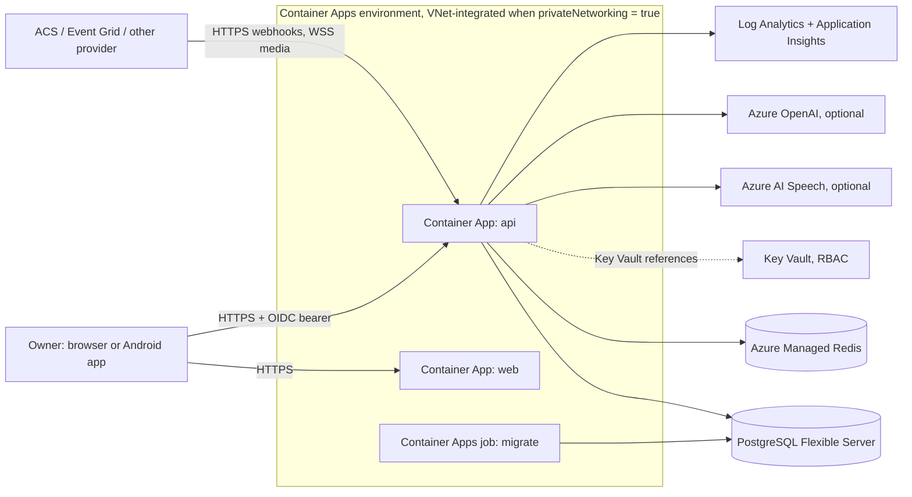

# Deployment (Azure)

How Sparta is deployed to Azure, what each resource is for, how secrets and releases are handled, and, in the last
sections, exactly what has and has not been verified. Read [What is not verified](#what-is-not-verified) before you trust
anything here with a real call.

**Honest status.** The container image, Docker Compose stack and the production-mode behaviour of the API were run and
checked on a developer machine. The Bicep templates **compile and lint** with the Bicep CLI but have **never been deployed**:
no Azure subscription was used to write them. The GitHub Actions workflows **have not run on GitHub**. Nothing here has
carried a real phone call, and no Azure Communication Services (ACS), Speech or Azure OpenAI resource has been exercised.
Where something is untested it is marked **UNVERIFIED**.

Contents: [What gets deployed](#what-gets-deployed) · [Before you start](#before-you-start) ·
[First deployment](#first-deployment-step-by-step) · [Configuration reference](#configuration-reference) ·
[Secrets and rotation](#secrets-and-rotation) · [Migrations](#migrations) · [Domain and TLS](#domain-and-tls) ·
[Telephony, Speech and OpenAI](#telephony-speech-and-openai) · [Rollback](#rollback) ·
[Monitoring and alerts](#monitoring-and-alerts) · [Cost levers](#cost-levers) ·
[Hardening and trade-offs](#hardening-and-trade-offs) · [Redis: Azure Cache vs Azure Managed Redis](#redis-azure-cache-for-redis-vs-azure-managed-redis) ·
[Check the image locally](#check-the-image-locally-in-production-mode) · [Legal and approvals checklist](#legal-and-approvals-checklist) ·
[External credentials](#external-credentials-you-must-obtain) · [What is not verified](#what-is-not-verified) ·
[Troubleshooting](#troubleshooting)

## What gets deployed



`infrastructure/azure/main.bicep` creates (every name is derived from `namePrefix` and `environmentName`):

| Resource | Module | Why | Default size / setting | Main cost lever |
| --- | --- | --- | --- | --- |
| Log Analytics workspace + Application Insights | `monitoring` | All container logs (one redacted JSON line per event) and platform metrics | PerGB2018, 30 days, 1 GB/day cap | retention, daily cap |
| Virtual network, private DNS zones | `network` | Lets PostgreSQL and Redis have no public endpoint | /16 with `aca`, `postgres`, `endpoints` subnets | none of its own; private endpoints and DNS zones cost a little |
| User-assigned managed identity `id-...-api` | `main`, `secretaccess` | Resolves the Key Vault references of the api app and the migrate job | `Key Vault Secrets User`, one role assignment **per secret** they reference, none on the vault itself | none |
| User-assigned managed identity `id-...-web` (only when a registry password is set) | `main`, `secretaccess` | Lets the web app read the private-registry password to pull its image | `Key Vault Secrets User` on `sparta-registry-password` only | none |
| Key Vault | `keyvault` | Holds every runtime secret; RBAC, soft delete, purge protection | Standard | none worth tuning |
| PostgreSQL Flexible Server 16 + database `sparta` | `postgres` | The system of record (call content is encrypted by the application before it is stored) | Burstable `Standard_B1ms`, 32 GB, 7-day backups, no HA | SKU, HA, storage |
| Azure Managed Redis | `redis` | Shared rate limits, WebSocket tickets, call locks, live events | `Balanced_B0`, TLS only | SKU, HA |
| Container Apps environment + `api` app + `web` app + `migrate` job | `containerapps` | Runs the three containers; the job applies migrations | api 0.5 vCPU / 1 GiB, 1 to 3 replicas; web 0.25 vCPU / 0.5 GiB | replicas, sizes |
| ACS resource (optional) | `acs` | Call Automation | off (`deployAcs`) | usage |
| Speech resource (optional) | `speech` | Speech-to-text and text-to-speech | off (`deploySpeech`), S0 | usage |
| Action group and alert rules (optional) | `alerts` | Notify on 5xx, restarts, no replicas, PostgreSQL CPU/storage | off (`alertEmail`) | none |

The template deliberately has **no secret in a parameter, output or app definition**: secrets are Key Vault secrets, written
by the module that owns them, and the apps reference them with their managed identities. The web app is internet-facing and
needs no secret, so by default it has **no managed identity at all** and cannot reach Key Vault; no identity is ever granted
access to the vault as a whole (see [Secrets and rotation](#secrets-and-rotation)).

## Before you start

* An Azure subscription, a resource group in a region that offers **every** service you enable (Container Apps,
  PostgreSQL Flexible Server, the Azure Managed Redis SKU, and for speech the `en-IN`, `hi-IN` and `kn-IN` voices).
  `centralindia` is the default in the workflow; check availability yourself, it was not checked.
* Tools: Azure CLI 2.60+ with Bicep (`az bicep install`), Docker for local image checks, Python 3.12 only for
  `python -m sparta keygen`.
* A **Microsoft Entra ID** tenant (or another OpenID Connect issuer) for the API: an app registration whose application ID
  URI is the API audience (`SPARTA_OIDC_AUDIENCE`). Request v2 access tokens (`accessTokenAcceptedVersion: 2` in the API
  app's manifest) so the issuer is `https://login.microsoftonline.com/<tenant-id>/v2.0`, which is what the API discovers keys
  from (`<issuer>/.well-known/openid-configuration`, issuer must match exactly). **No sign-in has been verified against a live
  tenant.** In particular the web app's OIDC mode (a public client registration, `NEXT_PUBLIC_OIDC_CLIENT_ID`) exists in
  the code but has never been run against a real identity provider or against the API's token validation (see
  [`docs/WEB_APP.md`](WEB_APP.md)); in `dev` mode the web app sends no token at all, so it cannot authenticate to a
  production API. Plan the first production check around a client that sends bearer tokens, and do not promise web sign-in.
* Container images in a registry the Container Apps can pull from. `container.yml` publishes
  `ghcr.io/<owner>/sparta-api` and `sparta-web`. Packages published by a workflow start **private**: either make them public
  in the package settings or pass `registryServer`, `registryUsername` and a read-only token as `registryPassword`.
* Read the [legal and approvals checklist](#legal-and-approvals-checklist). Real calls are **not** to be taken before that
  review.

## First deployment, step by step

`NEXT_PUBLIC_*` values are compiled into the web app when it is built, and a Container App's default host name
(`<app>.<random>.<region>.azurecontainerapps.io`) is only known once its environment exists. Decide the public host names
first: **a custom domain you control makes this a single pass**. Without one, plan for two passes (steps 5 and 7).

1. **Generate the application secrets** (nothing is stored; keep the output in a password manager or your CI secret
   store, never in a file in the repository):

   ```bash
   docker run --rm ghcr.io/<owner>/sparta-api:latest python -m sparta keygen    # or: make keygen
   ```

   It prints `SPARTA_DATA_KEYS` (a Fernet key), `SPARTA_PEPPER` and `SPARTA_WEBHOOK_SECRET`. Also choose a PostgreSQL
   administrator password (12+ characters).

2. **Create the resource group** and, for manual deployments, export the inputs. `main.bicepparam` reads them from the
   environment (`readEnvironmentVariable`), so no secret touches a file:

   ```bash
   az login
   az account set --subscription <subscription-id>
   az group create --name rg-sparta-prod --location centralindia

   export SPARTA_API_IMAGE=ghcr.io/<owner>/sparta-api:sha-<commit>
   export SPARTA_WEB_IMAGE=ghcr.io/<owner>/sparta-web:sha-<commit>
   export SPARTA_DATA_KEYS=... SPARTA_PEPPER=... SPARTA_WEBHOOK_SECRET=... POSTGRES_ADMIN_PASSWORD=...
   export SPARTA_OIDC_ISSUER=https://login.microsoftonline.com/<tenant-id>/v2.0
   export SPARTA_OIDC_AUDIENCE=api://sparta-api
   ```

   PowerShell: `$env:SPARTA_DATA_KEYS = '...'` and so on.

3. **Validate, preview, deploy**:

   ```bash
   cd infrastructure/azure
   az deployment group validate -g rg-sparta-prod -f main.bicep -p main.bicepparam
   az deployment group what-if  -g rg-sparta-prod -f main.bicep -p main.bicepparam
   az deployment group create   -g rg-sparta-prod -f main.bicep -p main.bicepparam --query properties.outputs
   ```

   The first deployment creates the role assignments (one per secret) and then immediately asks Container Apps to read Key
   Vault with them. If it fails with a Key Vault "forbidden" or "secret not found" error, role propagation was slower than
   the deployment: run the same command again.

4. **Run the migrations** (production never migrates at startup; see [Migrations](#migrations)):

   ```bash
   az extension add --name containerapp --upgrade
   az containerapp job start -n <migrationJobName> -g rg-sparta-prod
   ```

   `migrationJobName` is in the deployment outputs.

5. **Point the web build at the API.** Read `apiUrl` and `webUrl` from the outputs and set the repository variable
   `NEXT_PUBLIC_API_BASE_URL`. Sign-in from the web app is **unverified** (see Before you start): with the default
   `NEXT_PUBLIC_AUTH_MODE=dev` the browser sends no token, which a production API refuses; the `oidc` mode additionally
   needs `NEXT_PUBLIC_OIDC_AUTHORITY` and `NEXT_PUBLIC_OIDC_CLIENT_ID`. Then rebuild the web image (run the "Container
   images" workflow). With a custom domain, set these before the first image build and skip the extra pass.
6. **Register the redirect URI** of the web app on the client app registration in Entra ID (only for the web app's OIDC
   mode): `<webUrl>/auth/callback`, with `<webUrl>` as the post-logout URI, for a public client (no secret).
7. **Redeploy with the new web image tag** (step 3 with `SPARTA_WEB_IMAGE` updated), then smoke-test:

   ```bash
   curl -fsS https://<apiFqdn>/healthz
   curl -fsS https://<apiFqdn>/readyz        # 200 only when PostgreSQL (migrated to this release) and Redis answer
   ```

   `/docs` and `/api/v1/openapi.json` are switched off in production, and `/api/v1/me` answers 401 without a token.

### Deploying from GitHub Actions

`.github/workflows/deploy.yml` does steps 2 to 4 and a smoke test for you, after a human approves it. **Until the
variables below exist it does nothing except explain why.**

1. Create an Entra app registration (or a user-assigned managed identity) for the pipeline and a federated credential:

   ```bash
   appId=$(az ad app create --display-name sparta-deploy --query appId -o tsv)
   az ad sp create --id "$appId"
   az ad app federated-credential create --id "$appId" --parameters '{
     "name": "github-production",
     "issuer": "https://token.actions.githubusercontent.com",
     "subject": "repo:<owner>/<repo>:environment:production",
     "audiences": ["api://AzureADTokenExchange"] }'
   az role assignment create --assignee "$appId" --role Contributor --scope /subscriptions/<sub>/resourceGroups/rg-sparta-prod
   az role assignment create --assignee "$appId" --role "Role Based Access Control Administrator" --scope /subscriptions/<sub>/resourceGroups/rg-sparta-prod
   ```

   The second role is needed because the template creates role assignments (Key Vault Secrets User, one per secret). Scope
   it tightly. These commands were **not run**.

2. In the repository settings add the **variables** `AZURE_CLIENT_ID`, `AZURE_TENANT_ID`, `AZURE_SUBSCRIPTION_ID`
   (required), `AZURE_RESOURCE_GROUP` (default `rg-sparta-prod`), `AZURE_LOCATION` (default `centralindia`),
   `SPARTA_OIDC_ISSUER`, `SPARTA_OIDC_AUDIENCE`, optionally `SPARTA_ENVIRONMENT_NAME`; and for the web image build
   `NEXT_PUBLIC_API_BASE_URL`, `NEXT_PUBLIC_AUTH_MODE`, `NEXT_PUBLIC_OIDC_AUTHORITY`, `NEXT_PUBLIC_OIDC_CLIENT_ID`.
3. Create the **environment** `production` (Settings, Environments) and **protect it**: it is the gate in front of the Azure
   login and the production secrets.
   * **Deployment branches and tags:** "Selected branches and tags" with **only `main`**. A run from any other branch is then
     refused by GitHub before any of its steps runs.
   * **Required reviewers:** at least one person who is not the one starting the run, with **Prevent self-review** switched
     on, and do not let administrators bypass the rules.
   * Add its **secrets** `SPARTA_DATA_KEYS`, `SPARTA_PEPPER`, `SPARTA_WEBHOOK_SECRET`, `POSTGRES_ADMIN_PASSWORD` and optionally
     `AZURE_SPEECH_KEY`, `AZURE_OPENAI_KEY`. Environment secrets exist only for approved runs of that environment.
4. Run **Deploy** manually (choose an image tag, or "what if only" for a preview), or let it follow a successful
   **Container images** run on `main`. The automatic path starts only for a **push to this repository's `main`**: a pull
   request (a fork's included, even from a branch that is also called `main`), another branch or a tag never starts it.

#### Protect the release path

The workflow's own checks only help when these repository settings exist; they are **not** in the repository and nothing in
the files can enforce them:

* **`main` is the only source of deployments.** Whatever the trigger, the deploy job refuses a commit that is not part of
  main's history (`git merge-base --is-ancestor <commit> origin/main`) before it checks that commit out or signs in to Azure.
  That is only as strong as `main`: protect it (a ruleset or branch protection that requires pull requests, a review from a
  code owner and the `ci-ok` check, and blocks force pushes and deletion).
* **Protect the `v*` tags.** `container.yml` publishes images to GHCR for every `v*.*.*` tag, and an operator may deploy an
  image by that tag. Create a **tag ruleset** (Settings, Rules, Rulesets, target "tags", pattern `v*`) that restricts who can
  create, update and delete them to the maintainers.
* **The federated credential** (step 1) names the environment in its subject, so only jobs of the `production` environment,
  hence only runs from `main` once the branch restriction above is on, can obtain an Azure token. Keep that subject; never
  widen it to the repository or to a branch pattern.
* **Fork pull requests:** under Settings, Actions, General require approval to run workflows from outside collaborators, and
  leave "Send write tokens to workflows from pull requests" off. "Container images" and CI run for forks without secrets.

None of the settings above, and none of the workflow paths they protect, has been exercised on GitHub (**UNVERIFIED**, see
[What is not verified](#what-is-not-verified)); the shell logic of the checks was tested locally.

## Configuration reference

The template turns parameters into the API's `SPARTA_*` settings (all defined in
`services/api/src/sparta/config.py`, documented in `.env.example`). Production **refuses to start** unless
`SPARTA_AUTH_MODE=oidc`, `SPARTA_DATA_KEYS`, `SPARTA_PEPPER`, `SPARTA_WEBHOOK_SECRET`, a PostgreSQL URL, `SPARTA_REDIS_URL`,
https CORS origins without `localhost`, and explicit trusted hosts are all set, and it lists every missing item at once:

```text
Invalid Sparta configuration:
  - SPARTA_DATA_KEYS (Fernet key list) is required in production
  - SPARTA_REDIS_URL is required in production for shared rate limits and call coordination
  ...
```

| Bicep parameter | Becomes | Default |
| --- | --- | --- |
| `oidcIssuer`, `oidcAudience`, `oidcJwksUrl` | `SPARTA_OIDC_ISSUER`, `SPARTA_OIDC_AUDIENCE`, `SPARTA_OIDC_JWKS_URL` | required, required, empty |
| (web host) + `extraCorsOrigins` | `SPARTA_CORS_ORIGINS` | the web app's `https://` host |
| (API host) + `extraTrustedHosts` | `SPARTA_TRUSTED_HOSTS` | the API's own host |
| (API host) | `SPARTA_PUBLIC_BASE_URL`, `SPARTA_ACS_CALLBACK_BASE_URL` | `https://<api host>` |
| `simulatorEnabled` | `SPARTA_SIMULATOR_ENABLED` | `false` |
| `telephonyProvider`, `sttProvider`, `ttsProvider`, `llmProvider` | `SPARTA_TELEPHONY_PROVIDER`, `SPARTA_STT_PROVIDER`, `SPARTA_TTS_PROVIDER`, `SPARTA_LLM_PROVIDER` | all `simulator` / `rules` |
| `azureOpenAiEndpoint`, `azureOpenAiDeployment` (+ key) | `SPARTA_AZURE_OPENAI_*` | empty |
| `speechRegion` (+ key or `deploySpeech`) | `SPARTA_AZURE_SPEECH_REGION`, `SPARTA_AZURE_SPEECH_KEY` | the deployment region |
| `acsResourceId`, `entraTenantId`, `eventGridAudience`, `telephonyOwnerUserId`, `forwardingNumber` | `SPARTA_ACS_RESOURCE_ID`, `SPARTA_ENTRA_TENANT_ID`, `SPARTA_EVENT_GRID_AUDIENCE`, `SPARTA_TELEPHONY_OWNER_USER_ID`, `SPARTA_FORWARDING_NUMBER` | empty |
| `dailyCallCap`, `maxActiveCalls` | `SPARTA_DAILY_CALL_CAP`, `SPARTA_MAX_ACTIVE_CALLS` | 200, 5 |
| `otlpEndpoint` | `SPARTA_OTLP_ENDPOINT` | empty (no trace export) |
| `logLevel` | `SPARTA_LOG_LEVEL` | `INFO` |

Fixed by the template: `SPARTA_ENV=production`, `SPARTA_AUTH_MODE=oidc`, `SPARTA_LOG_JSON=true`. Everything else keeps the
application default, including the guardrails (`SPARTA_RATE_LIMIT_PER_MINUTE`, `SPARTA_CALL_CREATE_RATE_LIMIT_PER_MINUTE`,
`SPARTA_PROFILE_WRITE_RATE_LIMIT_PER_MINUTE` (12), `SPARTA_DAILY_SCREENING_EVENT_CAP` (2000 native screening events per owner
per UTC day), `SPARTA_MAX_CALL_DURATION_S`, `SPARTA_ABANDONED_CALL_TIMEOUT_S`) and the privacy defaults: raw audio storage is
off and the API refuses to start with it on in production, Personal Voice and LLM summaries are off. To change one of those,
add the variable to `baseEnv` in `modules/containerapps.bicep`. The template never sets `SPARTA_ALLOW_NETWORK_DEV_AUTH`
(the opt-in that lets the development identity listen on a non-loopback address; it is for the local compose stack only),
and production refuses the development identity altogether.

The API container runs `python -m sparta serve --host 0.0.0.0 --port 8000 --proxy-headers --forwarded-allow-ips *`. The
wildcard is acceptable because the only path into the container is the environment's ingress proxy, which sets
`X-Forwarded-*`; keep it in mind if you add other workloads to the same network.

**Probes send a Host header.** In production the API rejects unknown hosts (`SPARTA_TRUSTED_HOSTS`), so a probe that
reaches the container by its IP gets `400 Invalid host header` (verified with the image). The template therefore sets
`Host: <api host>` on the startup, liveness and readiness probes. Liveness uses `/healthz` (never touches dependencies);
readiness uses `/readyz` (the database must be reachable and migrated to this release, and Redis must answer; a degraded
telephony provider is reported but does not make the API unready).

## Secrets and rotation

| Key Vault secret | Setting | Written by | Read by | Notes |
| --- | --- | --- | --- | --- |
| `sparta-data-keys` | `SPARTA_DATA_KEYS` | `keyvault` | api, migrate job | Fernet keys, newest first, comma-separated |
| `sparta-pepper` | `SPARTA_PEPPER` | `keyvault` | api, migrate job | HMAC pepper for caller-number fingerprints |
| `sparta-webhook-secret` | `SPARTA_WEBHOOK_SECRET` | `keyvault` | api, migrate job | HMAC for generic webhooks |
| `sparta-database-url` | `SPARTA_DATABASE_URL` | `postgres` | api, migrate job | `postgresql+asyncpg://...?ssl=require`, password URL-encoded |
| `sparta-redis-url` | `SPARTA_REDIS_URL` | `redis` | api, migrate job | `rediss://:<key>@<host>:10000/0` |
| `sparta-speech-key` | `SPARTA_AZURE_SPEECH_KEY` | `speech` or `keyvault` | api, migrate job | optional |
| `sparta-openai-key` | `SPARTA_AZURE_OPENAI_KEY` | `keyvault` | api, migrate job | optional |
| `sparta-acs-connection-string` | `SPARTA_ACS_CONNECTION_STRING` | `acs` or `keyvault` | api, migrate job | optional |
| `sparta-registry-password` | registry credential | `keyvault` | api, migrate job, **web** (its own identity) | only for a private registry |

**Who may read what.** Read access is granted **per secret** (`modules/secretaccess.bicep`: one `Key Vault Secrets User`
role assignment on each secret, never on the vault). The identity of the api app and the migrate job can read exactly the
secrets in the table that are in use in your deployment, and nothing else that may be in the vault. The internet-facing web
app has no identity, and so no access, unless you configure a private-registry password: then it gets its own identity that
can read `sparta-registry-password` and nothing else. The list of secrets the api identity may read is `apiVaultSecretNames`
in `main.bicep`; it must stay in step with the secrets that `modules/containerapps.bicep` references (a mismatch fails the
deployment with "forbidden", it never silently widens access).

The apps and the job carry **references** to these secrets, resolved with their managed identities. A replica reads them
when it starts. After you change a secret in Key Vault, restart the revision so every replica picks it up:

```bash
az containerapp revision restart -n <apiAppName> -g rg-sparta-prod --revision <active revision name>
```

Whether Container Apps also re-reads a Key Vault reference without a restart was not verified; restart anyway.

**Rotation, by secret** (none of these procedures has been run in Azure):

* **`SPARTA_DATA_KEYS`.** Generate a key (`python -m sparta keygen`), put it **first** and keep the old ones after it
  (`new,old1,old2`), write the new secret version, restart. New data is encrypted with the first key, everything older
  still decrypts. Rows are only re-encrypted when they are rewritten, so keep an old key until retention has deleted
  everything it encrypted (transcripts default to 7 days, call records to 90) before you remove it
  ([`docs/PRIVACY.md`](PRIVACY.md), section 3). A lost or wrong key makes stored content unreadable: back keys up.
* **`SPARTA_PEPPER`.** Changing it invalidates every stored caller-number fingerprint (blocked and trusted lists, repeat-caller
  history) and the per-owner salts the Android app derives from it, so clients must resync. Rotate only after a compromise.
* **`SPARTA_WEBHOOK_SECRET`.** Change the secret and the sender's copy together.
* **PostgreSQL password.** Easiest is to deploy again with a new `POSTGRES_ADMIN_PASSWORD`: the template updates the server
  and rewrites `sparta-database-url`; then restart the apps.
* **Redis key.** Regenerate the access key on the database, redeploy (the template reads the current key into
  `sparta-redis-url`) and restart. Entra authentication for Redis is not supported by the API.
* **Provider keys (Speech, OpenAI, ACS).** Regenerate in the resource, write the new Key Vault secret version, restart.

If a secret leaks, rotate it first, then investigate. The pipeline identity is not granted any Key Vault data-plane role; the
template writes the secrets through Azure Resource Manager. (That this works without a data-plane role on an RBAC-enabled
vault was **not verified**. Note also that a pipeline identity holding "Role Based Access Control Administrator" can grant
itself access: scope that role as narrowly as you can.)

## Migrations

Production does **not** migrate at startup (`auto_migrate` applies outside production only). The template creates a
**manual-trigger Container Apps job** (`caj-migrate-...`) that runs `python -m sparta migrate` with the API's image,
settings and secrets. `deploy.yml` starts it after each deployment and waits for `Succeeded`.

```bash
az containerapp job start -n <migrationJobName> -g rg-sparta-prod
az containerapp job execution list -n <migrationJobName> -g rg-sparta-prod -o table
```

Rules that keep releases safe:

* Migrations must be **additive first** (expand), with the destructive step (contract) one release later, because during a
  deployment the old and new API revisions overlap and share one database.
* The job runs after the new revision is created, so for a moment the new code may meet a schema that has not been
  migrated yet. `/readyz` closes that gap: it compares the applied Alembic revision with the head the image expects and
  answers **503 with `checks.database: "migrations_pending"`** until the job has run, so Container Apps should keep routing
  to the previous revision until then. A database that is *ahead* of the image (a rollback) stays ready, which is one more
  reason migrations must be additive. Migration `0002` is the example: it adds the nullable `idempotency_keys.call_id`
  column and an index, which the new code writes whenever it stores an idempotent response. That Container Apps holds the
  old revision until the new one passes its readiness probe, and that the deployment step does not wait for it, are
  **UNVERIFIED** on Azure (a first deployment into an empty database already relies on the same thing, because `/readyz`
  is 503 until the schema exists). If the deployment step does wait for readiness, start the job first with the new image
  (`az containerapp job start ... --image <new image>`) and only then update the apps; those overrides are also **UNVERIFIED**.
  Order releases by expand, then deploy, then contract.
* Back up before a risky migration (PostgreSQL point-in-time restore is on by default with 7-day retention) and test the
  migration on a restored copy.
* The CLI checks the database before it runs and prints one readable line instead of a stack trace, for example
  `error: Cannot reach the database (postgresql at <host>:5432/sparta): connection refused. ...`, and exits with status 2.
* Downgrades exist (`python -m sparta migrate -1`, `--direction down`); there are currently two migrations: `0001` (the
  schema) and `0002` (`idempotency_keys.call_id`, nullable, so the previous API revision keeps working after it ran).
  SQLite files (development only, refused in production) use `BEGIN IMMEDIATE` transactions.

## Domain and TLS

Every app gets an `https://<name>.<random>.<region>.azurecontainerapps.io` host with a platform certificate and HTTP is
redirected to HTTPS (`allowInsecure: false`). The API sends HSTS in production. PostgreSQL requires TLS (the template keeps
the service default and the connection string uses `ssl=require`), and Redis accepts TLS only (`rediss://`, TLS 1.2
minimum).

To use your own domain (steps **not run**; follow the current Microsoft documentation for custom domains and managed
certificates on Container Apps):

1. Create DNS records: a CNAME from `api.example.com` to the API app's default host, and the `asuid.api` TXT record with the
   environment's custom-domain verification ID (`az containerapp env show ... --query properties.customDomainConfiguration.customDomainVerificationId`).
2. Add the hostname and bind a managed certificate (`az containerapp hostname add`, then `az containerapp hostname bind
   --validation-method CNAME`).
3. Add the new host to the template (`extraTrustedHosts: ['api.example.com']`, `extraCorsOrigins: ['https://app.example.com']`)
   and redeploy. Probes keep using the default host, which stays valid.
4. Rebuild the web image with `NEXT_PUBLIC_API_BASE_URL=https://api.example.com`.

`ssl=require` encrypts the database connection but does not verify the server's certificate. Moving to `ssl=verify-full`
needs the certificate chain of your server to be in the image's trust store, which was not verified for PostgreSQL
Flexible Server: test it before you change the secret.

## Telephony, Speech and OpenAI

Read [`docs/TELEPHONY.md`](TELEPHONY.md) and [`docs/research/`](research/). The facts that matter for deployment:

* **ACS cannot provision India (+91) numbers directly.** For an Indian owner the realistic paths are Teams Phone Extensibility
  or Operator Connect through a licensed carrier, or an Indian programmable-voice provider that speaks Sparta's
  provider-neutral media-stream interface. Which of those works end to end is **UNVERIFIED**, as is any official guidance
  for conditionally forwarding a mobile line to an ACS-hosted number.
* **ACS standalone telephony is scheduled to retire on 2028-09-30**, and tenants without an ACS resource created before
  2026-10-23 cannot acquire numbers for the retiring PSTN workloads. Call Automation and streaming continue for the documented
  Teams-aligned scenarios.
* The `acs` module only creates the resource and stores its connection string. Numbers, the **Event Grid** subscription for
  `Microsoft.Communication.IncomingCall` (Event Grid schema, delivery to `POST /api/v1/webhooks/acs/events` with an
  Entra-secured webhook and the `AzureEventGridSecureWebhookSubscriber` role) and the callback and media endpoints
  (`/api/v1/webhooks/acs/callbacks/{call_id}`, `wss://<api host>/api/v1/media/acs/{call_id}`) are manual and **UNVERIFIED**.
  Set `entraTenantId` and `eventGridAudience` so the API can verify the delivery tokens.
* **Speech:** `en-IN`, `hi-IN` and `kn-IN` are supported for recognition and synthesis. **Personal Voice** requires Microsoft
  Limited Access approval, explicit consent, supports `en-IN` and `hi-IN` only (Kannada is not listed) and is not offered in
  `centralindia`; Sparta ships its consent flow and a predefined-voice fallback, and the feature stays off.
* **Azure OpenAI:** create the resource and a deployment yourself and pass its endpoint, deployment name and key. Model
  versions retire on a published schedule; check it before choosing one. The safety rules never depend on the model.

## Rollback

| What went wrong | Roll back by | Notes |
| --- | --- | --- |
| A bad API or web image | Deploy the previous `sha-<commit>` tag (run **Deploy** with `image_tag`, or `az containerapp update -n <app> -g <rg> --image <old image>`) | Container Apps keeps revisions; `az containerapp revision list` shows them, `revision activate` re-enables one |
| A bad template change | Redeploy the previous commit's templates | `what-if` first; resources the change added are not deleted unless you use complete mode |
| A bad migration | Restore PostgreSQL to a point in time (`az postgres flexible-server restore ... --restore-time <UTC time>` into a new server), repoint `sparta-database-url`, restart; or `python -m sparta migrate -1` against the database if the migration is reversible | Test restores before you need them. The restore creates a new server |
| A leaked or wrong secret | Write the previous (or a new) Key Vault secret version, restart the revision | Old secret versions are kept; disable a bad version with `az keyvault secret set-attributes --enabled false` |
| A bad data key rotation | Put the old key back (`old,new`), restart | Never delete a key until nothing encrypted with it remains |
| Everything | Stop the apps (`az containerapp update --min-replicas 0 --max-replicas 0` is **not** advised for the API while calls are live); route calls away at the carrier or number provider first | The owner's phone keeps working: Sparta screens, it does not carry the call path |

None of these commands was run against Azure. Practise them in a test environment.

## Monitoring and alerts

**Logs.** The API writes one redacted JSON line per event (fields include `ts`, `level`, `logger`, `msg`, `correlation_id`,
`trace_id`, `call_id`) to stdout; the environment ships them to the Log Analytics workspace. Transcripts, phone numbers,
tokens and keys are redacted by name and by pattern before they are logged. Example queries (the custom table and column
names `ContainerAppConsoleLogs_CL`, `Log_s`, `ContainerAppName_s` are the usual ones; **verify them in your workspace**):

```kusto
ContainerAppConsoleLogs_CL
| where ContainerAppName_s == "<api app name>" and Log_s has '"level": "ERROR"'
| project TimeGenerated, Log_s
| order by TimeGenerated desc

ContainerAppConsoleLogs_CL
| where Log_s has "<correlation id from a client error>"
```

Every error response carries a `trace_id` and every response an `X-Request-ID` (the correlation id); ask users to quote them.

**Platform metrics and the template's alerts** (set `alertEmail`): API server errors (5xx) above 5 in 5 minutes, more than 3
restarts in 15 minutes, no running replica, PostgreSQL CPU above 85% for 15 minutes, PostgreSQL storage above 85%. These are
starting points.

**Product metrics.** The API keeps in-process counters and histograms and can render them as Prometheus text at `/metrics`
when `SPARTA_EXPOSE_METRICS=true`. They carry identifiers and timings only, never call content. The template does **not**
enable it, because the route has no authentication of its own and the API's ingress is public: expose it only behind a
restriction you add (an internal-only app, IP rules) and scrape it with a collector. **No collector or Azure Monitor
integration is provided; that path is UNVERIFIED.** Names, for the dashboards you build:

| Metric | Meaning |
| --- | --- |
| `sparta_calls_total`, `sparta_call_minutes_total`, `sparta_call_failures_total` | Volume and failures |
| `sparta_stage_latency_ms`, `sparta_risk_engine_ms`, `sparta_provider_latency_ms` | Time per pipeline stage, rule engine, provider call (time to first audio is a stage) |
| `sparta_provider_requests_total`, `sparta_provider_errors_total` | Provider health |
| `sparta_escalations_total`, `sparta_feedback_total` | Escalation rate, owner false-positive and false-negative feedback |
| `sparta_llm_tokens_total`, `sparta_audio_seconds_total`, `sparta_estimated_cost_usd_total` | Usage and estimated cost (estimates, not billing) |
| `sparta_transcript_confidence`, `sparta_language_confidence`, `sparta_validator_fallbacks_total`, `sparta_rate_limited_total` | Quality and guardrail signals |

Recommended extra alerts once you have real traffic: provider error ratio, estimated cost per day against your budget, call
failures, readiness failures, repeated 429s, and Key Vault or database authentication failures.

**Traces.** Set `otlpEndpoint` to an OpenTelemetry collector's OTLP/HTTP traces URL (for example
`http://collector:4318/v1/traces`; the API needs the `otlp` extra, which the default image includes) and the API exports
spans: one SERVER span per HTTP request, named `METHOD /route/template`, with the request id and the status; one
`provider.call` span per provider call; one `engine.on_caller_turn` span per caller turn. Attributes are identifiers and
timings only, never transcript text or phone numbers. A call created inside a request takes that request's trace id
(`CallDetail.trace_id`), so a call can be followed from the HTTP request to its provider calls. Only traces are exported
(no metrics and no logs; metrics are the Prometheus text above). Application Insights is provisioned and linked to the
workspace, but the API has no Azure Monitor exporter, so it receives nothing from Sparta unless a collector forwards the
OTLP traces to it (for example the OpenTelemetry Collector's Azure Monitor exporter); the template does not deploy a
collector and that route is **UNVERIFIED**.

## Cost levers

No prices are quoted here because they change; use the Azure pricing calculator for your region and check the bill.

* **Fixed cost** is the always-on part: the API's minimum replica, PostgreSQL, Managed Redis, Log Analytics ingestion, and
  (in private mode) private endpoints and DNS zones. For a test environment set `privateNetworking=false`, keep the smallest
  SKUs, turn off high availability, and delete the resource group when you are done.
* **Variable cost** is Speech, Azure OpenAI and telephony usage. Guardrails already in the API: `SPARTA_DAILY_CALL_CAP`,
  `SPARTA_MAX_ACTIVE_CALLS`, `SPARTA_MAX_CALL_DURATION_S`, `SPARTA_ABANDONED_CALL_TIMEOUT_S`, per-owner rate limits, and
  the `SPARTA_ESTIMATED_*_USD` settings that feed the `sparta_estimated_cost_usd_total` metric. Expensive features (Personal
  Voice, LLM summaries) are off by default.
* **Log Analytics:** `logRetentionDays` and `logDailyQuotaGb` (a cap protects the budget and drops logs once reached).
* **Replicas:** `apiMinReplicas`/`apiMaxReplicas`. Keep at least one API replica running: a call lives on the replica that
  holds it, and scaling in ends it.
* **Redis and PostgreSQL SKUs** and storage; both are an in-place change, but test it first.

## Hardening and trade-offs

**Private versus public data services (`privateNetworking`).**

| | `true` (default, recommended) | `false` |
| --- | --- | --- |
| PostgreSQL | In a delegated subnet, no public endpoint, private DNS | Public endpoint, TLS + password, firewall that admits Azure-hosted clients (`0.0.0.0`) and any IPs you list |
| Redis | Private endpoint, public access disabled | Public endpoint, TLS + access key |
| Container Apps | VNet-integrated environment | Platform network |
| Cost and effort | More resources (VNet, 2 DNS zones, private endpoint), slightly more cost, harder to reach the database from a laptop (use a jump host, or temporarily open it) | Cheapest and simplest |
| Exposure | Data stores unreachable from the internet | Any Azure customer's workload can attempt a TLS connection to the public endpoints; they still need credentials. Use for throwaway test environments only |

**Other deliberate trade-offs and follow-ups:**

* **Key Vault stays reachable on its public endpoint** (every call needs Entra authentication and RBAC; only the managed
  identities, and each of them only for its own secrets, can read secret values). A private endpoint is the next hardening
  step and is not implemented.
* **Per-secret role assignments.** Microsoft's general advice is to assign Key Vault roles at the vault when a vault belongs
  to one application. This template assigns `Key Vault Secrets User` **per secret** instead, so the internet-facing web app
  never has vault-wide read access and a secret added to the vault later is not readable by default. The cost is one role
  assignment per secret and the list that must be kept in step (see Secrets and rotation). The assignments for the database
  and Redis URLs can only be created after PostgreSQL and Redis exist, that is right before the apps start, so they have
  less time to propagate than one vault-level assignment created first would have: if a first deployment fails with
  "forbidden", deploy again. That Container Apps resolves a Key Vault reference through a role assignment scoped to a single
  secret was **not verified in Azure**; if it does not work in your environment, give the api identity the role on the whole
  vault (one assignment in `secretaccess.bicep`) and keep the web app identity-free.
* **The application connects as the PostgreSQL administrator.** Create a least-privilege runtime role (DML only) and give
  only the migration job the DDL-capable login; the template does not do this yet.
* **`--forwarded-allow-ips *`** (see above) and **`ssl=require`** without certificate verification (see Domain and TLS).
* **Single revision mode** keeps one active revision; blue/green needs `Multiple` mode and traffic weights.
* Consider Azure Front Door/WAF in front of the public endpoints, Defender for Cloud, Azure Policy, and Azure Monitor alerts
  on Key Vault access, none of which is included.

## Redis: Azure Cache for Redis vs Azure Managed Redis

The brief asked for Azure Cache for Redis. The template uses **Azure Managed Redis** (`Microsoft.Cache/redisEnterprise`)
instead, because Microsoft's lifecycle notice says (checked 2026-11-17, source:
<https://learn.microsoft.com/azure/azure-cache-for-redis/cache-whats-new>): creating Basic, Standard or Premium caches is
**blocked for new customers since 2026-04-01** (a tenant that had a cache before that date can keep creating them), and
all Basic, Standard and Premium caches **retire on 2028-09-30**; Enterprise tiers retire earlier (2027-03-31). Azure Managed
Redis is the successor. The API uses `GETDEL` (Redis 6.2 or newer), Lua `EVAL`, key expiry and pub/sub through a plain,
non-cluster-aware client, so the database uses the **EnterpriseCluster** policy (one endpoint) with TLS on port 10000.
These commands were verified against a local Redis 7 over TLS (below); the Azure resource itself was not deployed.

## The container images

**API image** (`services/api/Dockerfile`): multi-stage, runs as uid 10001, contains no `.env` file, no secret and no test or
lint tool. Every third-party package is installed from a **sha256-pinned lock with `--require-hashes`**, so a package index
or mirror cannot substitute a different file: the build fails instead (`error: Failed to download ... Hash mismatch`).

| Lock file (`services/api`) | Content | Used for |
| --- | --- | --- |
| `requirements-build.lock` | `uv` and the `hatchling` build backend (from `requirements-build.in`) | a throwaway build environment that is never copied to the final image |
| `requirements.lock` | runtime dependencies only | `--build-arg SPARTA_EXTRAS=` (simulator-only image) |
| `requirements-extras.lock` | runtime dependencies + the `azure` and `otlp` extras | the default image |

Only the application's own wheel is built from the source in the build context. The build also fails when a lock and
`pyproject.toml` have drifted apart (`uv pip check`, because the wheel is installed with `--no-deps`), when the language
packs, safety policy, scenarios or Alembic scripts are missing from the wheel, or when an extras SDK cannot be imported.

* **After changing dependencies:** update `requirements-dev.lock` (see `services/api/README.md`), then run `make lock` (or
  `.\scripts\lock.ps1`) and commit the three `requirements*.lock` files together. Versions are held to
  `requirements-dev.lock`, so the image runs what the tests ran against. `scripts/verify_locks.py` (run by `make lock`, by
  `make verify-locks` and in CI) asks pypi.org whether every locked hash is a file digest it publishes, so a lock generated
  through a mirror cannot carry a file PyPI does not know. Observed on 2026-11-17: all 2,091 distinct sha256 values (97
  pinned releases, all four lock files) were published on PyPI, and the same check exits 1 for a deliberately wrong hash.
* **Behind a mirror or proxy:** `--build-arg PIP_INDEX_URL=https://mirror.example/simple/` (Compose reads `PIP_INDEX_URL`
  from your environment). The hashes still apply.
* **Base image:** the `python:3.12-slim` tag (override with `--build-arg PYTHON_IMAGE=`, for example a digest-pinned
  reference). The runtime stage also applies the pending Debian security updates (`apt-get upgrade`), because the official
  image is rebuilt only periodically and the CI scan fails on a HIGH or CRITICAL finding that has a fix (on 2026-11-17 the
  base image still had a HIGH `zlib1g` finding that Debian had already fixed). Trade-off: two builds of the same commit can
  differ by the Debian packages published in between; the Python packages never differ. Trivy scans every CI build and
  Dependabot watches the tag.
* `SPARTA_EXTRAS` accepts only an empty value or `azure,otlp`, because the locks cover exactly those two sets.

**Publishing** (`.github/workflows/container.yml`, not yet run on GitHub): pull requests build and scan only; pushes to
`main` and `v*.*.*` tags also publish to GHCR.

* **The published image is a second build, not the exact scanned artifact.** The workflow builds each image once (loaded into
  the runner's Docker daemon) and scans that build with Trivy. If the scan passes it builds the image **again** for the push,
  reusing the cached layers of the first build. The pushed image is therefore expected to be, but is not guaranteed to be, the
  very artifact that was scanned: a cache miss rebuilds layers (the `apt-get upgrade` step then takes whatever Debian has
  published meanwhile) and the image configuration always carries a new timestamp. Pushing the scanned image itself would close
  the gap but would lose the provenance and SBOM attestations that the push build attaches, so the workflow does not do that.
  If you need the guarantee, also scan the published digest (not done here).
* **Who can publish.** Every `v*.*.*` tag publishes, and an operator may deploy an image by that tag, so protect the `v*`
  tags with a tag ruleset and protect `main` (see [Protect the release path](#protect-the-release-path)).

**Web image** (`apps/web/Dockerfile`, owned by the web app): the Next.js standalone output as a non-root user, `npm ci`
from `package-lock.json`. `NEXT_PUBLIC_*` values are build arguments (they are compiled into the browser bundle and the
Content-Security-Policy), so build one image per environment. In Compose the web container runs with a read-only root
filesystem, no capabilities and `no-new-privileges`.

## Check the image locally in production mode

This is what was run to verify the image (Windows 11, Docker Desktop, 2026-11-17). It uses throwaway values.

```bash
docker build -t sparta-api services/api
docker run --rm -e SPARTA_ENV=production sparta-api python -m sparta serve   # lists 8 missing settings, exits 2
docker run --rm -p 127.0.0.1:8000:8000 sparta-api    # refuses to start (exit 2): the development identity may not listen on 0.0.0.0
docker run --rm -e SPARTA_ALLOW_NETWORK_DEV_AUTH=true -p 127.0.0.1:8000:8000 sparta-api   # dev identity, trusted local machine only

docker compose up -d postgres redis
docker compose exec postgres createdb -U sparta sparta_prod
# keygen output -> the three secrets; then:
docker run --rm --network sparta_default <all the settings below> sparta-api python -m sparta migrate
docker run -d  --network sparta_default -p 127.0.0.1:8001:8000 <all the settings below> sparta-api
```

with `SPARTA_ENV=production SPARTA_AUTH_MODE=oidc SPARTA_OIDC_ISSUER=... SPARTA_OIDC_AUDIENCE=...
SPARTA_DATA_KEYS=... SPARTA_PEPPER=... SPARTA_WEBHOOK_SECRET=...
SPARTA_DATABASE_URL=postgresql+asyncpg://sparta:<pw>@postgres:5432/sparta_prod SPARTA_REDIS_URL=redis://:<pw>@redis:6379/0
SPARTA_CORS_ORIGINS=https://app.example.test SPARTA_TRUSTED_HOSTS=api.example.test`. Observed: the migration ran on
PostgreSQL, the container became `healthy` (its health check sends `Host: api.example.test`), `/readyz` answered 200 with
the database and Redis "ok", `/docs` answered 404, `Strict-Transport-Security` was present, `/api/v1/me` answered 401
without a token, and a request with `Host: 127.0.0.1` answered 400.

## Legal and approvals checklist

Sparta does not give legal advice and none of these items has been reviewed by a lawyer. Treat every unchecked item as a
**launch blocker** for real calls and for every additional region. See also [`docs/PRIVACY.md`](PRIVACY.md), section 13.

- [ ] **AI disclosure.** The assistant always says it is an AI (this is not configurable). Confirm that the wording, timing and
      language satisfy the rules where callers and the owner are located.
- [ ] **Call recording consent.** Sparta stores transcripts (default 7 days) and no audio; confirm whether transcribing a
      call needs the caller's consent, whether the greeting must say so, and the rules for the owner's jurisdiction and the
      caller's.
- [ ] **Call interception rules.** Confirm that answering a forwarded call with an automated assistant and processing its
      audio is lawful for each route in use (carrier forwarding, a virtual number, Teams-based routing).
- [ ] **Telephone-number acquisition.** Confirm who may acquire and hold a number for this purpose and what the provider and
      the regulator require (for India: ACS cannot provision +91 numbers directly; the alternatives carry their own licensing
      terms).
- [ ] **Spam-reporting rules.** Confirm what Sparta may record, report or share about a caller (block lists, feedback) and
      any obligations when flagging a number.
- [ ] **Data retention.** Confirm the retention periods (defaults: transcripts 7 days, summaries and risk records 90 days)
      and the deletion paths against the applicable rules.
- [ ] **Cross-border data transfer.** Call content leaves India if a provider region or the database is elsewhere. Confirm the
      region choices (data at rest, Speech/OpenAI processing, ACS data location) and any transfer mechanism required.
- [ ] **Personalised voice.** Personal Voice needs Microsoft approval, explicit consent and a synthetic-voice disclosure; confirm
      the consent flow and the local rules on voice cloning before enabling `SPARTA_FEATURE_PERSONAL_VOICE`.
- [ ] **India-specific telecommunications and privacy obligations.** Review telecom licensing and consumer-protection rules for
      unsolicited-call handling, and the data-protection regime that applies to the owner's and callers' personal data.
- [ ] **Every additional launch region.** Repeat this review per region before enabling it.

## External credentials you must obtain

None of these can be created by the repository or its pipelines:

| Item | Needed for |
| --- | --- |
| Azure subscription (permissions to create resources and role assignments) | Everything in this document |
| Microsoft Entra tenant, API and client app registrations | Sign-in (OIDC) for the web and Android apps |
| Pipeline identity with an OIDC federated credential | `deploy.yml` |
| GitHub environment `production` (restricted to `main`, required reviewers with prevent-self-review), variables and secrets | `deploy.yml` |
| Container registry access (public GHCR package, or a read-only token) | Pulling images |
| Azure AI Speech resource | Real speech recognition and synthesis |
| Azure OpenAI resource and a model deployment | LLM replies and summaries (optional; rules work without it) |
| ACS resource, a PSTN-capable number or SBC, carrier agreements (Teams Phone Extensibility, Operator Connect, or an Indian programmable-voice provider) | Real calls (see the India constraints above) |
| Microsoft Limited Access approval | Personal Voice |
| A domain name and DNS control | Custom domains |
| Firebase/FCM project | OS-level push on Android (the app works without it) |
| A physical Android device | End-to-end role enrollment against a real incoming call |

## What is not verified

**Verified on a developer machine** (Windows 11 with Docker Desktop, and a Debian container for the Linux tooling):

* The API image builds, runs as a non-root user, answers `/healthz`, `/readyz` and `/api/v1/system/status`, creates a
  simulator call and flags a one-time-passcode request; with PostgreSQL and Redis through Compose; in production mode with
  the guards described above. The image installs only from the sha256-pinned locks (`--require-hashes`); a deliberately
  wrong hash makes the install fail, and every locked hash was found in pypi.org's published metadata.
* The web image builds and runs (Compose service `web`: healthy, read-only root filesystem, every route answers, the
  Content-Security-Policy carries the API origin and the API accepts that origin through CORS). On the author's network
  `npm ci` only worked through a package mirror (`--build-arg NPM_REGISTRY=...`), because containers there cannot complete
  a TLS handshake with registry.npmjs.org.
* The API image exports OpenTelemetry traces: with `SPARTA_OTLP_ENDPOINT` pointing at a local receiver, the smoke test's
  requests arrived as `POST /v1/traces` (`application/x-protobuf`) carrying `GET /healthz`, `POST /api/v1/simulator/calls`
  and `engine.on_caller_turn` spans. No collector, Azure Monitor or Application Insights was involved.
* The PostgreSQL and Redis **URL formats** the template writes (`...?ssl=require` with a URL-encoded password, and
  `rediss://:<encoded key>@host:port/0`) work with the API's own code against local TLS servers (self-signed certificates).
* The backend CI commands (`ruff`, `mypy`, `pytest` including the PostgreSQL integration tests, the OpenAPI drift check, the
  evaluation gate, `bandit`, `pip-audit`) pass in a Debian container with Python 3.12 using the locked dependencies.
* The Bicep templates compile and lint cleanly (`bicep build`, `bicep lint`, `build-params` with placeholder values). The
  identity model was also **evaluated offline** with `bicep snapshot` for four parameter sets (defaults, a private registry,
  everything optional switched on, bring-your-own Speech and ACS keys; run on a scratch copy with the `@secure()` decorators
  removed, because the offline evaluator cannot read secure parameters): the api identity may read exactly the secrets that
  the api app and the migrate job reference, no role assignment is scoped to the vault itself, and the web app has no identity
  and no secret unless a registry password is set (then one identity, one secret). That is the template's logic evaluated
  locally, not a deployment.
* The workflows pass `actionlint` (with `shellcheck`) and parse as YAML. The shell logic of the deploy workflow's guards
  (image tag and commit validation, including a newline-injection attempt, and the "commit must be in main's history" check
  against a throwaway git repository) and of the CI path filter (renames, 2,500-file lists) was run against throwaway inputs.
  The secret scan configuration finds no leak in a clean copy of the working tree or in the committed history, and detects a
  planted canary in every location except the few that gitleaks' own built-in defaults ignore (any `node_modules/` folder
  and any `package-lock.json`).

**UNVERIFIED (not run, with the reason):**

* **Any Azure deployment** (`validate`, `what-if`, `create`), Key Vault reference resolution and timing (in particular that
  Container Apps resolves a reference through a role assignment scoped to a single secret), private endpoint and
  DNS behaviour, SKU and region availability, role-assignment propagation, Container Apps probe behaviour, the migration job,
  alert rules, restore and rollback commands. No Azure subscription was used.
* **The GitHub Actions workflows on GitHub** (including the path filter, caching, service containers, Playwright, the Android
  build, CodeQL, dependency review, the container build, Trivy, GHCR publishing and the deploy job), and the **GitHub
  settings** the release path relies on (the `production` environment's branch restriction and required reviewers with
  prevent-self-review, the `v*` tag ruleset, branch protection of `main`, fork-approval settings). They run on GitHub only.
  The Android job needs a JDK and the Android SDK that were not available locally.
* **OIDC federation** to Azure and **Entra sign-in** end to end, including the web app's OIDC mode (unit-tested with a fake
  user manager only) and the API's token validation against a real issuer.
* **ACS, Event Grid, Teams/Operator Connect or any telephony provider**, and any real call. No account or number exists.
* **Azure AI Speech and Azure OpenAI** against live services.
* **Custom domains and managed certificates**, `ssl=verify-full` against Azure's certificate chain, mutual TLS between apps.
* **Container vulnerability scan results from CI** (the workflow was not run on GitHub). A local run of the same Trivy
  release (0.76.2, `--severity HIGH,CRITICAL --ignore-unfixed`, vulnerability database fetched 2026-11-17) found the API
  image clean after the `apt-get upgrade` step.
* **Collecting product metrics** in Azure Monitor (see Monitoring).

## Troubleshooting

| Symptom | Likely cause and fix |
| --- | --- |
| `Invalid Sparta configuration:` and a list | A required production setting is missing or unsafe; the list names each one (see Configuration reference) |
| `error: Cannot reach the database (...)` / `error: Cannot reach Redis (...)`, exit status 2 | The database or Redis is not reachable from the container: firewall or private DNS, wrong host or password, server not started. The message names the target without credentials |
| Revision never becomes ready; probes answer 400 | The probe's `Host` header is not in `SPARTA_TRUSTED_HOSTS` (check the API host and any custom domain) |
| Readiness answers 503 | `/readyz` reports which of `database` or `shared_state` is not `ok`. `database: "migrations_pending"` means the schema is older than this image: run the migration job (`python -m sparta migrate`). `unavailable` means connectivity (or a database that was never migrated); telephony status never blocks readiness |
| Deployment fails resolving a Key Vault secret on the first run | Role assignment still propagating; run the deployment again. If it keeps failing with "forbidden" for one secret, that secret is referenced by an app but missing from `apiVaultSecretNames` in `main.bicep` |
| **Deploy** stops with "Refusing to deploy: Commit ... is not part of the history of main" | The run's commit is not on `main` (a feature branch, a fork, or a commit that was rewritten away). Merge it to `main` first, or run **Deploy** from `main` with the image tag you want |
| **Deploy** is skipped after "Container images" although it succeeded | The automatic path only follows a successful run for a push to `main` of this repository, and only when the three `AZURE_*` variables exist; start it manually otherwise |
| `The vault name is already in use` after deleting a resource group | Purge protection keeps the soft-deleted vault for 90 days; use `keyVaultPurgeProtection=false` in throwaway environments or purge it |
| Web app calls the wrong API | `NEXT_PUBLIC_*` values are baked in at build time: rebuild the web image after changing them |
| Browser blocks calls with a CORS error | The web origin is not in `SPARTA_CORS_ORIGINS` (`extraCorsOrigins` for a custom domain) |
| `stored value cannot be decrypted with the configured data keys` | A stored value was encrypted with a key that is no longer in `SPARTA_DATA_KEYS`; restore the old key in `sparta-data-keys` |
| API image build fails with `Hash mismatch for ...` | The index (or mirror) served a file that is not in `requirements*.lock`: the protection working. Do not bypass it: find out why (a compromised or misconfigured mirror, a re-uploaded release) and, if the change is legitimate, regenerate with `make lock` and review the diff |
| API image build cannot download packages (TLS or connection errors) | pypi.org or files.pythonhosted.org is unreachable from the build (for example a TLS-inspecting proxy): pass `--build-arg PIP_INDEX_URL=<your mirror>`; the hash check still applies |
| Web image build stops at `npm ci` (`Exit handler never called!`, TLS or timeout errors) | The build container cannot reach registry.npmjs.org (for example a TLS-inspecting proxy). Pass your npm mirror: `--build-arg NPM_REGISTRY=<mirror url>` (Compose and `make docker-build` read `NPM_REGISTRY` from the environment); npm rewrites the registry.npmjs.org URLs of `package-lock.json` to it. GitHub Actions has no such proxy |
