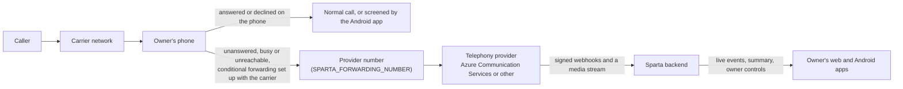

# Telephony

What each telephony path can and cannot do, how a call reaches Sparta, how to configure each provider, and what a human
must do before any real call is trusted. Nothing in this document describes a live call that was tested: **no live phone
call, Azure Communication Services resource, Event Grid subscription or Android device was available while Sparta was
built.** Behaviour that depends on them is marked **UNVERIFIED**.

Related: [ARCHITECTURE.md](ARCHITECTURE.md) (ports and call flow), [ANDROID_SETUP.md](ANDROID_SETUP.md),
[research/acs-android-verification.md](research/acs-android-verification.md) (documentation facts and their sources),
[SAFETY_MODEL.md](SAFETY_MODEL.md), [PRIVACY.md](PRIVACY.md), [DEPLOYMENT.md](DEPLOYMENT.md).

## 1. Three paths, three different capabilities

| Path | What it does | What it cannot do | Status |
| --- | --- | --- | --- |
| **Simulator** (`TELEPHONY_PROVIDER=simulator`, the default) | A complete, credential-free provider for development and demos: scripted, typed, browser-microphone and uploaded-audio calls through the real conversation engine, with live events, barge-in, silence timers and a labelled takeover simulation | Carry a real call or real audio. Every call is `simulated: true`, `two_way_audio: false`, `live_calls_supported: false` | Implemented and tested (`telephony/simulator.py`) |
| **Native Android call screening** (`CallScreeningService`) | On the phone, for each incoming call: allow, silence the ringer or reject, from local rules and synced block and trust lists; reports the decision to the backend as a `screening_only` call | Answer a call, speak to the caller, bridge a call, record, or hear any call audio. It receives call metadata only | Implemented in `apps/android`; **never run on a device or emulator** ([ANDROID_SETUP.md](ANDROID_SETUP.md) section 10) |
| **Programmable-number provider** (`TELEPHONY_PROVIDER=azure` or `other`) | Receives calls delivered to a provider-owned number, answers them, streams caller audio to Sparta, plays the assistant's speech, hangs up and can transfer to the owner | Intercept calls to the owner's own SIM by itself. The owner has to forward unknown or unanswered calls to the provider's number (section 3) | Azure adapter implemented against fakes of the SDK and the media socket; **UNVERIFIED live**. The `other` route is a plugin hook plus signed webhooks, tested only with a stand-in plugin |

The AI conversation exists only on the first and third paths. On a normal cellular call that reaches only the Android
phone, Sparta can screen (allow, silence, reject) but cannot talk to the caller. The apps and `CallDetail.capabilities`
say so for each call and never imply otherwise.

## 2. Native Android capabilities and limits

Facts from the verification notes ([research/acs-android-verification.md](research/acs-android-verification.md), sources
and date there) and from the app's own documentation ([ANDROID_SETUP.md](ANDROID_SETUP.md)):

* The app asks to become the call-screening app through `RoleManager.ROLE_CALL_SCREENING` (Android 10 or newer; it need
  not be the default dialer). Android then asks the service about each incoming call and expects an answer within about
  five seconds. The app uses a 1.5 second budget with a 2.5 second watchdog.
* A response can allow, silence (Android 10 or newer) or reject the call. The screening role gets no call audio and cannot
  inject audio; the privileged permissions for that are not available to ordinary apps.
* Call details expose the number, direction (Android 10 or newer) and the carrier's STIR/SHAKEN verification status
  (Android 11 or newer, carrier support needed). Restricted or unknown presentations are not available.
* Phone makers customise role handling, battery management and settings wording. Behaviour on Samsung, Xiaomi and
  other OEM builds is **UNVERIFIED**.
* The app reports each decision with an idempotent `POST /api/v1/screening/events`; the backend stores it as a call with
  provider `android_screening`, mode `screening_only`, no transcript, and capabilities with `two_way_audio: false`, no
  takeover and no end control. Each owner may record at most `SPARTA_DAILY_SCREENING_EVENT_CAP` new events per UTC day
  (default 2000), counted by when the server received each event (`provider_events.received_at`), not by the
  client-supplied `occurred_at`, so backdating an event does not get around the cap
  (`tests/api/test_api_hardening.py::test_backdating_screening_events_does_not_get_around_the_daily_cap`); further new
  events get 429 with a `Retry-After` header, while a retry of an event that was already
  recorded (same `client_event_id`) still succeeds (`tests/api/test_api_hardening.py`). The device sends a masked display
  and a keyed fingerprint of the number, never the number
  ([PRIVACY.md](PRIVACY.md), section 4).

## 3. The programmable-number path and call forwarding



* **Forwarding is a carrier feature, not something Sparta or Android can set up or read.** Conditional call forwarding is
  usually enabled with standard GSM codes (the Android app can pre-fill the dialer with `**61*<number>#` for no answer,
  `**67*` for busy and `**62*` for unreachable, and `##002#` cancels all forwarding; the owner presses call).
  Codes, supported conditions, charges and behaviour differ by carrier and by plan, and Android has no API that reports
  whether forwarding is active, so the app says it cannot tell. Behaviour for any specific carrier is **UNVERIFIED**.
* `SPARTA_FORWARDING_NUMBER` is the provider's inbound number. The backend only reports it (`/system/status` and
  `/screening/config`) so the apps can show it and offer the dialer shortcut; it does not configure anything.
* Calls from a real provider are created for **one owner**: `SPARTA_TELEPHONY_OWNER_USER_ID`, falling back to
  `SPARTA_DEV_USER_ID` (`CallService.incoming_call`). With OIDC sign-in the owner's user id is the token subject (or its
  hash, see `api/auth.py` `subject_to_user_id`), so set `SPARTA_TELEPHONY_OWNER_USER_ID` to exactly that id or the calls
  will belong to a different user from the one who signs in. There is no per-number routing between owners.
* A caller on the owner's blocked list is not answered and the call is ended in Sparta without a spoken refusal. With the
  Azure adapter the underlying call is left to ring out, because reject and redirect are not part of the telephony port
  (`telephony/azure_acs.py`, `handle_incoming`).
* The `trusted_contact_behavior = "allow_directly"` pass-through exists only for simulated calls. A real provider cannot
  hand a call back to the owner's phone through this port, so trusted callers are screened there as well.

## 4. Provider configuration

### 4.1 Simulator

Nothing to configure. `SPARTA_SIMULATOR_ENABLED=true` (the default) exposes `/api/v1/simulator/*`. The simulator's speech
recognition cannot transcribe audio (uploads need a `transcript_hint`, otherwise 422 `stt_unavailable`), its speech
synthesis is timing only, and its takeover is a labelled simulation.

### 4.2 Azure Communication Services (Call Automation)

Adapter: `services/api/src/sparta/telephony/azure_acs.py`; request verification: `telephony/webhooks.py`. **UNVERIFIED
against live Azure.** Install the optional SDK with the `azure` extra (`azure-communication-callautomation`); it is
imported on first use and a missing package is reported as "the azure-communication-callautomation package is not
installed".

Settings (environment variables; secrets belong in a secret store, never in the repository):

| Variable | Purpose |
| --- | --- |
| `TELEPHONY_PROVIDER=azure` (also read as `SPARTA_TELEPHONY_PROVIDER`) | Select the adapter |
| `SPARTA_ACS_CONNECTION_STRING` | ACS resource connection string (secret) |
| `SPARTA_ACS_CALLBACK_BASE_URL` | Public `https://` origin that ACS can reach; Sparta derives the callback URL `/api/v1/webhooks/acs/callbacks/{call_id}` and the media socket URL `wss://.../api/v1/media/acs/{call_id}` from it |
| `SPARTA_ACS_RESOURCE_ID` | Expected audience of Call Automation JWTs (a comma-separated list is accepted). The exact audience form is UNVERIFIED |
| `SPARTA_ENTRA_TENANT_ID`, `SPARTA_EVENT_GRID_AUDIENCE` | Tenant GUID and audience used to verify Event Grid secure-webhook tokens |
| `SPARTA_STT_PROVIDER=azure`, `SPARTA_TTS_PROVIDER=azure`, `SPARTA_AZURE_SPEECH_KEY`, `SPARTA_AZURE_SPEECH_REGION` | Speech recognition and synthesis. Startup refuses `TELEPHONY_PROVIDER=azure` with simulated STT. With simulated TTS the provider cannot speak (`play` is refused and `can_play_audio` is false) |
| `SPARTA_TELEPHONY_OWNER_USER_ID` | The owner who receives the calls (section 3) |
| `SPARTA_FORWARDING_NUMBER` | The provider number shown to the apps |
| Owner preference `takeover_number` (Assistant Studio) | E.164 number to transfer to on Take Over; without it the action is refused |

What the adapter does:

1. **Incoming call.** Event Grid posts a `Microsoft.Communication.IncomingCall` event (Event Grid schema only; create the
   subscription with `--event-delivery-schema eventgridschema`) to `POST /api/v1/webhooks/acs/events`. Every request,
   including the subscription validation handshake, is verified before its body is parsed: an Entra bearer token (RS256;
   the role `AzureEventGridSecureWebhookSubscriber`, issuer, audience and lifetime checked). Whether Event Grid really sends
   the token with the handshake is UNVERIFIED. Event ids are de-duplicated.
2. **Answer.** `handle_incoming` creates the Sparta call through the call service and answers it with bidirectional media
   streaming: PCM16 mono 16 kHz over a WebSocket, mixed channel, DTMF tones enabled.
3. **Caller audio.** `WS /api/v1/media/acs/{call_id}` must present a valid ACS JWT on the upgrade (otherwise it is refused
   before it is accepted). Audio frames go to `services/audio_pipeline.py` (voice-activity detection, one recognition
   request per utterance, ordered delivery). DTMF digits are received and ignored by design.
4. **Assistant speech.** Text from the templates is synthesised by the TTS provider and sent as paced 20 ms PCM frames,
   one line at a time. Barge-in cancels playback and sends `StopAudio`.
5. **Callbacks.** `POST /api/v1/webhooks/acs/callbacks/{call_id}` (ACS JWT; callback token lifetime at most about ten
   minutes) updates call state (`CallConnected`, `CallDisconnected`, `AnswerFailed`, `PlayFailed`,
   `MediaStreamingFailed`, `CallTransferAccepted`, `CallTransferFailed`), de-duplicated by event id.
6. **Take over.** `transfer_call_to_participant` to the owner's `takeover_number`. The adapter configures no ACS source
   caller id, and whether a PSTN transfer needs one is UNVERIFIED. The transfer is requested once and never retried.
7. **End.** `hang_up(is_for_everyone=True)`.

Constraints from the verification notes (read the note for sources and the date it was checked):

* ACS cannot acquire +91 (India) numbers directly, so an Indian owner needs another route to a provider number: a
  Teams-based route, an approved carrier route or another provider. Whether any of those works with this adapter is
  **UNVERIFIED**.
* ACS standalone telephony is documented as scheduled to retire on 2028-09-30, and customers without an ACS resource
  created before 2026-10-23 cannot acquire numbers for the retiring workloads.
* The media WebSocket key casing is documented inconsistently (the Python sample is PascalCase, the JavaScript serializer
  lower-case). The adapter defaults to PascalCase and supports both; the wire format must be confirmed in an integration
  test. Also unconfirmed: the form of the callback token audience, the `RS256` versus `RSA256` algorithm name (only
  `RS256` is accepted), whether live Event Grid deliveries carry the expected role claim, and chunked streaming of
  synthesised speech.
* Azure's speech-to-text adapter is utterance based: Azure produces no partial transcripts, so there are no live
  captions for a real call.

### 4.3 Another provider (`TELEPHONY_PROVIDER=other`)

For a provider that can speak WebSockets and webhooks, such as an Indian programmable-voice provider. Two parts:

1. **A plugin.** Set `SPARTA_TELEPHONY_PLUGIN='package.module:factory'`. The factory is called as
   `factory(settings, *, tts, clock, metrics)` and must return an object implementing `TelephonyProvider`
   (`telephony/base.py`: `answer`, `play`, `stop_playback`, `hangup`, `transfer`, `status`, `bind`, plus `name`, `kind`
   and honest `capabilities`). `tests/api/fake_other_provider.py` is a minimal example. Startup refuses
   `TELEPHONY_PROVIDER=other` without a plugin. No real provider has been integrated.
2. **Signed webhooks.** `POST /api/v1/webhooks/generic` (only when `TELEPHONY_PROVIDER=other` and `SPARTA_WEBHOOK_SECRET`
   is set; otherwise 404). Headers: `X-Sparta-Timestamp` (Unix seconds), `X-Sparta-Nonce` (8 to 128 characters: letters,
   digits and `_`, `-`, `:`, `=`, `+`, `/`; no dot; unique per request) and `X-Sparta-Signature`. The signature is the hex
   `HMAC-SHA256(secret, "{timestamp}.{nonce}." + raw_body)`; a leading `sha256=` is accepted. The timestamp must be
   within 300 seconds, a nonce can be used once, and the nonce is recorded only after the signature verified. The body is a
   JSON object with `event_id` (8 to 128 characters, unique per event) and `type` (`call.incoming`, `call.ended`,
   `playback.finished` or `caller.transcript`) plus the fields for that type (`provider_call_id`, `caller_number`,
   `called_number`, `display_name`, `call_id`, `playback_id`, `text`, `language`, `confidence`, `reason`). Unknown fields
   are rejected. Duplicate event ids return `{"status": "duplicate"}`.

   Signing example (verified against `verify_generic_hmac` on 2026-11-18):

   ```python
   import hashlib, hmac, time
   timestamp, nonce = str(int(time.time())), "n-1234567890"
   signature = hmac.new(secret.encode(), f"{timestamp}.{nonce}.".encode() + body, hashlib.sha256).hexdigest()
   ```

## 5. Limitations

* No live call has been placed through any provider; no audio has been heard by a person.
* One owner per deployment for provider calls (section 3).
* Azure speech recognition is per utterance; there is no streaming recognition and no live captions for real calls.
* The adapters were exercised only against fakes of the Azure SDK client and of the media WebSocket, and Azure Speech
  and Azure OpenAI only against mocked HTTP.
* Take over is a provider transfer to a phone number the owner sets; on the simulator it is labelled as a simulation. The
  Android app cannot bridge a call.
* Push notifications are not implemented, so an escalation raised while the apps are closed can reach the owner late
  ([ANDROID_SETUP.md](ANDROID_SETUP.md) section 7).
* Caller-ID spoofing is not addressed; caller names and organisations are claims.
* Call forwarding must be set up by the owner with the carrier; Sparta cannot check it.
* Recording is not implemented, so there is no recording consent flow. Legal questions (AI disclosure, interception,
  number acquisition, spam reporting, retention, cross-border transfer, India-specific obligations) need a review before
  real calls: [DEPLOYMENT.md](DEPLOYMENT.md), [PRIVACY.md](PRIVACY.md).

## 6. Live-test checklist

Everything below needs a human, a real number and a real device. Nothing here has been done. Record the date, commit and
result for each step.

**Before starting**

- [ ] Legal review of the topics listed in [PRIVACY.md](PRIVACY.md) section 13 is complete for the country where calls
  will be received.
- [ ] A way to get a provider number that can receive calls in the target country exists (for India, see the ACS
  constraints in section 4.2), and a second phone is available to place test calls.
- [ ] An Azure Speech resource in a region that supports `en-IN`, `hi-IN` and `kn-IN` text-to-speech and speech-to-text,
  and (optionally) an Azure OpenAI deployment.
- [ ] The backend is deployed behind HTTPS with production settings ([DEPLOYMENT.md](DEPLOYMENT.md)); `GET /readyz` is
  ready, which includes `checks.database` being `ok` (the migrations have been applied) and a reachable shared-state store.

**Provider wiring (Azure example)**

- [ ] Settings in section 4.2 are set; `GET /api/v1/system/status` reports `telephony.provider: "azure"` and
  `live_calls_supported: true`, and the Simulator Lab lists Azure as available.
- [ ] The Event Grid subscription (Event Grid schema, Entra-secured webhook) validates; `POST .../acs/events` accepts the
  handshake. Record whether the delivery token carries the expected role claim.
- [ ] A call from the second phone to the provider number creates a call in the apps within the ring window.
- [ ] The media socket connects; record the actual key casing of the frames ACS sends and expects.

**Conversation**

- [ ] The assistant's greeting is audible and says it is an AI assistant, in the configured language.
- [ ] Speech in English, Hindi and Kannada appears as a transcript with the right language; record the quality honestly,
  including code-switched speech.
- [ ] Reading an OTP request aloud makes the assistant refuse and end the call; a spoken "ignore your rules" ends it too.
- [ ] Speaking over the assistant stops it quickly; record the delay.
- [ ] Two silences end the call; the summary appears.
- [ ] A legitimate-sounding delivery call raises an escalation to the apps.

**Owner controls**

- [ ] Take Over with a `takeover_number` transfers the call to the owner's phone; record what ACS reports
  (`CallTransferAccepted` or `CallTransferFailed`) and whether PSTN transfer needs a source caller id.
- [ ] A blocked number is not answered; record what the caller hears.

**Forwarding and Android**

- [ ] On a real phone and carrier, set conditional forwarding to the provider number, call the phone, let it go
  unanswered, and confirm the call reaches Sparta. Record the carrier, the codes used and any charges.
- [ ] Cancel forwarding afterwards and confirm normal calls ring again.
- [ ] Install the Android app, grant the call-screening role and place calls: record what happens for allow, silence and
  reject, how OEM settings differ, and that the service answers within the platform deadline
  ([ANDROID_SETUP.md](ANDROID_SETUP.md) section 10 lists what was never exercised).

**Failure behaviour**

- [ ] With the speech key removed or the TTS region wrong, the call degrades with a visible `provider.error` and does not
  hang.
- [ ] A forged request to each webhook route is rejected (401) and a redelivered Event Grid event does not create a second
  call.

**Known untested at the time of writing:** ACS callback wire casing, chunked synthesised speech over the media socket, the
Event Grid role claim, PSTN transfer, Azure Speech and Azure OpenAI behaviour with real credentials, OIDC sign-in with a
real identity provider, Android screening on a device, and push notifications (not implemented).
