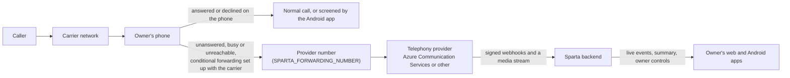

# Telephony

What each telephony path can and cannot do, how a call reaches Sparta, how to configure each provider, and what a human
must do before any real call is trusted. Nothing in this document describes a live call that was tested: **no live phone
call, Azure Communication Services resource, Twilio account, Event Grid subscription or Android device was available
while Sparta was built.** Behaviour that depends on them is marked **UNVERIFIED**. What *was* exercised is listed in
[PHASE2_CONTROLLED_RESULTS.md](PHASE2_CONTROLLED_RESULTS.md): whole calls through the Twilio adapter, a real media
WebSocket, the audio pipeline and the call service, with scripted recognition and synthesis. That is a controlled test,
not a call.

Phase 2 added a second programmable-number provider (Twilio, section 4.3) because ACS cannot supply a number to a new
customer and has none in India, and a preflight command: `python -m sparta doctor --provider azure|twilio --online`
reports what is configured, what answers and what can only be proven by a real call.

Phase 3 added a fourth path that needs **no provider account and no number**: **local SIP over Asterisk** (section 4.5), where a
SIP phone on the owner's own network calls an open-source PBX that streams real two-way audio to Sparta. It is *not* a
phone-network (PSTN) connection. A separate SIP client (baresip, in Docker) has called it for real; no physical phone has.
`python -m sparta doctor --provider asterisk` is its preflight.

Related: [ARCHITECTURE.md](ARCHITECTURE.md) (ports and call flow), [ANDROID_SETUP.md](ANDROID_SETUP.md),
[research/acs-android-verification.md](research/acs-android-verification.md) and
[research/phase2-provider-verification.md](research/phase2-provider-verification.md) (documentation facts and their
sources), [PHASE2_REAL_WORLD_PLAN.md](PHASE2_REAL_WORLD_PLAN.md), [SAFETY_MODEL.md](SAFETY_MODEL.md),
[PRIVACY.md](PRIVACY.md), [DEPLOYMENT.md](DEPLOYMENT.md).

## 1. Four paths, four different capabilities

| Path | What it does | What it cannot do | Status |
| --- | --- | --- | --- |
| **Simulator** (`TELEPHONY_PROVIDER=simulator`, the default) | A complete, credential-free provider for development and demos: scripted, typed, browser-microphone and uploaded-audio calls through the real conversation engine, with live events, barge-in, silence timers and a labelled takeover simulation | Carry a real call or real audio. Every call is `simulated: true`, `two_way_audio: false`, `live_calls_supported: false` | Implemented and tested (`telephony/simulator.py`) |
| **Native Android call screening** (`CallScreeningService`) | On the phone, for each incoming call: allow, silence the ringer or reject, from local rules and synced block and trust lists; reports the decision to the backend as a `screening_only` call | Answer a call, speak to the caller, bridge a call, record, or hear any call audio. It receives call metadata only | Implemented in `apps/android`; **never run on a device or emulator** ([ANDROID_SETUP.md](ANDROID_SETUP.md) section 10) |
| **Programmable-number provider** (`TELEPHONY_PROVIDER=azure`, `twilio` or `other`) | Receives calls delivered to a provider-owned number, answers them, streams caller audio to Sparta, plays the assistant's speech, hangs up and can transfer to the owner | Intercept calls to the owner's own SIM by itself. The owner has to forward unknown or unanswered calls to the provider's number (section 3) | Azure and Twilio adapters implemented against fakes of the SDK, the REST API and the media socket; **UNVERIFIED live**. The `other` route is a plugin hook plus signed webhooks, tested only with a stand-in plugin |
| **Local SIP over Asterisk** (`TELEPHONY_PROVIDER=asterisk`) | Takes the real audio of a **SIP call from a phone on the owner's own network** through a local Asterisk, speaks back, handles barge-in, refuses and hangs up, and can ring an owner SIP extension. Free: no provider account, no phone number | Receive a call from the phone network. An ordinary mobile or landline caller cannot reach it: that needs a paid carrier, a phone number and a SIP trunk, which are **not** delivered. It never dials out. | Verified in Docker with a headless SIP client and a machine voice (section 4.5); **never run with a physical phone** |

The AI conversation exists only on the third and fourth paths (and, simulated, on the first). On a normal cellular call that
reaches only the Android phone, Sparta can screen (allow, silence, reject) but cannot talk to the caller. The apps and
`CallDetail.capabilities` say so for each call and never imply otherwise: a local SIP call is labelled `Connection: Local SIP`
and `PSTN: Not configured`.

## 2. Native Android capabilities and limits

Facts from the verification notes ([research/acs-android-verification.md](research/acs-android-verification.md), sources
and date there) and from the app's own documentation ([ANDROID_SETUP.md](ANDROID_SETUP.md)):

* The app asks to become the call-screening app through `RoleManager.ROLE_CALL_SCREENING` (Android 10 or newer; it need
  not be the default dialer). Android then asks the service about each incoming call and expects an answer within about
  five seconds. The app uses a 1.5 second budget with a 2.5 second watchdog.
* A response can allow, silence (Android 10 or newer) or reject the call. The screening role gets no call audio and cannot
  inject audio; the privileged permissions for that are not available to ordinary apps.
* Call details expose the number, direction (Android 10 or newer) and the carrier's STIR/SHAKEN verification status
  (Android 11 or newer, carrier support needed). Restricted or unknown presentations are not available.
* Phone makers customise role handling, battery management and settings wording. Behaviour on Samsung, Xiaomi and
  other OEM builds is **UNVERIFIED**.
* The app reports each decision with an idempotent `POST /api/v1/screening/events`; the backend stores it as a call with
  provider `android_screening`, mode `screening_only`, no transcript, and capabilities with `two_way_audio: false`, no
  takeover and no end control. Each owner may record at most `SPARTA_DAILY_SCREENING_EVENT_CAP` new events per UTC day
  (default 2000), counted by when the server received each event (`provider_events.received_at`), not by the
  client-supplied `occurred_at`, so backdating an event does not get around the cap
  (`tests/api/test_api_hardening.py::test_backdating_screening_events_does_not_get_around_the_daily_cap`); further new
  events get 429 with a `Retry-After` header, while a retry of an event that was already
  recorded (same `client_event_id`) still succeeds (`tests/api/test_api_hardening.py`). The device sends a masked display
  and a keyed fingerprint of the number, never the number
  ([PRIVACY.md](PRIVACY.md), section 4).

## 3. The programmable-number path and call forwarding



* **Forwarding is a carrier feature, not something Sparta or Android can set up or read.** Conditional call forwarding is
  usually enabled with standard GSM codes (the Android app can pre-fill the dialer with `**61*<number>#` for no answer,
  `**67*` for busy and `**62*` for unreachable, and `##002#` cancels all forwarding; the owner presses call).
  Codes, supported conditions, charges and behaviour differ by carrier and by plan, and Android has no API that reports
  whether forwarding is active, so the app says it cannot tell. Behaviour for any specific carrier is **UNVERIFIED**.
* `SPARTA_FORWARDING_NUMBER` is the provider's inbound number. The backend only reports it (`/system/status` and
  `/screening/config`) so the apps can show it and offer the dialer shortcut; it does not configure anything.
* Calls from a real provider are created for **one owner**: `SPARTA_TELEPHONY_OWNER_USER_ID`, falling back to
  `SPARTA_DEV_USER_ID` (`CallService.incoming_call`). With OIDC sign-in the owner's user id is the token subject (or its
  hash, see `api/auth.py` `subject_to_user_id`), so set `SPARTA_TELEPHONY_OWNER_USER_ID` to exactly that id or the calls
  will belong to a different user from the one who signs in. There is no per-number routing between owners.
* A caller on the owner's blocked list is not answered and the call is ended in Sparta without a spoken refusal. With the
  Azure adapter the underlying call is left to ring out, because reject and redirect are not part of the telephony port
  (`telephony/azure_acs.py`, `handle_incoming`). With the Twilio adapter the voice webhook answers `<Reject>`, which Twilio
  does not bill (`telephony/twilio.py`); the same happens to a call over one of the caps (section 4.3).
* The `trusted_contact_behavior = "allow_directly"` pass-through exists only for simulated calls. A real provider cannot
  hand a call back to the owner's phone through this port, so trusted callers are screened there as well.

## 4. Provider configuration

### 4.1 Simulator

Nothing to configure. `SPARTA_SIMULATOR_ENABLED=true` (the default) exposes `/api/v1/simulator/*`. The simulator's speech
recognition cannot transcribe audio (uploads need a `transcript_hint`, otherwise 422 `stt_unavailable`), its speech
synthesis is timing only, and its takeover is a labelled simulation.

### 4.2 Azure Communication Services (Call Automation)

Adapter: `services/api/src/sparta/telephony/azure_acs.py`; request verification: `telephony/webhooks.py`. **UNVERIFIED
against live Azure.** Install the optional SDK with the `azure` extra (`azure-communication-callautomation`); it is
imported on first use and a missing package is reported as "the azure-communication-callautomation package is not
installed".

Settings (environment variables; secrets belong in a secret store, never in the repository):

| Variable | Purpose |
| --- | --- |
| `TELEPHONY_PROVIDER=azure` (also read as `SPARTA_TELEPHONY_PROVIDER`) | Select the adapter |
| `SPARTA_ACS_CONNECTION_STRING` | ACS resource connection string (secret) |
| `SPARTA_ACS_CALLBACK_BASE_URL` | Public `https://` origin that ACS can reach; Sparta derives the callback URL `/api/v1/webhooks/acs/callbacks/{call_id}` and the media socket URL `wss://.../api/v1/media/acs/{call_id}` from it |
| `SPARTA_ACS_RESOURCE_ID` | Expected audience of Call Automation JWTs (a comma-separated list is accepted). The exact audience form is UNVERIFIED |
| `SPARTA_ENTRA_TENANT_ID`, `SPARTA_EVENT_GRID_AUDIENCE` | Tenant GUID and audience used to verify Event Grid secure-webhook tokens |
| `SPARTA_STT_PROVIDER=azure`, `SPARTA_TTS_PROVIDER=azure`, `SPARTA_AZURE_SPEECH_KEY`, `SPARTA_AZURE_SPEECH_REGION` | Speech recognition and synthesis. Startup refuses `TELEPHONY_PROVIDER=azure` with simulated STT. With simulated TTS the provider cannot speak (`play` is refused and `can_play_audio` is false) |
| `SPARTA_TELEPHONY_OWNER_USER_ID` | The owner who receives the calls (section 3) |
| `SPARTA_FORWARDING_NUMBER` | The provider number shown to the apps |
| Owner preference `takeover_number` (Assistant Studio) | Number, with its country code, to transfer to on Take Over (spaces and dashes are fine; a number without a country code is not used); without a usable one the apps show Take Over as unavailable and the action is refused |

What the adapter does:

1. **Incoming call.** Event Grid posts a `Microsoft.Communication.IncomingCall` event (Event Grid schema only; create the
   subscription with `--event-delivery-schema eventgridschema`) to `POST /api/v1/webhooks/acs/events`. Every request,
   including the subscription validation handshake, is verified before its body is parsed: an Entra bearer token (RS256;
   the role `AzureEventGridSecureWebhookSubscriber`, issuer, audience and lifetime checked). Whether Event Grid really sends
   the token with the handshake is UNVERIFIED. Event ids are de-duplicated.
2. **Answer.** `handle_incoming` creates the Sparta call through the call service and answers it with bidirectional media
   streaming: PCM16 mono 16 kHz over a WebSocket, mixed channel, DTMF tones enabled.
3. **Caller audio.** `WS /api/v1/media/acs/{call_id}` must present a valid ACS JWT on the upgrade (otherwise it is refused
   before it is accepted). Audio frames go to `services/audio_pipeline.py` (voice-activity detection, one recognition
   request per utterance, ordered delivery). DTMF digits are received and ignored by design.
4. **Assistant speech.** Text from the templates is synthesised by the TTS provider and sent as paced 20 ms PCM frames,
   one line at a time. Barge-in cancels playback and sends `StopAudio`.
5. **Callbacks.** `POST /api/v1/webhooks/acs/callbacks/{call_id}` (ACS JWT; callback token lifetime at most about ten
   minutes) updates call state (`CallConnected`, `CallDisconnected`, `AnswerFailed`, `PlayFailed`,
   `MediaStreamingFailed`, `CallTransferAccepted`, `CallTransferFailed`), de-duplicated by event id.
6. **Take over.** `transfer_call_to_participant` to the owner's `takeover_number`. The adapter configures no ACS source
   caller id, and whether a PSTN transfer needs one is UNVERIFIED. The transfer is requested once and never retried.
7. **End.** `hang_up(is_for_everyone=True)`.

Constraints from the verification notes (read the note for sources and the date it was checked):

* ACS cannot acquire +91 (India) numbers directly, so an Indian owner needs another route to a provider number: a
  Teams-based route, an approved carrier route or another provider. Whether any of those works with this adapter is
  **UNVERIFIED**.
* ACS standalone telephony is documented as scheduled to retire on 2028-09-30, and customers without an ACS resource
  created before 2026-10-23 cannot acquire numbers for the retiring workloads.
* The media WebSocket key casing is documented inconsistently (the Python sample is PascalCase, the JavaScript serializer
  lower-case). The adapter defaults to PascalCase and supports both; the wire format must be confirmed in an integration
  test. Also unconfirmed: the form of the callback token audience, the `RS256` versus `RSA256` algorithm name (only
  `RS256` is accepted), whether live Event Grid deliveries carry the expected role claim, and chunked streaming of
  synthesised speech.
* Azure's speech-to-text adapter has two modes. With the Speech SDK installed (`azure` extra, `SPARTA_AZURE_SPEECH_STREAMING=auto`)
  each utterance is recognised on a streaming connection and produces partial transcripts (live captions) and a final
  with its confidence; without it the REST adapter transcribes each utterance after it ends and produces no partials.
  Neither mode has recognised a real caller's audio yet (**UNVERIFIED**, see [MULTILINGUAL_SPEECH.md](MULTILINGUAL_SPEECH.md)).
* Event Grid deliveries can additionally be pinned to the calling application: set `SPARTA_EVENT_GRID_ALLOWED_APP_IDS` to
  the application id of the `Microsoft.EventGrid` service principal in your tenant (the `appid`/`azp` claim must match).
  The `AzureEventGridSecureWebhookSubscriber` role is also granted to the subscription-writer app, so the role alone does
  not show that Event Grid is the caller. `sparta doctor` warns while it is unset, and with `SPARTA_ENV=production` the
  server refuses to start with `TELEPHONY_PROVIDER=azure` until it is set.
* The ACS resource id is documented by Microsoft's own sample as the *immutable resource id* (a GUID, not the ARM path)
  and used as the audience of callback and media tokens. A live token has not been inspected: **UNVERIFIED**.

### 4.3 Twilio Media Streams (`TELEPHONY_PROVIDER=twilio`)

Added in Phase 2 because ACS cannot give a new customer a number and has no +91 numbers
([PHASE2_REAL_WORLD_PLAN.md](PHASE2_REAL_WORLD_PLAN.md)). Adapter: `services/api/src/sparta/telephony/twilio.py` (and
`g711.py` for mu-law); routes in `api/routers/webhooks.py`. It is reported as provider kind `other`, so the API contract,
the web app and the Android app are unchanged. **Exercised only against fakes (a fake Twilio REST client and a scripted
WebSocket client over the real app); no Twilio account, number or call was involved: UNVERIFIED live.**

Settings:

| Variable | Purpose |
| --- | --- |
| `SPARTA_TELEPHONY_PROVIDER=twilio` | Select the adapter |
| `SPARTA_TWILIO_ACCOUNT_SID` | Account SID (`AC` + 32 hex digits); the account, not an API key |
| `SPARTA_TWILIO_AUTH_TOKEN` | Auth token (secret). It signs every webhook Twilio sends, authenticates the REST API and keys the per-call stream tokens, so Sparta needs nothing else from Twilio |
| `SPARTA_TWILIO_CALLBACK_BASE_URL` | Public `https://` origin Twilio calls and streams audio to. Signatures are checked against this configured origin, never against the `Host` header |
| `SPARTA_TWILIO_CALLER_ID` | Optional. E.164 number shown on a takeover call; default is the Twilio number that was dialled |
| `SPARTA_TWILIO_VERIFY_MEDIA_SIGNATURE` | Default `true`. Whether the media WebSocket upgrade must carry `X-Twilio-Signature`. The per-call token in the `start` message authenticates the socket either way. A debugging switch: the server refuses to start with `false` when `SPARTA_ENV=production` (reproduce a mismatch on a development tunnel) |
| `SPARTA_STT_PROVIDER=azure`, `SPARTA_TTS_PROVIDER=azure`, `SPARTA_AZURE_SPEECH_KEY`, `SPARTA_AZURE_SPEECH_REGION` | Required in production: a silent or deaf assistant would never make the AI disclosure |
| `SPARTA_TELEPHONY_OWNER_USER_ID`, `SPARTA_FORWARDING_NUMBER` | As in section 3 (`SPARTA_FORWARDING_NUMBER` is the Twilio number callers dial; the doctor checks it on the account) |
| Owner preference `takeover_number` | Destination of Take Over, with its country code (`+91 98123 45670`: spaces and dashes are fine; a number without a country code is refused, never completed with a guess). **Without a usable one the apps show Take Over as unavailable and the tap is refused** |

What the adapter does:

1. **Voice webhook.** `POST /api/v1/webhooks/twilio/voice` (form body, `X-Twilio-Signature` verified before anything is
   acted on). The call is created once per `CallSid` (Twilio retries are answered with the same TwiML). A blocked caller, or a
   call over a limit (active calls, daily calls, daily minutes, calls per number), gets `<Reject>`, which Twilio does not
   bill. Otherwise the answer is `<Connect><Stream url="wss://<base>/api/v1/media/twilio/{call_id}">` with the per-call
   token as a `<Parameter>` (a Stream URL cannot carry a query string).
2. **Media socket.** `WS /api/v1/media/twilio/{call_id}`: the upgrade must carry a valid signature (checked against both
   the `wss://` and `https://` forms of the URL, with and without the default port, because which form Twilio signs is
   **UNVERIFIED**), and the `start` message must name this call's `CallSid`, carry its token and announce
   `audio/x-mulaw`, 8000 Hz, one channel. Frames before an authenticated `start` are dropped and counted; 500 malformed
   frames close the socket. A stranger's socket can never end anyone's call, and a socket becomes the live stream only
   once its `start` message has proven the token, so it cannot displace the live one either; a socket that sends no valid
   `start` within 10 s is closed.
3. **Caller audio.** mu-law 8 kHz, converted to PCM16 and handed to `services/audio_pipeline.py` (voice-activity detection,
   one streaming recognition per utterance). DTMF digits are received and ignored.
4. **Assistant speech.** The TTS provider synthesises mu-law 8 kHz, sent as 80 ms `media` messages, followed by a `mark`
   named after the playback. The `mark` echo means the caller heard it; if the echo never comes the call carries on after
   the estimated duration plus five seconds.
5. **Barge-in.** `clear` empties what Twilio has buffered; the late `mark` echoes of the cleared audio are ignored.
6. **Take over.** The call is redirected with inline TwiML `<Dial callerId=...><Number>owner</Number></Dial>`
   (`<Hangup/>` if the owner does not answer). The redirect waits (at most 8 s) until the announcement of the transfer has
   been heard, and Sparta never hangs up a call it has handed over. The transfer is requested once and never retried. That
   the owner's phone rings and bridges is **UNVERIFIED**, and Sparta does not learn whether the owner answered.
7. **End.** `Status=completed` on the Call resource (a `400` or `404` means the call was already over). The optional
   `POST /api/v1/webhooks/twilio/status` callback ends the call here if the stream did not.

Constraints (sources: [research/phase2-provider-verification.md](research/phase2-provider-verification.md)):

* **A Twilio trial account cannot be used.** Twilio removes `<Stream>` and `<Dial><Number>` from the TwiML of trial
  accounts, which would leave Sparta unable to hear the caller or hand the call over. Upgrade the account first;
  `sparta doctor --provider twilio --online` reports a trial account as BLOCKED.
* **Number availability is not solved.** A US number is the simplest first test. For India, Twilio lists `+91800` toll-free
  numbers with a regulatory bundle and an address outside India; eligibility and inventory for a given applicant are
  **UNVERIFIED**, and Sparta never buys or ports a number.
* The same public URL must serve the voice webhook, the media WebSocket and (optionally) the status callback. With a dev
  tunnel, set `SPARTA_PROVIDER_ONLY_HOSTS` to the tunnel's host name and `SPARTA_TRUSTED_HOSTS` to that host name plus
  `localhost` (the server refuses to start with a wildcard) so that only the provider routes are reachable through
  it ([DEPLOYMENT.md](DEPLOYMENT.md)).
* Twilio's own charges (number, per-minute, Stream) are Twilio's: Sparta's `SPARTA_ESTIMATED_*` settings only let the
  doctor print a worst-case figure from prices you enter.

### 4.4 Another provider (`TELEPHONY_PROVIDER=other`)

For a provider that can speak WebSockets and webhooks, such as an Indian programmable-voice provider. Two parts:

1. **A plugin.** Set `SPARTA_TELEPHONY_PLUGIN='package.module:factory'`. The factory is called as
   `factory(settings, *, tts, clock, metrics)` and must return an object implementing `TelephonyProvider`
   (`telephony/base.py`: `answer`, `play`, `stop_playback`, `hangup`, `transfer`, `status`, `bind`, plus `name`, `kind`
   and honest `capabilities`). `tests/api/fake_other_provider.py` is a minimal example. Startup refuses
   `TELEPHONY_PROVIDER=other` without a plugin. No real provider has been integrated.
2. **Signed webhooks.** `POST /api/v1/webhooks/generic` (only when `TELEPHONY_PROVIDER=other` and `SPARTA_WEBHOOK_SECRET`
   is set; otherwise 404). Headers: `X-Sparta-Timestamp` (Unix seconds), `X-Sparta-Nonce` (8 to 128 characters: letters,
   digits and `_`, `-`, `:`, `=`, `+`, `/`; no dot; unique per request) and `X-Sparta-Signature`. The signature is the hex
   `HMAC-SHA256(secret, "{timestamp}.{nonce}." + raw_body)`; a leading `sha256=` is accepted. The timestamp must be
   within 300 seconds, a nonce can be used once, and the nonce is recorded only after the signature verified. The body is a
   JSON object with `event_id` (8 to 128 characters, unique per event) and `type` (`call.incoming`, `call.ended`,
   `playback.finished` or `caller.transcript`) plus the fields for that type (`provider_call_id`, `caller_number`,
   `called_number`, `display_name`, `call_id`, `playback_id`, `text`, `language`, `confidence`, `reason`). Unknown fields
   are rejected. Duplicate event ids return `{"status": "duplicate"}`.

   Signing example (verified against `verify_generic_hmac` on 2026-11-18):

   ```python
   import hashlib, hmac, time
   timestamp, nonce = str(int(time.time())), "n-1234567890"
   signature = hmac.new(secret.encode(), f"{timestamp}.{nonce}.".encode() + body, hashlib.sha256).hexdigest()
   ```

### 4.5 Local SIP over Asterisk (`TELEPHONY_PROVIDER=asterisk`)

A free path for a **SIP phone on the owner's own network**: no provider account, no phone number. A separate, locked-down Asterisk 22
LTS container (`infrastructure/asterisk/`) registers the phones, routes extension **6000** to Sparta and nothing else, and streams
the call's audio to Sparta over **AudioSocket** (8 kHz PCM16, 20 ms frames over TCP). Why AudioSocket and not ARI or
`chan_websocket` is in [DECISIONS/ADR-ASTERISK-MEDIA-BRIDGE.md](DECISIONS/ADR-ASTERISK-MEDIA-BRIDGE.md). The code is
`telephony/asterisk/` (`protocol.py` the wire format, `session.py` one connection, `pacer.py` 20 ms pacing, `server.py` the
listener and the peer allow-list, `provider.py` the `TelephonyProvider`) plus three callback routes in `api/routers/webhooks.py`.

**One call:**

1. A SIP phone registers as **6001** (digest authentication, a random 32-character password) and dials **6000**.
2. The dialplan applies its own limits (`GROUP()` calls at once, `TIMEOUT(absolute)` seconds), then POSTs
   `/api/v1/webhooks/asterisk/incoming` (HTTP Basic with a shared secret, checked in constant time, from Asterisk's address only).
   Sparta answers `ACCEPT <single-use media id>` or `REJECT <reason>`.
3. Asterisk answers the call and opens `AudioSocket(<media id>, api:8090)`. Sparta's listener (compose network only, never
   published) accepts only Asterisk, requires the id as the first message within 3 s, accepts it once and refuses a second stream.
4. Caller audio goes through the same pipeline as every provider (voice-activity detection, recognition, the deterministic engine);
   the reply is synthesised to 8 kHz PCM and sent as paced 20 ms frames, about 40 ms ahead of real time. A caller who talks over it
   cancels the playback task, so at most that lead (plus the phone's jitter buffer) is still on its way.
5. **Take over** closes the socket gracefully, the dialplan asks `/next`, and only if Sparta says `DIAL 6002` (once) does
   it run `Dial(PJSIP/6002,30,r)`: a **SIP extension**, never a phone number. If 6002 does not answer the call ends.
6. When the call is over, the dialplan POSTs `/ended` (idempotent).

**What the API and the apps report:** `provider: asterisk`, `connection: local_sip`, `pstn: not_configured`,
`takeover_via: sip_extension`, and `two_way_audio` true only while the media connection is up. A SIP caller has no phone number, so
the call is labelled `SIP 6001` (or `Local SIP caller`), no per-number throttle applies, and the daily caps and the line limit still
do. DTMF is received and ignored.

**Settings** (the full list with comments is in `.env.example`): `SPARTA_TELEPHONY_PROVIDER=asterisk`,
`SPARTA_ASTERISK_WEBHOOK_SECRET` (at least 24 characters), `SPARTA_ASTERISK_MEDIA_BIND`/`_PORT`/`_PEERS` (who may open the media
connection: an address, a range no wider than a /8, or a host name), `SPARTA_ASTERISK_EXTENSION` and
`SPARTA_ASTERISK_OWNER_EXTENSION`, and the speech providers (`local` for free local speech). `python scripts/sip_local.py init` writes
a working set; `python -m sparta doctor --provider asterisk --env-file ../../.env [--online]` (from `services/api`) checks it,
including the shipped Asterisk files.

**Verified, in Docker, with a headless baresip client and a machine voice** (`python scripts/sip_e2e.py`, 28 scenarios; and
`--speech local`, 8 scenarios with real Whisper and Piper): registration with the right password and refusal of a wrong one or an
unknown user; a call that is answered with the AI disclosure; an OTP request refused by voice with the call ended and a summary; a
caller who talks over the greeting stopping it; a legitimate caller; noise and silence; Asterisk's own call limit; six numbers that
cannot be dialled; an unauthenticated INVITE and OPTIONS answered with nothing but a challenge; a host that is not Asterisk unable
to open the media socket; the module and configuration lock-down; and no secret in the container output. The latencies, labelled by
how they were measured, are in [PHASE3_ASTERISK_PLAN.md](PHASE3_ASTERISK_PLAN.md).

**UNVERIFIED:** a physical phone and a real SIP app (Linphone), a human voice, an Indian accent, a noisy line, Wi-Fi and firewall
behaviour on a real network, take-over to a second real phone, and anything over the phone network. The checklist for the phone is
[ANDROID_SIP_TESTING.md](ANDROID_SIP_TESTING.md).

**Not delivered, on purpose:** PSTN. Reaching ordinary phone numbers needs a paid carrier, a phone number (DID) and a SIP trunk,
plus a legal review ([PRIVACY.md](PRIVACY.md) section 13). The configuration has no trunk and no outbound route, and the dialplan
cannot dial out. SIP and RTP are not encrypted; the container does not limit failed logins
([SECURITY_REVIEW_PHASE3.md](SECURITY_REVIEW_PHASE3.md)).

## 5. Limitations

* No call over the **phone network** has been placed through any provider. A local SIP call has been made (to Asterisk, from a
  headless SIP client in Docker, with a machine voice); no audio has been heard by a person.
* One owner per deployment for provider calls (section 3).
* Azure speech recognition streams through the Speech SDK when it is installed (partials and a final per utterance, one
  connection per utterance); without the SDK it is per utterance over REST with no partials. Neither has recognised a real
  caller yet.
* The adapters were exercised only against fakes of the Azure SDK client, the Twilio REST API and the media WebSocket, and
  Azure Speech and Azure OpenAI only against mocked HTTP and a scripted SDK.
* A takeover is requested, not confirmed: Sparta does not learn whether the owner's phone rang or answered, and if the
  transfer is refused the call stays in the take-over state until the owner ends it or a limit ends it.
* Take over is a provider transfer to a phone number the owner sets; on the simulator it is labelled as a simulation. The
  Android app cannot bridge a call.
* Push notifications are not implemented, so an escalation raised while the apps are closed can reach the owner late
  ([ANDROID_SETUP.md](ANDROID_SETUP.md) section 7).
* Caller-ID spoofing is not addressed; caller names and organisations are claims.
* Call forwarding must be set up by the owner with the carrier; Sparta cannot check it.
* Recording is not implemented, so there is no recording consent flow. Legal questions (AI disclosure, interception,
  number acquisition, spam reporting, retention, cross-border transfer, India-specific obligations) need a review before
  real calls: [DEPLOYMENT.md](DEPLOYMENT.md), [PRIVACY.md](PRIVACY.md).

## 6. Live-test checklist

Everything below needs a human, a real number and a real device. Nothing here has been done. Record the date, commit and
result for each step.

**Before starting**

- [ ] Legal review of the topics listed in [PRIVACY.md](PRIVACY.md) section 13 is complete for the country where calls
  will be received.
- [ ] A way to get a provider number that can receive calls in the target country exists (for India, see the ACS
  constraints in section 4.2), and a second phone is available to place test calls.
- [ ] An Azure Speech resource in a region that supports `en-IN`, `hi-IN` and `kn-IN` text-to-speech and speech-to-text,
  and (optionally) an Azure OpenAI deployment.
- [ ] The backend is deployed behind HTTPS with production settings ([DEPLOYMENT.md](DEPLOYMENT.md)); `GET /readyz` is
  ready, which includes `checks.database` being `ok` (the migrations have been applied) and a reachable shared-state store.

**Provider wiring (Azure example)**

- [ ] Run `python -m sparta doctor --provider azure --online` against the deployed API: nothing may be BLOCKED, and
  every UNVERIFIED line it prints is one of the steps below.
- [ ] Settings in section 4.2 are set; `GET /api/v1/system/status` reports `telephony.provider: "azure"` and
  `live_calls_supported: true`, and the Simulator Lab lists Azure as available.
- [ ] The Event Grid subscription (Event Grid schema, Entra-secured webhook) validates; `POST .../acs/events` accepts the
  handshake. Record whether the delivery token carries the expected role claim and which `appid`/`azp` it carries
  (set `SPARTA_EVENT_GRID_ALLOWED_APP_IDS` to it).
- [ ] A call from the second phone to the provider number creates a call in the apps within the ring window.
- [ ] The media socket connects; record the actual key casing of the frames ACS sends and expects, and the audience of the
  callback token (the resource's immutable id, or something else).

**Provider wiring (Twilio)**

- [ ] The Twilio account is upgraded (not a trial), the number is on it and `SPARTA_FORWARDING_NUMBER` is that number.
- [ ] Run `python -m sparta doctor --provider twilio --online` against the deployed API. It checks the account type,
  that the number's voice webhook is `https://<host>/api/v1/webhooks/twilio/voice` over HTTP POST (and not a TwiML
  application), that an unsigned request is refused and that a WebSocket upgrade without a signature is refused.
- [ ] A call from the second phone creates a call in the apps; the greeting is audible. If the caller hears Twilio's own
  error message instead, read the Twilio debugger first (a signature mismatch is logged here as `webhook rejected`).
- [ ] Record whether the media socket upgrade is accepted with the signature check on (`SPARTA_TWILIO_VERIFY_MEDIA_SIGNATURE`),
  and which URL form (`wss` or `https`) the signature covered.

**Conversation**

- [ ] The assistant's greeting is audible and says it is an AI assistant, in the configured language.
- [ ] Speech in English, Hindi and Kannada appears as a transcript with the right language; record the quality honestly,
  including code-switched speech.
- [ ] Reading an OTP request aloud makes the assistant refuse and end the call; a spoken "ignore your rules" ends it too.
- [ ] Speaking over the assistant stops it quickly; record the delay (the call's diagnostic report has the
  `interruption` figure; [PHASE2_CONTROLLED_RESULTS.md](PHASE2_CONTROLLED_RESULTS.md) lists what is measured and what is not).
- [ ] Two silences end the call; the summary appears.
- [ ] A legitimate-sounding delivery call raises an escalation to the apps.

**Owner controls**

- [ ] The apps show Take Over as unavailable until a `takeover_number` is set, and as available afterwards.
- [ ] Take Over with a `takeover_number` transfers the call to the owner's phone; record what the provider reports
  (ACS: `CallTransferAccepted` or `CallTransferFailed` and whether PSTN transfer needs a source caller id; Twilio: whether
  the owner's phone rings, what the caller hears while it does, and what happens if the owner does not answer).
- [ ] A blocked number is not answered; record what the caller hears (Twilio: a rejected call).

**Forwarding and Android**

- [ ] On a real phone and carrier, set conditional forwarding to the provider number, call the phone, let it go
  unanswered, and confirm the call reaches Sparta. Record the carrier, the codes used and any charges.
- [ ] Cancel forwarding afterwards and confirm normal calls ring again.
- [ ] Install the Android app, grant the call-screening role and place calls: record what happens for allow, silence and
  reject, how OEM settings differ, and that the service answers within the platform deadline
  ([ANDROID_SETUP.md](ANDROID_SETUP.md) section 10 lists what was never exercised).

**Failure behaviour**

- [ ] With the speech key removed or the TTS region wrong, the call degrades with a visible `provider.error` and, after
  `SPARTA_PROVIDER_FAILURE_LIMIT` (default 2) failures in a row, ends with a summary that says Sparta could not screen it;
  it does not hang.
- [ ] A forged request to each webhook route is rejected (401) and a redelivered provider event does not create a second
  call.
- [ ] A caller who rings more than `SPARTA_PER_NUMBER_DAILY_CALL_CAP` times, and an owner whose calls pass
  `SPARTA_DAILY_CALL_MINUTES_CAP`, are rejected without being answered.

**Known untested at the time of writing:** ACS and Twilio callback and media wire formats, the signature URL form Twilio
signs for the media socket, chunked synthesised speech over the media socket, the Event Grid role and `azp` claims, PSTN
transfer, Azure Speech (streaming recognition, language identification on telephone audio, Hinglish and Kanglish) and
Azure OpenAI behaviour with real credentials, OIDC sign-in with a real identity provider, Android screening on a device,
and push notifications (not implemented).
